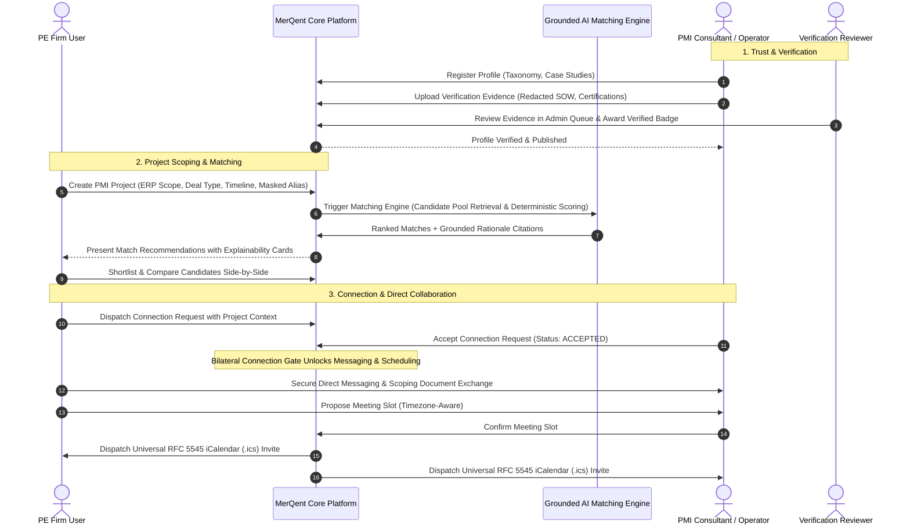

# MerQent

> **Specialized PMI Expertise. Intelligent Matching. Trusted Connections.**

[](<>)
[](<>)
[](<>)
[](<>)

---

## 1. Overview & Problem Statement

**MerQent** is an enterprise B2B professional marketplace engineered specifically to connect **Private Equity (PE) firms and portfolio operations teams** with **vetted Post-Merger Integration (PMI) consultants and seasoned operators**.

Finding the right operator for a high-stakes integration engagement is notoriously challenging. A private equity sponsor frequently requires a professional with a hyper-specific combination of operational experience:

- Manufacturing industry domain knowledge
- SAP S/4HANA & ECC 6.0 financial ledger integration experience
- Corporate carve-out execution under tight Transition Services Agreements (TSAs)
- Chart-of-accounts (COA) harmonization across multiple legal entities
- Multi-jurisdiction organizational change management and synergy realization

Generic freelance marketplaces treat professional services as broad, undifferentiated categories ("finance", "strategy", "software development"). They lack the structural comprehension required for M&A integration work.

**MerQent bridges this gap through:**

1. **Governed PMI-Specific Taxonomies** (ERPs, Deal Archetypes, Integration Disciplines, Industries)
2. **Multi-Tier Verified Expertise** (Identity, Credentials, Redacted Work History, Peer References)
3. **Structured Project Scoping & Confidential Deal Masking**
4. **Hybrid Faceted & Dense Vector Discovery**
5. **Multi-Signal Deterministic AI Matching Engine**
6. **Explainable AI Recommendations with Grounded Evidence Linkage**
7. **Project-Specific Shortlisting & Side-by-Side Candidate Comparison**
8. **Connection-Gated Handshakes & Relationship States**
9. **Confidential In-Platform Messaging with Secure Document Attachments**
10. **Timezone-Aware Meeting Scheduling with RFC 5545 iCalendar (`.ics`) Integration**

---

## 2. Project Status & Roadmap

| Attribute         | Canonical Value                                                   |
| ----------------- | ----------------------------------------------------------------- |
| **Current Stage** | **Phase 2 — Production Foundation**                               |
| **Active Task**   | **Task 2.1 — Repository & Workspace Initialization (COMPLETE)**   |
| **Previous Gate** | **Phase 1.26 Final Architecture Audit (PASSED)**                  |
| **Next Task**     | **Task 2.2 — Development Environment & Configuration Foundation** |


### Feature Implementation Status Matrix

| Capability / Layer                 | Status              | Description                                                                       |
| ---------------------------------- | ------------------- | --------------------------------------------------------------------------------- |
| **Monorepo Architecture**          | **Implemented**     | pnpm workspace + Turborepo orchestration across 2 apps and 4 packages             |
| **TypeScript Foundation**          | **Implemented**     | Strict TypeScript baseline (`tsconfig.base.json`, project references)             |
| **Code Quality Tools**             | **Implemented**     | ESLint (`next/core-web-vitals` + `@typescript-eslint`), Prettier, EditorConfig    |
| **Web Shell (`apps/web`)**         | **Implemented**     | Next.js 14 App Router application shell, Tailwind CSS, Radix UI baseline          |
| **API Shell (`apps/api`)**         | **Implemented**     | NestJS 10 modular monolith shell, Swagger OpenAPI setup, AppModule smoke test     |
| **Shared Packages**                | **Implemented**     | `@merqent/shared-types`, `@merqent/validation`, `@merqent/config`, `@merqent/ui`  |
| **Prisma Schema & Seed**           | **Implemented**     | 28 entities, pgvector integration, initial migration, seed script                 |
| **Domain Logic & Business Rules**  | _Architecture-Only_ | Ratified in Phase 1 specifications; implementation scheduled for subsequent tasks |
| **AI Matching Engine**             | _Architecture-Only_ | Mathematical scoring and grounding ratified in Phase 1 (ADR-006)                  |
| **Authentication & Authorization** | _Planned_           | Dual-token JWT + Argon2id planned for Phase 2 configuration & auth tasks          |
| **Marketplace Business Features**  | _Planned_           | Profiles, projects, messaging, scheduling, shortlisting planned for Phase 3       |

---

## 3. Final Production Technology Stack

Following a rigorous, evidence-based evaluation against eleven enterprise criteria, the production stack is formally ratified across 13 Architecture Decision Records:

| Layer                  | Selected Production Technology                                                   | Architectural Justification                                                                                                                                          | Reference ADR                                                                                                            |
| ---------------------- | -------------------------------------------------------------------------------- | -------------------------------------------------------------------------------------------------------------------------------------------------------------------- | ------------------------------------------------------------------------------------------------------------------------ |
| **Web Frontend**       | **Next.js 14+ (App Router)** / React 18+ / TypeScript / Tailwind CSS / Radix UI  | Hybrid React Server Components (RSC) for fast SEO-rendered public previews; interactive client components for chat/scheduling; shared TypeScript types with backend. | [ADR-001](file:///c:/Users/Vishal%20S%20Naik/MyProjects/MerQent/docs/decisions/ADR-001-frontend.md)                      |
| **Backend API**        | **Node.js 20 LTS / NestJS 10+** (Strict TypeScript)                              | Enterprise Modular Monolith with Inversion of Control (IoC), Dependency Injection, clean domain boundaries, and automated OpenAPI 3.0 generation.                    | [ADR-002](file:///c:/Users/Vishal%20S%20Naik/MyProjects/MerQent/docs/decisions/ADR-002-backend.md)                       |
| **Primary Database**   | **PostgreSQL 16+** with `pgvector` & `pg_trgm`                                   | Strict ACID transactional consistency; unified relational, JSONB document, and 1536d vector embedding storage in a single engine with zero ETL lag.                  | [ADR-003](file:///c:/Users/Vishal%20S%20Naik/MyProjects/MerQent/docs/decisions/ADR-003-database.md)                      |
| **ORM / Migrations**   | **Prisma ORM 5+**                                                                | Declarative schema as single source of truth; type-safe client generation; automated migration and seed engine.                                                      | [ADR-004](file:///c:/Users/Vishal%20S%20Naik/MyProjects/MerQent/docs/decisions/ADR-004-orm.md)                           |
| **Authentication**     | **Dual-Token JWT** (15m Access Token) + DB/Redis Stateful Refresh Token Rotation | XSS-immune browser cookies; native mobile Bearer header compatibility; immediate server-side session revocation.                                                     | [ADR-005](file:///c:/Users/Vishal%20S%20Naik/MyProjects/MerQent/docs/decisions/ADR-005-authentication.md)                |
| **AI Matching Engine** | **Hybrid Grounded AI Matching Engine** via Abstracted `IAiProvider`              | Two-stage grounded pipeline: relational filtering + `pgvector` semantic retrieval + deterministic multi-factor scoring + LLM explainability.                         | [ADR-006](file:///c:/Users/Vishal%20S%20Naik/MyProjects/MerQent/docs/decisions/ADR-006-ai.md)                            |
| **Search & Discovery** | **PostgreSQL native** (`pg_trgm` + `pgvector` HNSW)                              | Single-engine hybrid queries combining exact boolean taxonomy filters with sub-25ms cosine similarity ranking.                                                       | [ADR-007](file:///c:/Users/Vishal%20S%20Naik/MyProjects/MerQent/docs/decisions/ADR-007-search.md)                        |
| **Real-Time Push**     | **WebSockets / Socket.IO** with Redis Cluster Adapter                            | Low-latency bidirectional events, delivery receipts, typing indicators, presence, room-based isolation, and HTTP long-polling fallback.                              | [ADR-008](file:///c:/Users/Vishal%20S%20Naik/MyProjects/MerQent/docs/decisions/ADR-008-realtime.md)                      |
| **Object Storage**     | **S3-Compatible Object Storage** (MinIO for local dev / AWS S3)                  | Zero-proxy direct browser uploads/downloads via short-lived signed URLs (TTL <= 15m); ClamAV malware scanning pipeline.                                              | [ADR-009](file:///c:/Users/Vishal%20S%20Naik/MyProjects/MerQent/docs/decisions/ADR-009-storage.md)                       |
| **Email**              | **Transactional Email** via `IEmailService` (Resend / AWS SES)                   | Non-blocking queue-based email dispatch; React Email templates; deliverability tracking.                                                                             | [ADR-010](file:///c:/Users/Vishal%20S%20Naik/MyProjects/MerQent/docs/decisions/ADR-010-email.md)                         |
| **Scheduling**         | **Native Scheduler + RFC 5545 iCalendar (`.ics`)**                               | Zero external calendar OAuth compliance friction; universal Outlook/Google/Apple Calendar compatibility; timezone-safe.                                              | [ADR-011](file:///c:/Users/Vishal%20S%20Naik/MyProjects/MerQent/docs/decisions/ADR-011-calendar.md)                      |
| **Deployment**         | **Containerized Cloud Deployment** (Docker / AWS ECS / Cloud Run)                | Multi-stage Docker containers, zero-downtime rolling updates, automated pre-deployment migrations.                                                                   | [ADR-012](file:///c:/Users/Vishal%20S%20Naik/MyProjects/MerQent/docs/decisions/ADR-012-deployment.md)                    |
| **Observability**      | **Pino JSON + Sentry APM + OpenTelemetry**                                       | Fast structured logging with automatic PII scrubbing; distributed error tracing; Prometheus metrics; zero vendor lock-in.                                            | [ADR-013](file:///c:/Users/Vishal%20S%20Naik/MyProjects/MerQent/docs/decisions/ADR-013-observability.md)                 |
| **Future Mobile**      | **Flutter (Dart)**                                                               | Shared REST & Socket.IO backend API; single cross-platform codebase for iOS and Android.                                                                             | [23-mobile-readiness.md](file:///c:/Users/Vishal%20S%20Naik/MyProjects/MerQent/docs/architecture/23-mobile-readiness.md) |

---

## 4. Repository Structure

The MerQent repository is organized as a production **TypeScript Monorepo** managed with **pnpm workspaces** and **Turborepo**:

```text
MerQent/
├── apps/
│   ├── web/                          # Next.js 14+ Frontend (App Router, features/, components/)
│   └── api/                          # NestJS 10+ Modular API Service (src/modules/, src/infrastructure/)
│
├── packages/
│   ├── shared-types/                 # Canonical domain enums, interfaces, contracts
│   ├── validation/                   # Zod validation schemas shared across workspaces
│   ├── config/                       # Shared constants, limits, conventions
│   └── ui/                           # Design system tokens and UI contracts
│
├── prisma/
│   ├── schema.prisma                 # PostgreSQL 16+ Relational & Vector Schema (21 entities)
│   ├── migrations/                   # Versioned SQL migrations
│   └── seed/seed.ts                  # Controlled PMI taxonomies seed script
│
├── infrastructure/
│   ├── docker/docker-compose.yml     # Local development (PostgreSQL+pgvector, Redis, MinIO)
│   ├── database/init.sql             # Database extensions initialization script
│   ├── deployment/                   # Cloud deployment manifests
│   ├── environments/                 # Environment configurations
│   ├── search/                       # Search indexing configuration
│   └── monitoring/                   # Observability & telemetry configurations
│
├── scripts/
│   ├── development/setup-dev.ps1     # Local setup and container startup
│   ├── database/migrate-and-seed.ps1 # Migration and taxonomy seeding
│   ├── testing/                      # Test automation scripts
│   └── deployment/                   # Build and packaging scripts
│
├── tests/
│   ├── e2e/                          # Playwright critical end-to-end user workflows
│   ├── integration/                  # API integration test suites
│   ├── security/                     # Multi-tenant isolation & privilege escalation tests
│   └── performance/                  # k6 load testing scenarios
│
├── docs/                             # Complete Version-Controlled Architecture
│   ├── product/                      # Product definition, requirements, user roles, business rules
│   ├── architecture/                 # 27 comprehensive architectural specifications (00 to 26)
│   ├── decisions/                    # 13 formal Architecture Decision Records (ADRs 001-013)
│   ├── api/                          # OpenAPI 3.0 specification & endpoint overview
│   ├── database/                     # Relational & vector schema documentation
│   ├── ai/                           # AI matching and grounding architecture
│   ├── security/                     # Security model & threat mitigation
│   ├── testing/                      # Testing strategy & coverage standards
│   ├── deployment/                   # Deployment and environment strategies
│   └── phase-reports/phase-1/        # 26 task completion reports + Master Final Report
│
├── .github/workflows/ci.yml          # GitHub Actions automated CI pipeline
├── .editorconfig                     # Consistent editor formatting
├── .env.example                      # Environment configuration template
├── .gitignore                        # Git exclusion rules
├── package.json                      # Workspace scripts & Turborepo pipelines
├── pnpm-workspace.yaml               # pnpm workspace definition
├── tsconfig.base.json                # Root TypeScript compiler configuration
└── turbo.json                        # Turborepo task execution cache pipeline
```

---

## 5. Core Product Workflow



---

## 6. Architecture Documentation Directory

The complete architecture is documented across 26 formal specifications in `docs/architecture/`:

1. [`00-architecture-overview.md`](file:///c:/Users/Vishal%20S%20Naik/MyProjects/MerQent/docs/architecture/00-architecture-overview.md) — Master entrypoint & high-level system blueprint.
2. [`01-system-components.md`](file:///c:/Users/Vishal%20S%20Naik/MyProjects/MerQent/docs/architecture/01-system-components.md) — 14 core system components, boundaries & dependencies.
3. [`02-roles-permissions.md`](file:///c:/Users/Vishal%20S%20Naik/MyProjects/MerQent/docs/architecture/02-roles-permissions.md) — 5 canonical roles, 32-permission matrix & authorization policies.
4. [`03-domain-model.md`](file:///c:/Users/Vishal%20S%20Naik/MyProjects/MerQent/docs/architecture/03-domain-model.md) — 13 Aggregate Roots, entities, invariants & DDD boundaries.
5. [`04-technology-evaluation.md`](file:///c:/Users/Vishal%20S%20Naik/MyProjects/MerQent/docs/architecture/04-technology-evaluation.md) — Comparative technology evaluation against 11 criteria.
6. [`05-final-technology-stack.md`](file:///c:/Users/Vishal%20S%20Naik/MyProjects/MerQent/docs/architecture/05-final-technology-stack.md) — Canonical technology stack specification.
7. [`06-repository-architecture.md`](file:///c:/Users/Vishal%20S%20Naik/MyProjects/MerQent/docs/architecture/06-repository-architecture.md) — Monorepo structure, package boundaries & coding standards.
8. [`07-backend-architecture.md`](file:///c:/Users/Vishal%20S%20Naik/MyProjects/MerQent/docs/architecture/07-backend-architecture.md) — NestJS Modular Monolith, BullMQ queues & SSE streaming.
9. [`08-frontend-architecture.md`](file:///c:/Users/Vishal%20S%20Naik/MyProjects/MerQent/docs/architecture/08-frontend-architecture.md) — Next.js 14 App Router, component tiers & state strategy.
10. [`09-database-architecture.md`](file:///c:/Users/Vishal%20S%20Naik/MyProjects/MerQent/docs/architecture/09-database-architecture.md) — PostgreSQL 16+ DDL, Prisma schema & HNSW indexes.
11. [`10-search-architecture.md`](file:///c:/Users/Vishal%20S%20Naik/MyProjects/MerQent/docs/architecture/10-search-architecture.md) — Hybrid faceted boolean + vector cosine search.
12. [`11-ai-matching-architecture.md`](file:///c:/Users/Vishal%20S%20Naik/MyProjects/MerQent/docs/architecture/11-ai-matching-architecture.md) — Multi-signal scoring formulas & strict LLM schema contracts.
13. [`12-explainable-ai.md`](file:///c:/Users/Vishal%20S%20Naik/MyProjects/MerQent/docs/architecture/12-explainable-ai.md) — Fact vaults, grounding interceptors & citation cards.
14. [`13-messaging-architecture.md`](file:///c:/Users/Vishal%20S%20Naik/MyProjects/MerQent/docs/architecture/13-messaging-architecture.md) — Connection-gated chat, SSE push & cursor pagination.
15. [`14-scheduling-architecture.md`](file:///c:/Users/Vishal%20S%20Naik/MyProjects/MerQent/docs/architecture/14-scheduling-architecture.md) — Timezone-safe meetings, RFC 5545 .ics & delayed reminders.
16. [`15-notification-architecture.md`](file:///c:/Users/Vishal%20S%20Naik/MyProjects/MerQent/docs/architecture/15-notification-architecture.md) — Event-driven multi-channel alerts & React Email.
17. [`16-file-document-architecture.md`](file:///c:/Users/Vishal%20S%20Naik/MyProjects/MerQent/docs/architecture/16-file-document-architecture.md) — Zero-proxy S3 signed URLs & ClamAV malware scanning.
18. [`17-verification-architecture.md`](file:///c:/Users/Vishal%20S%20Naik/MyProjects/MerQent/docs/architecture/17-verification-architecture.md) — 4-tier progressive trust hierarchy & reviewer queue.
19. [`18-admin-architecture.md`](file:///c:/Users/Vishal%20S%20Naik/MyProjects/MerQent/docs/architecture/18-admin-architecture.md) — Governance plane, taxonomy editor & low-confidence audit.
20. [`19-security-privacy-architecture.md`](file:///c:/Users/Vishal%20S%20Naik/MyProjects/MerQent/docs/architecture/19-security-privacy-architecture.md) — Defense-in-depth, Argon2id, MFA, KMS & privacy masking.
21. [`20-api-contract-architecture.md`](file:///c:/Users/Vishal%20S%20Naik/MyProjects/MerQent/docs/architecture/20-api-contract-architecture.md) — RESTful API contract across 16 platform domains.
22. [`21-testing-architecture.md`](file:///c:/Users/Vishal%20S%20Naik/MyProjects/MerQent/docs/architecture/21-testing-architecture.md) — Multi-tier testing pyramid & 10 Playwright E2E workflows.
23. [`22-cicd-architecture.md`](file:///c:/Users/Vishal%20S%20Naik/MyProjects/MerQent/docs/architecture/22-cicd-architecture.md) — Trunk-based CI/CD pipelines & zero-downtime migrations.
24. [`23-deployment-architecture.md`](file:///c:/Users/Vishal%20S%20Naik/MyProjects/MerQent/docs/architecture/23-deployment-architecture.md) — AWS ECS Fargate, Aurora Serverless v2 & BCDR plan.
25. [`24-mobile-readiness.md`](file:///c:/Users/Vishal%20S%20Naik/MyProjects/MerQent/docs/architecture/24-mobile-readiness.md) — Client-agnostic API, push notification adapters & deep links.
26. [`25-scalability-review.md`](file:///c:/Users/Vishal%20S%20Naik/MyProjects/MerQent/docs/architecture/25-scalability-review.md) — 10x volume stress tests & workspace extension boundaries.
27. [`26-final-architecture-audit.md`](file:///c:/Users/Vishal%20S%20Naik/MyProjects/MerQent/docs/architecture/26-final-architecture-audit.md) — Formal gate review determination (PASS).

### Companion Master Documents:

- [Requirements Traceability Matrix](file:///c:/Users/Vishal%20S%20Naik/MyProjects/MerQent/docs/architecture/traceability-matrix.md)
- [Architectural Risk Register](file:///c:/Users/Vishal%20S%20Naik/MyProjects/MerQent/docs/architecture/risk-register.md)
- [Non-Functional Requirements Specification](file:///c:/Users/Vishal%20S%20Naik/MyProjects/MerQent/docs/architecture/non-functional-requirements.md)
- [Open Questions & Decisions Log](file:///c:/Users/Vishal%20S%20Naik/MyProjects/MerQent/docs/product/open-questions.md)
- [OpenAPI 3.0 Specification Contract](file:///c:/Users/Vishal%20S%20Naik/MyProjects/MerQent/docs/api/openapi.yaml)
- [Phase 1 Final Master Report](file:///c:/Users/Vishal%20S%20Naik/MyProjects/MerQent/docs/phase-reports/phase-1/PHASE-1-FINAL-REPORT.md)

---

## 7. Developer Quickstart & Command Reference

### 7.1 Prerequisites

Before developing on MerQent, ensure your environment meets the following baseline requirements:

| Tool                        | Version Requirement                   | Purpose                                       |
| --------------------------- | ------------------------------------- | --------------------------------------------- |
| **Node.js**                 | `>= 20.0.0 LTS`                       | Monorepo runtime                              |
| **pnpm**                    | `9.5.0` (pinned via `packageManager`) | Fast, deterministic workspace package manager |
| **Docker & Docker Compose** | Latest Desktop / Engine               | Local PostgreSQL 16 + pgvector, Redis, MinIO  |
| **Git**                     | `>= 2.40.0`                           | Version control                               |

### 7.2 Bootstrap & Environment Setup

```bash
# 1. Clone repository
git clone https://github.com/Vish-0806/MerQent.git
cd MerQent

# 2. Copy environment template (safe default values, no production secrets)
cp .env.example .env

# 3. Install all monorepo dependencies reproducibly
pnpm install

# 4. (Optional) Start local Docker infrastructure (PostgreSQL 16, pgvector, Redis, MinIO)
cd infrastructure/docker
docker compose up -d
cd ../..
```

### 7.3 Workspace Commands

MerQent uses **Turborepo** to orchestrate tasks across the monorepo. Every command below is functional and verified:

| Command             | Action                                                              | Scope                             |
| ------------------- | ------------------------------------------------------------------- | --------------------------------- |
| `pnpm dev`          | Run all applications in development mode with live reload           | Monorepo (`web:3000`, `api:4000`) |
| `pnpm build`        | Compile shared packages, NestJS API, and Next.js production bundle  | All workspaces via Turborepo      |
| `pnpm lint`         | Execute ESLint across all applications and packages                 | All workspaces                    |
| `pnpm typecheck`    | Execute strict TypeScript compiler check (`tsc --noEmit`)           | All workspaces                    |
| `pnpm test`         | Execute test runner (Jest) across the workspace                     | `@merqent/api` + test suites      |
| `pnpm format:check` | Check code formatting adherence against Prettier                    | Root and packages                 |
| `pnpm format`       | Reformat codebase adhering to `.prettierrc` rules                   | Root and packages                 |
| `pnpm clean`        | Cross-platform cleanup of `.turbo`, `dist`, `.next`, and `coverage` | All workspaces                    |
| `pnpm db:generate`  | Generate Prisma Client from `prisma/schema.prisma`                  | `@merqent/api`                    |
| `pnpm db:migrate`   | Apply database migrations to local PostgreSQL                       | `@merqent/api`                    |
| `pnpm db:seed`      | Seed canonical PMI taxonomies into database                         | `@merqent/api`                    |
| `pnpm db:studio`    | Launch Prisma Studio GUI browser                                    | `@merqent/api`                    |

---

## 8. Development Methodology & Phase Gates

MerQent development follows strict engineering phase discipline:

1. Every phase must complete its architectural specifications and quality checks before feature code is committed.
2. Direct commits of unvetted dependencies, untested migrations, or ungrounded AI prompts are prohibited.
3. All code modifications require Pull Requests passing automated CI linting, typechecks, and security scans.
4. Business logic features must never be implemented prematurely; each task adheres strictly to its phase boundary.

---

## 9. Current Phase Status

```text
====================================================================
PHASE 1 (Architecture):              COMPLETE (AUDIT PASSED)
PHASE 2.1 (Workspace Init):          COMPLETE (ALL CHECKS PASSED)
STATUS:                              READY FOR REVIEW
NEXT TASK:                           Task 2.2 — Development Environment
                                     & Configuration Foundation
====================================================================
```
