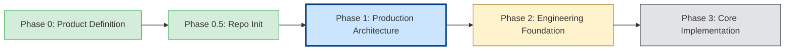
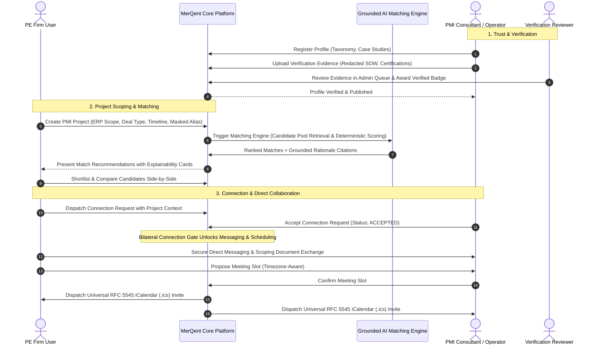

# MerQent

> **Specialized PMI Expertise. Intelligent Matching. Trusted Connections.**

[]()
[]()
[]()
[]()

---

## 1. Overview & Problem Statement

**MerQent** is an enterprise B2B professional marketplace engineered specifically to connect **Private Equity (PE) firms and portfolio operations teams** with **vetted Post-Merger Integration (PMI) consultants and seasoned operators**.

Finding the right operator for a high-stakes integration engagement is notoriously challenging. A private equity sponsor frequently requires a professional with a hyper-specific combination of operational experience:
- Manufacturing industry domain knowledge
- SAP S/4HANA & ECC 6.0 financial ledger integration experience
- Corporate carve-out execution under tight Transition Services Agreements (TSAs)
- Chart-of-accounts (COA) harmonization across multiple legal entities
- Multi-jurisdiction organizational change management and synergy realization

Generic freelance marketplaces treat professional services as broad, undifferentiated categories ("finance", "strategy", "software development"). They lack the structural comprehension required for M&A integration work.

**MerQent bridges this gap through:**
1. **Governed PMI-Specific Taxonomies** (ERPs, Deal Archetypes, Integration Disciplines, Industries)
2. **Multi-Tier Verified Expertise** (Identity, Credentials, Redacted Work History, Peer References)
3. **Structured Project Scoping & Confidential Deal Masking**
4. **Hybrid Faceted & Dense Vector Discovery**
5. **Multi-Signal Deterministic AI Matching Engine**
6. **Explainable AI Recommendations with Grounded Evidence Linkage**
7. **Project-Specific Shortlisting & Side-by-Side Candidate Comparison**
8. **Connection-Gated Handshakes & Relationship States**
9. **Confidential In-Platform Messaging with Secure Document Attachments**
10. **Timezone-Aware Meeting Scheduling with RFC 5545 iCalendar (`.ics`) Integration**

---

## 2. Project Status & Roadmap

| Attribute | Canonical Value |
|---|---|
| **Current Stage** | **Phase 1 — Production Architecture Complete** |
| **Development Status** | Architecture Ratified — Implementation Ready |
| **Architecture Audit** | **PASS (100% Quality Bar Met)** |
| **Next Phase** | **Phase 2 — Engineering Foundation & Application Scaffolding** |



> **Note:** The platform architecture and design specifications are 100% complete and verified. Product feature implementation (authentication, profiles, matching, chat) has intentionally **not** begun and will be executed systematically in Phase 2 and subsequent phases.

---

## 3. Final Production Technology Stack

Following a rigorous, evidence-based evaluation against eleven enterprise criteria, the production stack is formally ratified across 10 Architecture Decision Records:

| Layer | Selected Production Technology | Architectural Justification | Reference ADR |
|---|---|---|---|
| **Web Frontend** | **Next.js 14+ (App Router)** / React 18+ / TypeScript / Tailwind CSS / Radix UI | Hybrid React Server Components (RSC) for fast SEO-rendered public previews; interactive client components for chat/scheduling; shared TypeScript types with backend. | [ADR-001](file:///c:/Users/Vishal%20S%20Naik/MyProjects/MerQent/docs/decisions/ADR-001-frontend-framework.md) |
| **Backend API** | **Node.js 20 LTS / NestJS 10+** (Strict TypeScript) | Enterprise Modular Monolith with Inversion of Control (IoC), Dependency Injection, clean DDD boundaries, and automated OpenAPI 3.0 generation. | [ADR-002](file:///c:/Users/Vishal%20S%20Naik/MyProjects/MerQent/docs/decisions/ADR-002-backend-framework.md) |
| **Primary Database** | **PostgreSQL 16+** with `pgvector` & `pg_trgm` | Strict ACID transactional consistency; unified relational, JSONB document, and 1536d vector embedding storage in a single engine with zero ETL lag. | [ADR-003](file:///c:/Users/Vishal%20S%20Naik/MyProjects/MerQent/docs/decisions/ADR-003-primary-database.md) |
| **Search & Discovery** | **Hybrid PostgreSQL** (`tsvector` + `pgvector` HNSW) | Single-engine hybrid queries combining exact boolean taxonomy filters with sub-25ms cosine similarity ranking. | [ADR-004](file:///c:/Users/Vishal%20S%20Naik/MyProjects/MerQent/docs/decisions/ADR-004-search-and-vector-retrieval.md) |
| **AI / LLM Provider** | **OpenAI API** (`text-embedding-3-small` + `gpt-4o-mini`) + **Anthropic Claude 3.5 Sonnet** Fallback | Guaranteed strict JSON schema mode for explainability; standardized 1536d embeddings; contractual Zero Data Retention (ZDR). | [ADR-005](file:///c:/Users/Vishal%20S%20Naik/MyProjects/MerQent/docs/decisions/ADR-005-ai-llm-provider.md) |
| **Object Storage** | **Amazon S3** (MinIO for local development) with SSE-KMS | Zero-proxy direct browser uploads/downloads via short-lived signed URLs (TTL <= 15m); ClamAV malware scanning pipeline. | [ADR-006](file:///c:/Users/Vishal%20S%20Naik/MyProjects/MerQent/docs/decisions/ADR-006-object-storage.md) |
| **Authentication** | **Dual-Token JWT** (RS256 in HttpOnly Cookies / Bearer Header) + DB Refresh Token | XSS-immune browser cookies; native mobile Bearer header compatibility; immediate server-side session revocation. | [ADR-007](file:///c:/Users/Vishal%20S%20Naik/MyProjects/MerQent/docs/decisions/ADR-007-authentication-and-sessions.md) |
| **Scheduling** | **Native Scheduler + RFC 5545 iCalendar (`.ics`)** | Zero external calendar OAuth compliance friction; universal Outlook/Google/Apple Calendar compatibility; timezone-safe. | [ADR-008](file:///c:/Users/Vishal%20S%20Naik/MyProjects/MerQent/docs/decisions/ADR-008-calendar-and-scheduling.md) |
| **Real-Time Push** | **Server-Sent Events (SSE)** over HTTP/2 with Redis Pub/Sub | Transparent traversal of strict corporate PE enterprise firewalls; native browser auto-reconnect; REST POST for writes. | [ADR-009](file:///c:/Users/Vishal%20S%20Naik/MyProjects/MerQent/docs/decisions/ADR-009-realtime-and-event-messaging.md) |
| **Observability** | **Pino JSON + Sentry APM + OpenTelemetry** | Fast structured logging with automatic PII scrubbing; distributed error tracing; Prometheus metrics; zero vendor lock-in. | [ADR-010](file:///c:/Users/Vishal%20S%20Naik/MyProjects/MerQent/docs/decisions/ADR-010-observability-and-monitoring.md) |
| **Cloud Hosting** | **AWS ECS on AWS Fargate** / Amazon Aurora Serverless v2 | Serverless container orchestration with zero node management; Multi-AZ high availability; baseline early-stage cost ~$320/month. | [05-final-technology-stack.md](file:///c:/Users/Vishal%20S%20Naik/MyProjects/MerQent/docs/architecture/05-final-technology-stack.md) |

---

## 4. Repository Structure

The MerQent repository is organized as a production **TypeScript Monorepo** managed with **pnpm workspaces** and **Turborepo**:

```text
MerQent/
├── apps/
│   ├── web/                          # Next.js 14+ Frontend Web Application
│   └── api/                          # NestJS 10+ Modular API Service
│       └── prisma/schema.prisma      # PostgreSQL 16+ Relational & Vector Schema
│
├── packages/
│   ├── shared-types/                 # Canonical domain enums, interfaces, user context
│   └── shared-validation/            # Zod validation schemas shared between Web and API
│
├── infrastructure/
│   ├── docker/docker-compose.yml     # Local development (PostgreSQL+pgvector, Redis, MinIO)
│   └── database/init.sql             # Database extensions initialization script
│
├── docs/                             # Complete Version-Controlled Architecture
│   ├── product/                      # Product definition, requirements, open questions
│   ├── architecture/                 # 26 comprehensive architectural specifications (00 to 26)
│   ├── decisions/                    # 10 formal Architecture Decision Records (ADRs 001-010)
│   ├── api/openapi.yaml              # OpenAPI 3.0 specification contract
│   └── phase-reports/phase-1/        # 26 task completion reports + Master Final Report
│
├── tests/
│   ├── e2e/                          # 10 Playwright critical end-to-end user workflows
│   ├── security/                     # Multi-tenant isolation & privilege escalation tests
│   └── performance/                  # k6 load testing scenarios
│
├── .editorconfig                     # Consistent editor formatting
├── .env.example                      # Environment configuration template
├── .gitignore                        # Git exclusion rules
├── package.json                      # Workspace scripts & Turborepo pipelines
├── pnpm-workspace.yaml               # pnpm workspace definition
├── tsconfig.base.json                # Root TypeScript compiler configuration
└── turbo.json                        # Turborepo task execution cache pipeline
```

---

## 5. Core Product Workflow



---

## 6. Architecture Documentation Directory

The complete architecture is documented across 26 formal specifications in `docs/architecture/`:

1. [`00-architecture-overview.md`](file:///c:/Users/Vishal%20S%20Naik/MyProjects/MerQent/docs/architecture/00-architecture-overview.md) — Master entrypoint & high-level system blueprint.
2. [`01-system-components.md`](file:///c:/Users/Vishal%20S%20Naik/MyProjects/MerQent/docs/architecture/01-system-components.md) — 14 core system components, boundaries & dependencies.
3. [`02-roles-permissions.md`](file:///c:/Users/Vishal%20S%20Naik/MyProjects/MerQent/docs/architecture/02-roles-permissions.md) — 5 canonical roles, 32-permission matrix & authorization policies.
4. [`03-domain-model.md`](file:///c:/Users/Vishal%20S%20Naik/MyProjects/MerQent/docs/architecture/03-domain-model.md) — 13 Aggregate Roots, entities, invariants & DDD boundaries.
5. [`04-technology-evaluation.md`](file:///c:/Users/Vishal%20S%20Naik/MyProjects/MerQent/docs/architecture/04-technology-evaluation.md) — Comparative technology evaluation against 11 criteria.
6. [`05-final-technology-stack.md`](file:///c:/Users/Vishal%20S%20Naik/MyProjects/MerQent/docs/architecture/05-final-technology-stack.md) — Canonical technology stack specification.
7. [`06-repository-architecture.md`](file:///c:/Users/Vishal%20S%20Naik/MyProjects/MerQent/docs/architecture/06-repository-architecture.md) — Monorepo structure, package boundaries & coding standards.
8. [`07-backend-architecture.md`](file:///c:/Users/Vishal%20S%20Naik/MyProjects/MerQent/docs/architecture/07-backend-architecture.md) — NestJS Modular Monolith, BullMQ queues & SSE streaming.
9. [`08-frontend-architecture.md`](file:///c:/Users/Vishal%20S%20Naik/MyProjects/MerQent/docs/architecture/08-frontend-architecture.md) — Next.js 14 App Router, component tiers & state strategy.
10. [`09-database-architecture.md`](file:///c:/Users/Vishal%20S%20Naik/MyProjects/MerQent/docs/architecture/09-database-architecture.md) — PostgreSQL 16+ DDL, Prisma schema & HNSW indexes.
11. [`10-search-architecture.md`](file:///c:/Users/Vishal%20S%20Naik/MyProjects/MerQent/docs/architecture/10-search-architecture.md) — Hybrid faceted boolean + vector cosine search.
12. [`11-ai-matching-architecture.md`](file:///c:/Users/Vishal%20S%20Naik/MyProjects/MerQent/docs/architecture/11-ai-matching-architecture.md) — Multi-signal scoring formulas & strict LLM schema contracts.
13. [`12-explainable-ai.md`](file:///c:/Users/Vishal%20S%20Naik/MyProjects/MerQent/docs/architecture/12-explainable-ai.md) — Fact vaults, grounding interceptors & citation cards.
14. [`13-messaging-architecture.md`](file:///c:/Users/Vishal%20S%20Naik/MyProjects/MerQent/docs/architecture/13-messaging-architecture.md) — Connection-gated chat, SSE push & cursor pagination.
15. [`14-scheduling-architecture.md`](file:///c:/Users/Vishal%20S%20Naik/MyProjects/MerQent/docs/architecture/14-scheduling-architecture.md) — Timezone-safe meetings, RFC 5545 .ics & delayed reminders.
16. [`15-notification-architecture.md`](file:///c:/Users/Vishal%20S%20Naik/MyProjects/MerQent/docs/architecture/15-notification-architecture.md) — Event-driven multi-channel alerts & React Email.
17. [`16-file-document-architecture.md`](file:///c:/Users/Vishal%20S%20Naik/MyProjects/MerQent/docs/architecture/16-file-document-architecture.md) — Zero-proxy S3 signed URLs & ClamAV malware scanning.
18. [`17-verification-architecture.md`](file:///c:/Users/Vishal%20S%20Naik/MyProjects/MerQent/docs/architecture/17-verification-architecture.md) — 4-tier progressive trust hierarchy & reviewer queue.
19. [`18-admin-architecture.md`](file:///c:/Users/Vishal%20S%20Naik/MyProjects/MerQent/docs/architecture/18-admin-architecture.md) — Governance plane, taxonomy editor & low-confidence audit.
20. [`19-security-privacy-architecture.md`](file:///c:/Users/Vishal%20S%20Naik/MyProjects/MerQent/docs/architecture/19-security-privacy-architecture.md) — Defense-in-depth, Argon2id, MFA, KMS & privacy masking.
21. [`20-api-contract-architecture.md`](file:///c:/Users/Vishal%20S%20Naik/MyProjects/MerQent/docs/architecture/20-api-contract-architecture.md) — RESTful API contract across 16 platform domains.
22. [`21-testing-architecture.md`](file:///c:/Users/Vishal%20S%20Naik/MyProjects/MerQent/docs/architecture/21-testing-architecture.md) — Multi-tier testing pyramid & 10 Playwright E2E workflows.
23. [`22-cicd-architecture.md`](file:///c:/Users/Vishal%20S%20Naik/MyProjects/MerQent/docs/architecture/22-cicd-architecture.md) — Trunk-based CI/CD pipelines & zero-downtime migrations.
24. [`23-deployment-architecture.md`](file:///c:/Users/Vishal%20S%20Naik/MyProjects/MerQent/docs/architecture/23-deployment-architecture.md) — AWS ECS Fargate, Aurora Serverless v2 & BCDR plan.
25. [`24-mobile-readiness.md`](file:///c:/Users/Vishal%20S%20Naik/MyProjects/MerQent/docs/architecture/24-mobile-readiness.md) — Client-agnostic API, push notification adapters & deep links.
26. [`25-scalability-review.md`](file:///c:/Users/Vishal%20S%20Naik/MyProjects/MerQent/docs/architecture/25-scalability-review.md) — 10x volume stress tests & workspace extension boundaries.
27. [`26-final-architecture-audit.md`](file:///c:/Users/Vishal%20S%20Naik/MyProjects/MerQent/docs/architecture/26-final-architecture-audit.md) — Formal gate review determination (PASS).

### Companion Master Documents:
- [Requirements Traceability Matrix](file:///c:/Users/Vishal%20S%20Naik/MyProjects/MerQent/docs/architecture/traceability-matrix.md)
- [Architectural Risk Register](file:///c:/Users/Vishal%20S%20Naik/MyProjects/MerQent/docs/architecture/risk-register.md)
- [Non-Functional Requirements Specification](file:///c:/Users/Vishal%20S%20Naik/MyProjects/MerQent/docs/architecture/non-functional-requirements.md)
- [Open Questions & Decisions Log](file:///c:/Users/Vishal%20S%20Naik/MyProjects/MerQent/docs/product/open-questions.md)
- [OpenAPI 3.0 Specification Contract](file:///c:/Users/Vishal%20S%20Naik/MyProjects/MerQent/docs/api/openapi.yaml)
- [Phase 1 Final Master Report](file:///c:/Users/Vishal%20S%20Naik/MyProjects/MerQent/docs/phase-reports/phase-1/PHASE-1-FINAL-REPORT.md)

---

## 7. Local Development Quickstart

To run the local infrastructure components (PostgreSQL 16 with `pgvector`, Redis 7.2, and MinIO):

```bash
# 1. Clone repository
git clone https://github.com/Vish-0806/MerQent.git
cd MerQent

# 2. Copy environment template
cp .env.example .env

# 3. Start local Docker services
cd infrastructure/docker
docker compose up -d

# 4. Install dependencies via pnpm (Phase 2 readiness)
pnpm install
```

---

## 8. Development Methodology & Contributing

MerQent development follows strict engineering phase discipline:
1. Every phase must complete its architectural specifications and quality checks before feature code is committed.
2. Direct commits of unvetted dependencies, untested migrations, or ungrounded AI prompts are prohibited.
3. All code modifications require Pull Requests passing automated CI linting, typechecks, and security scans.

---

## 9. Final Phase 1 Determination

```text
====================================================================
PHASE 1 STATUS:          COMPLETE
ARCHITECTURE AUDIT:      PASS
READY FOR PHASE 2:       YES
====================================================================
```