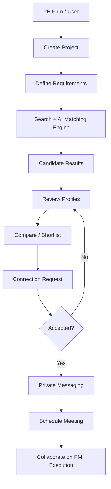

# MerQent

> **Specialized PMI Expertise. Intelligent Matching. Trusted Connections.**

[]()
[]()
[]()
[]()

---

## Overview

**MerQent** is a specialized professional marketplace designed to connect **private-equity firms** with **vetted Post-Merger Integration (PMI) consultants** and **experienced operators**.

Unlike generic consultant marketplaces, MerQent is purpose-built around the unique demands of M&A integration work — ERP consolidation, finance transformation, carve-out execution, multi-country integration, and organizational change management.

---

## Project Status

| Attribute | Value |
|-----------|-------|
| **Current Stage** | Product Definition Complete — Repository Initialization |
| **Development Status** | Architecture Planning |
| **Current Phase** | Phase 0.5 — Repository & Engineering Foundation |

> **Important:** The final technology stack, infrastructure architecture, AI provider, search technology, calendar integrations, and several other implementation decisions have intentionally not yet been finalized. These decisions will be evaluated during the architecture phase rather than assumed prematurely.

---

## 1. About MerQent

MerQent is being designed as a specialized marketplace focused specifically on **Post-Merger Integration (PMI)** and related integration expertise.

Private-equity firms and acquisition teams frequently require specialized professionals who can execute complex integration initiatives involving:

- **Enterprise Resource Planning (ERP) integration**
- **Accounting and finance integration**
- **Chart-of-accounts alignment**
- **IT integration**
- **Operational integration**
- **Organizational integration**
- **Change management**
- **Cultural integration**
- **Carve-out execution**
- **Post-acquisition transformation**
- **Synergy realization**
- **Multi-country integration**
- **Integration governance**

Traditional consultant marketplaces are generally broad and cover many unrelated professional categories.

MerQent takes a different approach:

> **Build a specialized professional network around PMI and post-acquisition execution.**

The platform makes it easier for private-equity firms to discover relevant experts, evaluate their actual experience, understand why they are suitable for a specific engagement, connect with them, communicate securely, and schedule discussions.

---

## 2. Vision

The long-term vision of MerQent is to become a trusted digital infrastructure layer for sourcing, evaluating, connecting, and collaborating with PMI professionals.

The platform aims to combine:

- Specialized PMI expertise
- Structured professional profiles
- Verified experience
- Intelligent discovery
- Explainable AI matching
- Project-centric workflows
- Secure communication
- Scheduling
- Trust and verification
- Future collaboration capabilities

The objective is not simply to create another freelancer marketplace.

MerQent is intended to become a **domain-specific professional marketplace built around the unique requirements of M&A integration work.**

---

## 3. Problem Statement

Finding the right PMI professional for a specific integration engagement can be difficult.

A private-equity firm may require a professional with a very specific combination of experience, such as:

- Manufacturing industry knowledge
- SAP integration experience
- PE carve-out experience
- Multi-country ERP consolidation
- Finance transformation
- Chart-of-accounts alignment
- Change-management expertise

A generic professional marketplace may allow users to search for consultants, but it may not understand the combination of domain-specific requirements involved in a PMI engagement.

MerQent addresses this problem through:

1. **Structured PMI-specific professional data**
2. **Verified expertise**
3. **Detailed project requirements**
4. **Advanced search and filtering**
5. **AI-assisted matching**
6. **Explainable recommendations**
7. **Project-specific shortlisting**
8. **Direct connections**
9. **Secure messaging**
10. **Scheduling and meeting coordination**

---

## 4. Core Value Proposition

### For Private-Equity Firms

MerQent helps PE firms:

- Define PMI project requirements
- Discover relevant consultants
- Filter consultants by specialized experience
- Identify professionals with specific ERP and integration experience
- Find experts with relevant industry and deal experience
- Compare candidates
- Understand why a candidate is recommended
- Build project-specific shortlists
- Connect with consultants
- Communicate privately
- Schedule meetings

---

### For PMI Consultants & Operators

MerQent helps professionals:

- Create specialized PMI profiles
- Showcase relevant integration experience
- Highlight ERP and IT integration experience
- Highlight industry expertise
- Highlight deal and carve-out experience
- Demonstrate verified professional credentials
- Discover relevant projects
- Receive project recommendations
- Respond to connection requests
- Communicate with firms
- Schedule meetings

---

## 5. Core Product Workflow

The primary MerQent workflow is designed around a project-centric interaction between firms and consultants.



**Detailed Flow:**

```
                    ┌─────────────────────┐
                    │    PE Firm / User   │
                    └──────────┬──────────┘
                               │
                               ▼
                    ┌─────────────────────┐
                    │   Create Project    │
                    └──────────┬──────────┘
                               │
                               ▼
                    ┌─────────────────────┐
                    │ Define Requirements │
                    │                     │
                    │ • Industry          │
                    │ • ERP               │
                    │ • Deal Type         │
                    │ • Geography         │
                    │ • PMI Expertise     │
                    │ • Timeline          │
                    └──────────┬──────────┘
                               │
                               ▼
              ┌────────────────────────────────┐
              │ Search + AI Matching Engine    │
              └───────────────┬────────────────┘
                              │
                              ▼
                    ┌─────────────────────┐
                    │ Candidate Results   │
                    └──────────┬──────────┘
                               │
                               ▼
                    ┌─────────────────────┐
                    │ Review Profiles     │
                    └──────────┬──────────┘
                               │
                               ▼
                    ┌─────────────────────┐
                    │ Compare / Shortlist │
                    └──────────┬──────────┘
                               │
                               ▼
                    ┌─────────────────────┐
                    │ Connection Request  │
                    └──────────┬──────────┘
                               │
                         Accepted
                               │
                               ▼
                    ┌─────────────────────┐
                    │ Private Messaging   │
                    └──────────┬──────────┘
                               │
                               ▼
                    ┌─────────────────────┐
                    │ Schedule Meeting    │
                    └─────────────────────┘
```

---

## 6. Key Product Capabilities

### 6.1 Consultant Profiles

Consultants create detailed professional profiles containing:

- **Professional background**
- **PMI experience**
- **Years of experience**
- **Industries served**
- **ERP experience**
- **Accounting systems**
- **Integration experience**
- **Deal experience**
- **Carve-out experience**
- **Change-management experience**
- **Certifications**
- **References**
- **Professional achievements**
- **Geographic experience**
- **Availability**

The platform distinguishes between:
- Information supplied by the consultant
- Information inferred by the matching system

---

### 6.2 Private-Equity Firm Profiles

PE firms have dedicated profiles containing relevant organization-level information.

The exact depth and visibility of firm information will be determined during the architecture and product refinement stages.

---

### 6.3 Project Creation

PE firms create PMI projects describing their requirements.

A project contains:

- **Project objectives**
- **Integration scope**
- **Required expertise**
- **Industry**
- **ERP systems**
- **Accounting requirements**
- **Integration type**
- **Deal type**
- **Geography**
- **Timeline**
- **Availability requirements**
- **Functional requirements**
- **Other PMI-specific requirements**

Project creation is structured enough to support intelligent matching while allowing free-form context.

---

### 6.4 Search & Discovery

MerQent provides specialized consultant discovery capabilities.

Search and filtering includes:

- Industry
- ERP system
- Accounting system
- Deal type
- Integration type
- Geography
- PMI experience
- Availability
- Years of experience
- Specialized expertise

The system supports both structured discovery and semantic understanding of professional profiles.

---

### 6.5 AI-Assisted Matching

AI-assisted matching is one of MerQent's central capabilities.

The system combines:

```text
Structured Requirements
          +
Structured Consultant Data
          +
Semantic Understanding
          +
Relevant Experience
          +
Availability
          ↓
Candidate Ranking
```

The objective is not merely to produce a generic similarity score.

The system identifies consultants whose actual professional background is relevant to the requirements of a specific project.

---

### 6.6 Explainable Matching

A central principle of MerQent:

> **AI recommendations must be understandable and traceable.**

Instead of simply displaying:

```text
92% Match
```

The system communicates reasoning such as:

```text
Recommended because:

✓ 12+ years of PMI experience
✓ Experience with SAP integration
✓ Previous PE carve-out engagements
✓ Manufacturing industry experience
✓ Multi-country integration experience
```

The recommendation is grounded in actual available profile information.

The AI must not invent:
- Experience
- Certifications
- Deal history
- Project outcomes
- Financial results
- Professional achievements
- Other consultant attributes

---

### 6.7 Shortlisting & Comparison

PE firms create project-specific shortlists.

The platform supports comparison of candidates based on:

- PMI experience
- ERP projects
- Industries served
- Deal experience
- Integration experience
- Certifications
- Availability
- Verification status

This allows firms to evaluate candidates without repeatedly searching for the same professionals.

---

### 6.8 Connection Management

The platform supports controlled connections between firms and consultants.

**Typical Flow:**

```text
Firm
  │
  ▼
Consultant Profile
  │
  ▼
Connection Request
  │
  ├── Accepted
  │      │
  │      ▼
  │   Messaging
  │
  └── Rejected
```

Messaging and other collaboration capabilities respect the platform's authorization and connection rules.

---

### 6.9 Private Messaging

Once an appropriate connection is established, users communicate privately.

**Planned messaging capabilities:**

- Text messaging
- Conversations
- Attachments
- Read receipts
- Message notifications
- Secure access controls

Messaging architecture supports future real-time capabilities where appropriate.

---

### 6.10 Scheduling

MerQent supports meeting coordination between firms and consultants.

**Potential scheduling capabilities:**

- Proposed meeting times
- Meeting confirmation
- Duration
- Time-zone handling
- Meeting reminders
- Calendar integration

The final calendar integration strategy will be determined during the architecture phase.

---

### 6.11 Notifications

The platform supports both:

#### In-App Notifications

#### Email Notifications

**Potential notification events:**

- New consultant match
- Connection request
- Connection acceptance
- New message
- Meeting invitation
- Meeting reminder
- Relevant project opportunity
- Important project activity

Notification preferences and delivery architecture will be defined during implementation planning.

---

### 6.12 Consultant Verification

Trust is a fundamental component of MerQent.

The platform supports verification of professional information through multiple levels.

**Potential verification areas:**

- Email
- Identity
- Work history
- Certifications
- References
- Supporting evidence

Verification may involve both automated and administrative processes.

The final verification depth will be determined during the architecture and product decision phases.

---

### 6.13 Administration

MerQent requires an administrative control layer.

**Administrative capabilities:**

- User management
- Consultant management
- Firm management
- Verification review
- Content management
- Taxonomy management
- User moderation
- AI/matching review
- Low-confidence match review
- Audit visibility

Administrative functionality remains separated from normal user permissions.

---

## 7. PMI-Specific Knowledge Structure

One of MerQent's major differentiators is the use of domain-specific structured data.

The platform maintains controlled and extensible taxonomies covering:

```text
Industries
├── Manufacturing
├── Healthcare
├── Technology
├── Financial Services
└── ...

ERP Systems
├── SAP
├── Oracle
├── NetSuite
└── ...

Deal Types
├── PE Acquisition
├── Carve-Out
├── Divestiture
└── ...

Integration Types
├── ERP Integration
├── Finance Integration
├── IT Integration
├── Culture Integration
├── Chart-of-Accounts Alignment
└── ...

PMI Expertise
├── Integration Management
├── Change Management
├── Synergy Realization
├── IT Integration
└── ...
```

The taxonomy is designed to evolve as the platform grows.

---

## 8. Trust & Transparency Principles

MerQent is designed around several important principles.

### 8.1 No Fabricated Expertise

The AI must never invent consultant information.

---

### 8.2 Evidence-Based Recommendations

Match explanations reference actual information available in the consultant's profile or verified records.

---

### 8.3 Clear Distinction Between Facts and Inference

The system distinguishes:

```text
Verified / User-Provided Information
                 vs.
AI-Inferred Relevance
```

AI inference is never presented as a verified fact.

---

### 8.4 Human Review for Low Confidence

Low-confidence AI recommendations are identifiable and, where appropriate, routed for human review.

---

### 8.5 Privacy by Design

Sensitive deal information is not unnecessarily required.

The platform provides appropriate privacy and visibility controls for professional and project information.

---

## 9. Future Collaboration Capabilities

The initial platform architecture does not prevent future expansion into more advanced project collaboration.

**Potential future capabilities:**

- Shared project spaces
- PMI checklists
- Milestone tracking
- Document repositories
- Project workspaces
- Integration planning
- Collaboration workflows
- Project analytics

These capabilities may be introduced progressively as the platform evolves.

---

## 10. Platform Architecture Philosophy

MerQent follows several architectural principles.

### API-First

The backend exposes well-defined APIs independently of any specific client.

This enables:

```text
                 ┌── Web Application
                 │
Shared Backend ──┼── Future Mobile Application
                 │
                 └── Future Clients / Integrations
```

The architecture avoids coupling core business logic directly to the web interface.

---

### Modular

Business capabilities have clear boundaries.

Examples include:

- Identity
- Profiles
- Projects
- Search
- Matching
- Verification
- Messaging
- Scheduling
- Notifications
- Administration

The exact implementation architecture will be decided during Phase 1.

---

### Extensible

The system allows new:

- Industries
- ERP systems
- PMI tasks
- Deal types
- Integration types
- Matching criteria
- Verification methods
- Notification types
- External integrations

without requiring fundamental redesign.

---

### Secure by Design

Security is not treated as a final-stage addition.

Authentication, authorization, privacy, data protection, file access, auditability, and sensitive-data handling are considered from the beginning.

---

### Explainable AI

AI assists decision-making rather than becoming an opaque black box.

MerQent explains:

> **Why was this consultant recommended for this project?**

---

## 11. Technology Stack

### Current Status

**Not finalized.**

The final technology stack will be selected during the Production Architecture phase after systematic evaluation.

### Evaluation Criteria

- Performance
- Scalability
- Security
- Maintainability
- Developer productivity
- AI integration
- Search capabilities
- Database requirements
- Real-time communication
- Mobile readiness
- Deployment complexity
- Cost
- Ecosystem maturity
- Long-term extensibility

The project will not assume a specific stack simply because a particular framework was initially suggested.

---

## 12. Repository Structure

The repository is intentionally initialized in a technology-neutral manner before the final architecture is selected.

```text
MerQent/
│
├── apps/
│
├── packages/
│
├── docs/
│   ├── product/
│   ├── architecture/
│   ├── decisions/
│   ├── api/
│   ├── database/
│   ├── ai/
│   ├── security/
│   ├── testing/
│   └── deployment/
│
├── infrastructure/
│
├── scripts/
│
├── tests/
│
├── .env.example
├── .gitignore
├── .editorconfig
└── README.md
```

The final structure will be refined after technology and architecture decisions are completed.

---

## 13. Documentation Strategy

MerQent maintains architecture and engineering decisions as version-controlled documentation.

```text
docs/
├── product/
│   ├── product-definition.md
│   ├── requirements.md
│   └── open-questions.md
│
├── architecture/
│   ├── system-components.md
│   ├── roles-permissions.md
│   ├── domain-model.md
│   └── ...
│
├── decisions/
│   └── ADRs
│
├── api/
├── database/
├── ai/
├── security/
├── testing/
└── deployment/
```

This ensures important architectural decisions do not exist only inside conversations or temporary development notes.

---

## 14. Development Methodology

MerQent is developed incrementally.

```text
Define
  ↓
Design
  ↓
Implement
  ↓
Test
  ↓
Review
  ↓
Validate
  ↓
Proceed
```

Each major phase is completed and validated before dependent work begins.

The project intentionally avoids attempting to implement the entire platform in one uncontrolled development cycle.

---

## 15. Development Roadmap

### Phase 0 — Product Definition & Requirements

**Status: COMPLETED**

**Objectives:**

- Define the product
- Identify target users
- Define core workflows
- Identify differentiators
- Define major requirements
- Identify open business questions
- Establish product scope

---

### Phase 0.5 — Repository & Engineering Foundation

**Status: IN PROGRESS / INITIALIZATION**

**Objectives:**

- Initialize Git repository
- Establish documentation structure
- Establish repository governance
- Add project-level configuration foundations
- Preserve product documentation
- Prepare architecture workspace

---

### Phase 1 — Production Architecture

**Status: NOT STARTED**

**Planned areas (26):**

1. Requirements → System Components
2. User Roles & Permissions
3. Domain Model
4. Technology Evaluation
5. Final Technology Stack
6. Repository Architecture
7. Backend Architecture
8. Frontend Architecture
9. Database Architecture
10. Search Architecture
11. AI Matching Architecture
12. Explainable AI Architecture
13. Messaging Architecture
14. Scheduling Architecture
15. Notification Architecture
16. File & Document Architecture
17. Verification Architecture
18. Admin Architecture
19. Security & Privacy Architecture
20. API Contract Architecture
21. Testing Architecture
22. CI/CD Architecture
23. Deployment Architecture
24. Mobile Readiness
25. Scalability & Extensibility Review
26. Final Architecture Audit

---

### Phase 2 — Engineering Foundation

**Status: PLANNED**

**Expected areas:**

- Concrete project setup
- Development environment
- Application scaffolding
- Configuration management
- Logging
- Error handling
- Testing infrastructure
- CI/CD foundations
- Development environments

---

### Future Implementation Phases

The implementation roadmap will be finalized after Phase 1.

**Potential feature areas:**

- Authentication & identity
- Consultant profiles
- Firm profiles
- Verification
- Projects
- PMI taxonomies
- Search
- AI matching
- Shortlisting
- Connections
- Messaging
- Scheduling
- Notifications
- Administration
- Security hardening
- Production deployment
- Mobile client readiness

The exact sequencing will be determined by the finalized architecture.

---

## 16. Open Product & Architecture Decisions

Several decisions are intentionally left open.

### Business Model

Possible models:
- Free
- Subscription
- Commission
- Tiered subscription

No final model has been selected yet.

---

### Consultant / Operator Definition

The precise definition and distinction between consultants and operators requires further clarification.

---

### Verification Depth

The final balance between:
- Self-attestation
- References
- Documentation
- Third-party verification
- Administrative review

remains to be finalized.

---

### AI Provider

The final AI/LLM provider has not yet been selected.

---

### Search Technology

The final search and semantic retrieval architecture has not yet been selected.

---

### Calendar Integration

The platform must determine whether scheduling will use:
- Built-in scheduling
- External calendar integrations
- Google Calendar
- Microsoft Outlook
- Or a combination

---

### Infrastructure

The final hosting and infrastructure strategy will be selected during architecture planning.

---

### Mobile Strategy

The initial product is designed as a web application, while the backend remains capable of supporting a future mobile application.

---

### Compliance

The appropriate regulatory and compliance requirements for financial and M&A-related data must be evaluated as the platform develops.

---

## 17. Engineering Principles

The following principles guide the project.

### 1. Product Requirements Before Code

Do not implement ambiguous requirements.

---

### 2. Architecture Before Large-Scale Implementation

Major architectural decisions should be documented before dependent implementation begins.

---

### 3. Evidence Over Assumptions

When a requirement is unknown, identify it as an open decision instead of inventing an answer.

---

### 4. Security From the Beginning

Security, privacy and authorization are foundational concerns.

---

### 5. Explainability Over Black-Box AI

AI recommendations should be understandable and traceable.

---

### 6. Modular Design

Components should have clear responsibilities and boundaries.

---

### 7. API-First Development

The backend should not depend on a single client.

---

### 8. Test Before Progressing

Each significant implementation phase should be validated before moving to dependent work.

---

### 9. Production-Quality Thinking

Although MerQent is being developed as an internship project, the architecture should be designed with real-world engineering standards in mind.

---

### 10. Avoid Unnecessary Complexity

Production quality does not mean blindly adding microservices, infrastructure, frameworks, or third-party services.

Every architectural decision should have a clear reason.

---

## 18. Quality Standards

MerQent development prioritizes:

- Correctness
- Security
- Reliability
- Maintainability
- Performance
- Accessibility
- Scalability
- Observability
- Testability
- Explainability
- Data integrity
- User experience

A feature is not considered complete simply because it works in a happy-path demonstration.

It must also account for:

- Invalid input
- Unauthorized access
- Missing data
- Network failures
- Duplicate operations
- Permission boundaries
- Error handling
- Data consistency
- Security risks
- Edge cases

---

## 19. AI Safety & Integrity

Because AI is central to MerQent's matching capabilities, AI-related functionality must follow strict integrity rules.

### The AI MUST:

- Use available profile/project information
- Clearly distinguish facts from inference
- Provide explainable recommendations
- Identify uncertainty where appropriate
- Support human review for low-confidence cases

### The AI MUST NOT:

- Invent consultant experience
- Invent certifications
- Invent project history
- Invent financial outcomes
- Invent client names
- Invent deal experience
- Present inferred information as verified fact

AI is intended to **assist professional discovery**, not manufacture professional credentials.

---

## 20. Security & Privacy Philosophy

MerQent may eventually process sensitive professional and project information related to private-equity and M&A activities.

Therefore the platform follows principles such as:

- Least privilege
- Strong authentication
- Role-based authorization
- Secure file access
- Sensitive-data minimization
- Encryption
- Auditability
- Controlled visibility
- Secure communication
- Environment-specific secrets
- Protection against unauthorized access

The exact security architecture will be defined during Phase 1.

---

## 21. Future Mobile Application

The initial product target is a web application.

However, MerQent is architected so that a future mobile application can reuse the same backend.

**Target architecture:**

```text
                    ┌───────────────────┐
                    │   MerQent Web     │
                    └─────────┬─────────┘
                              │
                              ▼
                    ┌───────────────────┐
                    │   Shared API      │
                    │   / Backend       │
                    └─────────┬─────────┘
                              │
                              ▼
                    ┌───────────────────┐
                    │ Core MerQent      │
                    │ Business Logic    │
                    └─────────┬─────────┘
                              │
                              ▼
                    ┌───────────────────┐
                    │ Data / Services   │
                    └───────────────────┘
                              ▲
                              │
                    ┌─────────┴─────────┐
                    │ Future Mobile App │
                    └───────────────────┘
```

The mobile application will be considered after the core platform architecture is stable.

---

## 22. Contributing

MerQent follows a controlled development workflow.

Before making substantial changes:

1. Understand the current phase.
2. Review relevant documentation.
3. Understand existing architecture.
4. Make the smallest appropriate change.
5. Test the change.
6. Review the result.
7. Update documentation when required.
8. Commit the change with a meaningful message.

Avoid introducing architectural changes without documenting their reasoning.

---

## 23. Git & Version Control

The repository uses Git for version control.

Commit messages clearly describe the change.

**Examples:**

```text
feat: add consultant profile model
fix: correct project requirement validation
docs: define matching architecture
refactor: simplify notification boundary
test: add connection workflow tests
chore: update development configuration
```

Major architectural decisions are documented separately through Architecture Decision Records (ADRs).

---

## 24. Architecture Decision Records

Significant decisions are documented.

**Examples:**

```text
ADR-001: Backend Framework Selection
ADR-002: Database Selection
ADR-003: Search Architecture
ADR-004: AI Provider Selection
ADR-005: Authentication Strategy
ADR-006: Calendar Integration Strategy
ADR-007: File Storage Architecture
```

Each ADR explains:
- Context
- Problem
- Options considered
- Decision
- Reasoning
- Consequences
- Alternatives rejected

---

## 25. Current Repository Philosophy

At the beginning of the project, the repository intentionally avoids premature technology commitments.

**Goal:**

```text
Product Requirements
        ↓
Architecture Analysis
        ↓
Technology Evaluation
        ↓
Technology Selection
        ↓
Concrete Architecture
        ↓
Implementation
```

This prevents the implementation from dictating the product architecture before the requirements have been properly analyzed.

---

## 26. Project Documentation

The primary product documentation is maintained alongside the repository.

**Important documents:**

- Product Definition
- Requirements
- Architecture
- Architecture Decision Records
- API Specifications
- Database Design
- AI Architecture
- Security Architecture
- Testing Strategy
- Deployment Strategy

The documentation is treated as part of the engineering system rather than optional project notes.

---

## 27. Disclaimer

MerQent is currently a project under active development.

Product capabilities, architecture, technologies, workflows, business model, integrations, and implementation details may evolve as research, validation, technical evaluation, and development progress.

Features described as planned or future capabilities should not be interpreted as currently implemented functionality.

---

## 28. Project Identity

| Attribute | Value |
|-----------|-------|
| **Project** | MerQent |
| **Domain** | Post-Merger Integration / Private Equity / Professional Services |
| **Platform Type** | Specialized B2B Professional Marketplace |
| **Primary Users** | Private Equity Firms, PMI Consultants, PMI Operators |
| **Primary Focus** | Consultant Discovery, PMI Expertise, Project-Based Matching, Explainable AI, Verification, Professional Collaboration |
| **Initial Client** | Web |
| **Future Client** | Mobile |
| **Development Approach** | Phased, test-driven, architecture-first |
| **Current Stage** | Product Definition Complete / Repository Initialization |

---

## 29. Long-Term Vision

MerQent aims to evolve from a specialized consultant marketplace into a broader PMI execution ecosystem.

```text
                 MERQENT
                    │
        ┌───────────┼───────────┐
        │           │           │
        ▼           ▼           ▼
   Discover      Match       Verify
        │           │           │
        └───────────┼───────────┘
                    │
                    ▼
                 Connect
                    │
                    ▼
               Communicate
                    │
                    ▼
                Schedule
                    │
                    ▼
              Collaborate
                    │
                    ▼
            Execute PMI Work
```

The ultimate objective is to make specialized PMI expertise easier to discover, evaluate, engage, and collaborate with through a trusted technology platform.

---

## 30. Final Note

MerQent is being built with a simple principle:

> **Specialized expertise deserves specialized infrastructure.**

The platform combines domain-specific professional data, structured discovery, intelligent matching, explainable AI, verification, and collaboration into a single ecosystem focused on Post-Merger Integration.

The project begins with a strong product definition and will now progress through a disciplined architecture and engineering process.

---

## MerQent

**Specialized PMI Expertise. Intelligent Matching. Trusted Connections.**