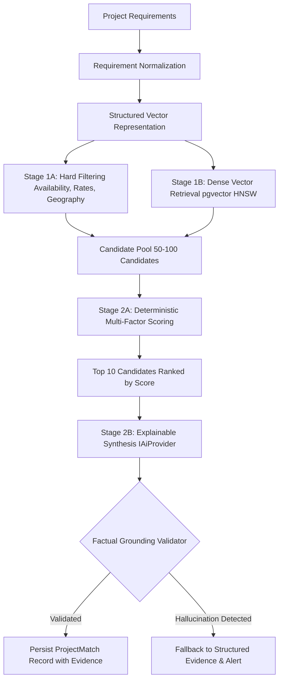

# MerQent — AI Matching Engine & Grounding Architecture

## 1. Grounded AI Matching Pipeline
The MerQent matching engine matches complex Private Equity post-merger integration requirements with vetted independent operators. The architecture enforces complete factual grounding and explainability.

---

## 2. The Four Distinct Data Categories

To prevent hallucinations, the engine strictly maintains four distinct data categories:

1. **`USER_REPORTED`**: Self-reported claims entered by the consultant in their profile. Displayed with unverified visual styling.
2. **`VERIFIED_EVIDENCE`**: Credentials, past deal contracts, and client references reviewed and approved by MerQent platform admins. Carries full verification weighting.
3. **`SYSTEM_CALCULATED`**: Deterministic calculations produced by the platform (e.g. responsiveness rate, completed engagements, profile completeness score).
4. **`AI_INFERRED_RELEVANCE`**: Semantic alignment and contextual synergy inferred by the AI matching engine. Never treated as factual ground truth.

---

## 3. Grounding Verification Invariants
- The LLM prompt context is strictly restricted to verified database fields from the candidate profile and project requirements.
- The LLM is provided a JSON schema containing exact fields: `overallScore`, `confidenceBand`, `strengths`, `potentialGaps`, and `evidenceQuotes`.
- Post-processing validator parses LLM output and checks every cited credential against PostgreSQL records. If an ungrounded entity is detected, the explanation is flagged and replaced with deterministic template evidence.
