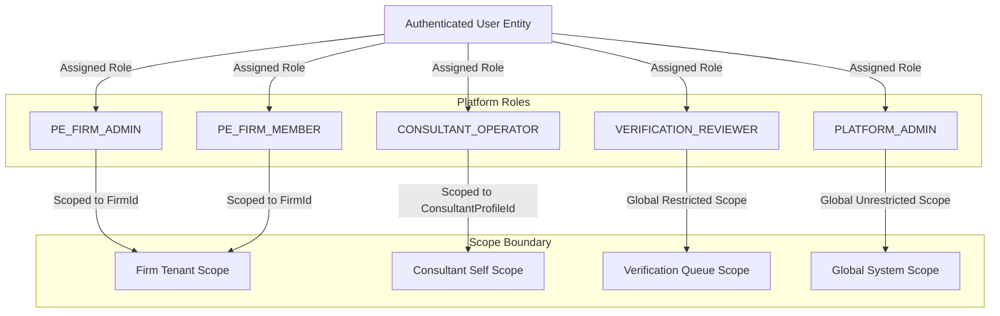
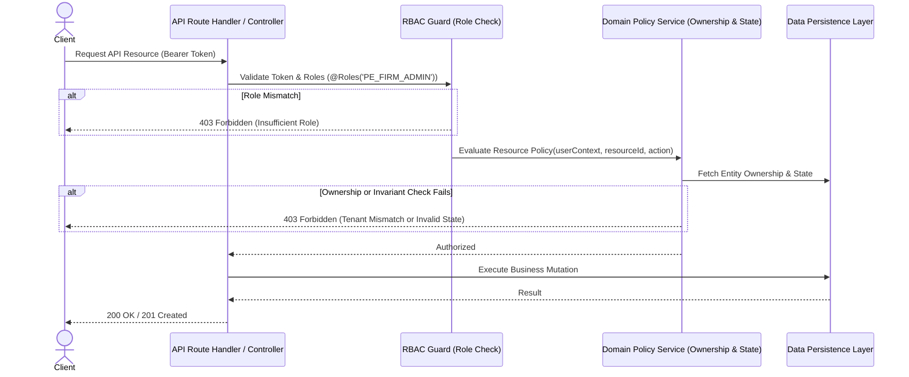

# MerQent — User Roles & Permissions Architecture

**Document Version:** 1.0.0  
**Status:** Approved Architecture  
**Phase:** 1.2 — User Roles & Permission Architecture  
**Author:** Security Architect & Principal Engineer  

---

## 1. Core Authorization Principles

MerQent enforces five foundational authorization principles across all API endpoints, background jobs, and direct database queries:

1. **Deny by Default:** Unless an explicit grant exists for a subject on a resource for an action, the operation is rejected (`403 Forbidden`).
2. **Principle of Least Privilege (PoLP):** Users and administrative actors are provisioned strictly with the minimum permissions required to perform their discrete business function.
3. **Multi-Tier Authorization (Role + Ownership + State):**
   - **Role Check (RBAC):** Does the user's role permit this verb on this entity type?
   - **Ownership / Tenant Check:** Does the user belong to the organization (Firm) or own the specific profile/project record?
   - **State Invariant Check:** Is the parent entity in a valid state (e.g., messaging is blocked if connection is not `ACCEPTED`)?
4. **Contextual Token Claims:** Authentication tokens carry tenant context (`firmId`, `consultantProfileId`, `roles`), but all authorization decisions re-verify ownership against current database state for mutating or sensitive operations.
5. **Separation of Duties (SoD):** Platform administrators cannot impersonate users or manipulate verified badges without an immutable audit record. System operations are segregated from verification review operations.

---

## 2. Definitive Role Catalog

To avoid role explosion and unmaintainable permission sprawl, MerQent defines four canonical platform roles, complemented by organizational tenant scopes.



### 2.1 `PE_FIRM_ADMIN` (Private Equity Firm Administrator)
- **Purpose:** Represents the primary account owner or team lead at a PE firm / portfolio operations group.
- **Tenant Scope:** Scoped to a specific `FirmId`.
- **Key Capabilities:** Manage firm profile; invite and manage colleagues (`PE_FIRM_MEMBER`); create, publish, and close PMI projects; trigger AI matching; view candidate profiles; manage shortlists; send connection requests; communicate and schedule meetings with connected consultants; manage firm-level billing/settings (future).
- **Restrictions:** Cannot edit consultant profiles; cannot review verification submissions; cannot access projects or shortlists belonging to other PE firms.

### 2.2 `PE_FIRM_MEMBER` (Private Equity Firm Team Member)
- **Purpose:** Associate, analyst, or operating director working under a PE firm account.
- **Tenant Scope:** Scoped to a specific `FirmId`.
- **Key Capabilities:** View firm projects; create and edit draft projects; view match recommendations; curate project shortlists; communicate and participate in scheduled meetings with connected consultants.
- **Restrictions:** Cannot invite/remove firm members; cannot edit firm profile; cannot delete active projects without admin privilege.

### 2.3 `CONSULTANT_OPERATOR` (PMI Consultant / Operator)
- **Purpose:** Independent practitioner, fractional executive, or boutique firm partner offering post-merger integration services.
- **Tenant Scope:** Scoped to their own `ConsultantProfileId`.
- **Key Capabilities:** Create and edit professional profile, taxonomy associations, and past engagement case studies; upload verification documents (resumes, references, certifications); browse public/anonymized active projects; receive connection requests; accept or decline connection requests; conduct direct messaging and schedule meetings once connected.
- **Restrictions:** Zero visibility into PE shortlists, private evaluation notes, other consultants' unverified documents, or draft/unaffiliated PE projects. Cannot initiate unsolicited connection requests to PE firms.

### 2.4 `VERIFICATION_REVIEWER` (Trust & Safety Reviewer)
- **Purpose:** Operational staff member responsible for reviewing consultant verification submissions.
- **Tenant Scope:** Global queue scoped to verification records and supporting evidence.
- **Key Capabilities:** Inspect pending verification queues; review submitted evidence documents (redacted contracts, certifications, reference attestations); approve, reject, or request information on verification requests; assign verification badge tiers.
- **Restrictions:** Read-only access to standard business operations; cannot edit consultant profiles; cannot access private messages or scheduled meetings between firms and consultants; cannot modify system configurations.

### 2.5 `PLATFORM_ADMIN` (Super Administrator)
- **Purpose:** System owner responsible for platform governance, security monitoring, and taxonomy management.
- **Tenant Scope:** Global.
- **Key Capabilities:** Manage all user and organization lifecycles; manage controlled taxonomies (ERPs, industries, integration types); review AI match quality and audit logs; moderate content; trigger system-level re-indexing.
- **Restrictions:** Direct access to private conversation content is restricted and requires break-glass audit justification.

---

## 3. Comprehensive Granular Permission Matrix

Permissions are structured as `domain:resource:action` (e.g., `project:details:read`, `connection:request:create`).

| Permission Key | Description | `PE_FIRM_ADMIN` | `PE_FIRM_MEMBER` | `CONSULTANT_OPERATOR` | `VERIFICATION_REVIEWER` | `PLATFORM_ADMIN` |
|---|---|:---:|:---:|:---:|:---:|:---:|
| **AUTH & ACCOUNT** | | | | | | |
| `auth:session:create` | Log in and obtain session | Yes | Yes | Yes | Yes | Yes |
| `auth:session:revoke` | Revoke current/all sessions | Yes | Yes | Yes | Yes | Yes |
| `auth:mfa:manage` | Configure TOTP MFA | Yes | Yes | Yes | Yes (Mandatory) | Yes (Mandatory) |
| `user:profile:manage_self` | Update own account email/pwd | Yes | Yes | Yes | Yes | Yes |
| **FIRM & ORGANIZATIONS** | | | | | | |
| `firm:profile:read` | Read firm profile details | Yes (Own) | Yes (Own) | No (Masked) | Read-only | Yes |
| `firm:profile:update` | Update firm metadata & settings | Yes (Own) | No | No | No | Yes |
| `firm:member:invite` | Invite colleagues to firm | Yes (Own) | No | No | No | Yes |
| `firm:member:remove` | Remove colleagues from firm | Yes (Own) | No | No | No | Yes |
| **CONSULTANT PROFILES** | | | | | | |
| `consultant:profile:create` | Register consultant profile | No | No | Yes (Self) | No | No |
| `consultant:profile:update` | Edit bio, skills, experience | No | No | Yes (Self) | No | Yes (Moderation) |
| `consultant:profile:read_public` | View verified public profile | Yes | Yes | Yes | Yes | Yes |
| `consultant:profile:read_private` | View unredacted/contact data | Yes (Connected) | Yes (Connected) | Yes (Self) | Yes | Yes |
| **PROJECT MANAGEMENT** | | | | | | |
| `project:create` | Create new PMI project | Yes | Yes | No | No | No |
| `project:update` | Edit project requirements/scope | Yes (Own Firm) | Yes (Own Firm) | No | No | Yes (Moderation) |
| `project:publish` | Make project active/matchable | Yes (Own Firm) | No | No | No | Yes |
| `project:close` | Mark project fulfilled/closed | Yes (Own Firm) | No | No | No | Yes |
| `project:read_internal` | Read full project details | Yes (Own Firm) | Yes (Own Firm) | No | No | Yes |
| `project:read_marketplace` | Read active anonymized project | Yes | Yes | Yes (Active only) | No | Yes |
| **SEARCH & DISCOVERY** | | | | | | |
| `search:consultant:faceted` | Execute faceted search filters | Yes | Yes | No | No | Yes |
| `search:consultant:semantic` | Execute free-text semantic query | Yes | Yes | No | No | Yes |
| **MATCHING & EXPLANATIONS** | | | | | | |
| `matching:run` | Trigger AI matching for project | Yes (Own Firm) | Yes (Own Firm) | No | No | Yes (Audit) |
| `matching:view_results` | View ranked matches & scores | Yes (Own Firm) | Yes (Own Firm) | No | No | Yes |
| `matching:view_explanation` | View grounded explainability | Yes (Own Firm) | Yes (Own Firm) | No | No | Yes |
| `matching:audit_low_conf` | Review low-confidence matches | No | No | No | Yes | Yes |
| **SHORTLISTS** | | | | | | |
| `shortlist:create_update` | Add/remove candidate from list | Yes (Own Firm) | Yes (Own Firm) | No | No | No |
| `shortlist:compare` | View candidate comparison matrix| Yes (Own Firm) | Yes (Own Firm) | No | No | No |
| `shortlist:notes:manage` | Manage private evaluation notes| Yes (Own Firm) | Yes (Own Firm) | No | No | No |
| **CONNECTIONS** | | | | | | |
| `connection:request:create` | Send request to consultant | Yes (Own Firm) | Yes (Own Firm) | No | No | No |
| `connection:request:respond` | Accept or decline request | No | No | Yes (Recipient) | No | No |
| `connection:cancel` | Withdraw pending request | Yes (Initiator) | Yes (Initiator) | No | No | Yes (Admin) |
| `connection:read` | View connection record status | Yes (Participant)| Yes (Participant)| Yes (Participant)| No | Yes |
| **MESSAGING** | | | | | | |
| `message:thread:read` | Read messages in conversation | Yes (Connected) | Yes (Connected) | Yes (Connected) | No | Audit Only |
| `message:send` | Post message to active thread | Yes (Connected) | Yes (Connected) | Yes (Connected) | No | No |
| `message:attachment:upload` | Attach file to message | Yes (Connected) | Yes (Connected) | Yes (Connected) | No | No |
| **SCHEDULING** | | | | | | |
| `meeting:propose` | Propose meeting time slot | Yes (Connected) | Yes (Connected) | Yes (Connected) | No | No |
| `meeting:respond` | Accept / reschedule / cancel | Yes (Participant)| Yes (Participant)| Yes (Participant)| No | No |
| `meeting:read` | View meeting schedule & .ics | Yes (Participant)| Yes (Participant)| Yes (Participant)| No | Yes |
| **VERIFICATION & TRUST** | | | | | | |
| `verification:request:submit` | Submit evidence for tier badge | No | No | Yes (Self) | No | No |
| `verification:evidence:read` | Review submitted evidence docs | No | No | Yes (Self) | Yes | Yes |
| `verification:review:decide` | Approve / reject tier badge | No | No | No | Yes | Yes |
| **FILES & STORAGE** | | | | | | |
| `file:upload:initiate` | Request signed upload URL | Yes (Own scope) | Yes (Own scope) | Yes (Own scope) | No | Yes |
| `file:read:signed_url` | Obtain signed download URL | Enforced via resource ownership & connection policies |
| **ADMIN & GOVERNANCE** | | | | | | |
| `admin:taxonomy:manage` | Add/modify ERP, deal taxonomies | No | No | No | No | Yes |
| `admin:user:suspend` | Suspend abusive user / account | No | No | No | No | Yes |
| `admin:audit:view` | Inspect system-wide audit logs | No | No | No | No | Yes |

---

## 4. Enforcement Architecture

Authorization enforcement occurs at three layers in the software architecture:



### 4.1 Implementation Pattern
- **Guard Layer:** Lightweight middleware checks the JWT signature, user active status, and RBAC role match.
- **Policy Service Layer:** Domain-specific policy classes (e.g., `ProjectAuthorizationPolicy`, `ConnectionAuthorizationPolicy`) execute contextual checks:
  ```typescript
  // Conceptual Policy Verification
  async canAccessMessaging(user: UserContext, connectionId: string): Promise<boolean> {
    const connection = await this.connectionRepo.findById(connectionId);
    if (!connection) return false;
    if (connection.status !== ConnectionStatus.ACCEPTED) return false;
    return connection.firmId === user.firmId || connection.consultantId === user.consultantId;
  }
  ```
- **Row-Level Tenancy Filter:** All database queries involving firm-owned resources automatically append `WHERE firm_id = :tenantFirmId` to prevent data leakage.
