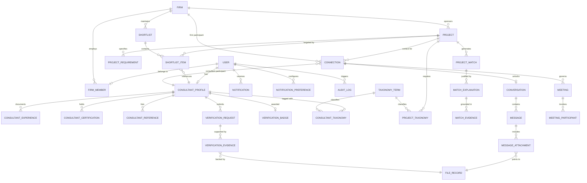

# MerQent — Complete Conceptual Domain Model

**Document Version:** 1.0.0  
**Status:** Approved Architecture  
**Phase:** 1.3 — Complete Domain Model  
**Author:** Database Architect & Principal Engineer  

---

## 1. Domain Modeling Philosophy

The MerQent domain model represents the core business reality of Post-Merger Integration advisory and execution. It adheres to Domain-Driven Design (DDD) principles:
- **Aggregates & Boundaries:** Each Aggregate Root manages its internal invariants. Child entities cannot be mutated outside the boundary of their aggregate root.
- **Controlled Taxonomies:** Domain classifications (ERPs, Deal Types, Integration Disciplines, Industries) are normalized entities referenced via many-to-many associations, ensuring taxonomy governance without ad-hoc string clutter.
- **Immutability of Audit & Evidence:** Records of matches, verification decisions, messages, and audit events are append-only to preserve legal integrity and auditability.
- **Privacy by Design:** Confidentiality classifications (`PUBLIC`, `INTERNAL`, `CONFIDENTIAL_RESTRICTED`) are embedded directly into entity metadata.

---

## 2. Comprehensive Domain Entity Relationship Diagram

---

## 3. Aggregate Roots & Entity Specifications

---

### 3.1 Aggregate: Identity & User
#### `User` (Aggregate Root)
- **Purpose:** Primary digital identity across the platform.
- **Attributes:** `id` (UUID), `email` (string, unique), `passwordHash` (string), `fullName` (string), `avatarUrl` (string), `status` (Enum: `PENDING_VERIFICATION`, `ACTIVE`, `SUSPENDED`, `DEACTIVATED`), `emailVerifiedAt` (timestamp), `mfaEnabled` (boolean), `mfaSecret` (string, encrypted), `lastLoginAt` (timestamp), `createdAt` (timestamp), `updatedAt` (timestamp).
- **Relationships:**
  - 1-to-0..1 with `FirmMember`
  - 1-to-0..1 with `ConsultantProfile`
  - 1-to-Many with `NotificationPreference`
  - 1-to-Many with `AuditLog`
- **Ownership:** System boundary.
- **Lifecycle / States:** `PENDING_VERIFICATION` → `ACTIVE` ⇄ `SUSPENDED` → `DEACTIVATED`.
- **Invariants:** Email must be RFC 5322 compliant and unique. Cannot be active without email verification.
- **Privacy Classification:** `CONFIDENTIAL_RESTRICTED` (PII).
- **Audit Requirements:** Log creation, password changes, MFA state changes, status transitions, and failed login attempts.

---

### 3.2 Aggregate: Organization & Firm
#### `Firm` (Aggregate Root)
- **Purpose:** Institutional entity representing a Private Equity sponsor or Portfolio Operations group.
- **Attributes:** `id` (UUID), `legalName` (string), `displayName` (string), `websiteUrl` (string), `aumTier` (Enum: `UNDER_500M`, `500M_TO_2B`, `2B_TO_10B`, `OVER_10B`), `headquartersCountry` (string), `headquartersCity` (string), `status` (Enum: `ACTIVE`, `PENDING_REVIEW`, `SUSPENDED`), `createdAt` (timestamp), `updatedAt` (timestamp).
- **Relationships:**
  - 1-to-Many with `FirmMember`
  - 1-to-Many with `Project`
  - 1-to-Many with `Shortlist`
- **Ownership:** Firm Administrator.
- **Lifecycle / States:** `PENDING_REVIEW` → `ACTIVE` ⇄ `SUSPENDED`.
- **Invariants:** Legal name cannot be blank. Must have at least one active `FirmMember` with role `PE_FIRM_ADMIN`.
- **Privacy Classification:** `INTERNAL` (Business entity data).
- **Audit Requirements:** Log firm creation, status transitions, and admin membership changes.

#### `FirmMember` (Entity)
- **Purpose:** Associates a `User` with a `Firm` tenant and defines their organizational role.
- **Attributes:** `id` (UUID), `firmId` (UUID, FK), `userId` (UUID, FK, unique), `role` (Enum: `PE_FIRM_ADMIN`, `PE_FIRM_MEMBER`), `jobTitle` (string), `joinedAt` (timestamp).
- **Invariants:** A user can belong to only one firm at any time.

---

### 3.3 Aggregate: Consultant Profile
#### `ConsultantProfile` (Aggregate Root)
- **Purpose:** Complete professional representation of a PMI consultant or operator.
- **Attributes:** `id` (UUID), `userId` (UUID, FK, unique), `headline` (string), `bio` (text), `primaryRoleType` (Enum: `STRATEGIC_CONSULTANT`, `HANDS_ON_OPERATOR`, `HYBRID`), `yearsPmiExperience` (integer), `availabilityStatus` (Enum: `IMMEDIATELY_AVAILABLE`, `AVAILABLE_WITHIN_30_DAYS`, `BOOKED`), `availableHoursPerWeek` (integer), `geographyCountry` (string), `willingToTravelPercent` (integer), `verificationTier` (Enum: `TIER_0_UNVERIFIED`, `TIER_1_EMAIL_VERIFIED`, `TIER_2_CREDENTIAL_VERIFIED`, `TIER_3_REFERENCE_VERIFIED`), `embedding` (vector[1536]), `publishedAt` (timestamp), `createdAt` (timestamp), `updatedAt` (timestamp).
- **Relationships:**
  - 1-to-Many with `ConsultantExperience`
  - 1-to-Many with `ConsultantCertification`
  - 1-to-Many with `ConsultantReference`
  - 1-to-Many with `ConsultantTaxonomy`
  - 1-to-Many with `VerificationRequest`
  - 1-to-0..1 with `VerificationBadge`
- **Ownership:** The consultant user (`userId`).
- **Lifecycle / States:** `DRAFT` → `PUBLISHED` ⇄ `UNLISTED` / `SUSPENDED`.
- **Invariants:** Profile can only be published if headline, bio, and at least one experience or taxonomy skill is registered.
- **Privacy Classification:** `PUBLIC` (for published profile view), `CONFIDENTIAL_RESTRICTED` (for contact details & unredacted references).
- **Audit Requirements:** Log all profile edits, status changes, and tier badge updates.

#### `ConsultantExperience` (Entity)
- **Purpose:** Documents specific past M&A integration engagements and case studies.
- **Attributes:** `id` (UUID), `consultantProfileId` (UUID, FK), `roleTitle` (string), `dealContextMasked` (string, e.g., "Carve-out of Tier-1 Automotive Supplier"), `industryTermId` (UUID, FK), `dealTypeTermId` (UUID, FK), `sourceErpTermId` (UUID, FK), `targetErpTermId` (UUID, FK), `startDate` (date), `endDate` (date, nullable if current), `description` (text), `achievements` (text[]), `verified` (boolean), `createdAt` (timestamp).
- **Invariants:** `startDate` must be <= `endDate`.

#### `ConsultantCertification` (Entity)
- **Purpose:** Verified professional credentials (PMP, SAP Certified, CPA, Six Sigma Black Belt).
- **Attributes:** `id` (UUID), `consultantProfileId` (UUID, FK), `certificationName` (string), `issuingOrganization` (string), `issueDate` (date), `expirationDate` (date, nullable), `credentialId` (string), `evidenceFileId` (UUID, FK, nullable), `verified` (boolean).

#### `ConsultantReference` (Entity)
- **Purpose:** Professional reference attestations from prior clients, PE operating partners, or executives.
- **Attributes:** `id` (UUID), `consultantProfileId` (UUID, FK), `referrerName` (string), `referrerTitle` (string), `referrerOrganization` (string), `referrerEmail` (string), `relationship` (string), `feedbackText` (text, nullable), `verifiedAt` (timestamp, nullable).
- **Privacy Classification:** `CONFIDENTIAL_RESTRICTED` (never displayed publicly; strictly accessible to Verification Reviewers).

---

### 3.4 Aggregate: Controlled Taxonomy
#### `TaxonomyTerm` (Aggregate Root)
- **Purpose:** Governed terminology classifying PMI skills, ERPs, deal types, and industries.
- **Attributes:** `id` (UUID), `category` (Enum: `ERP_SYSTEM`, `ACCOUNTING_SYSTEM`, `DEAL_TYPE`, `INTEGRATION_DISCIPLINE`, `INDUSTRY`, `PMI_TASK`), `code` (string, unique), `name` (string), `description` (text), `parentTermId` (UUID, FK, nullable for hierarchical taxonomy), `isActive` (boolean), `createdAt` (timestamp).
- **Ownership:** Platform Administrator.
- **Invariants:** Code must be uppercase slug (e.g., `ERP_SAP_S4HANA`). Cannot be deleted if referenced by profiles or projects (soft-deprecated via `isActive=false`).

---

### 3.5 Aggregate: PMI Project
#### `Project` (Aggregate Root)
- **Purpose:** Represents an M&A post-acquisition integration engagement created by a PE firm.
- **Attributes:** `id` (UUID), `firmId` (UUID, FK), `title` (string), `confidentialNameMasked` (string, e.g., "Project Apex - Industrial Carve-Out"), `description` (text), `industryTermId` (UUID, FK), `dealTypeTermId` (UUID, FK), `status` (Enum: `DRAFT`, `ACTIVE`, `PAUSED`, `FULFILLED`, `CLOSED`), `targetCloseDate` (date), `targetStartDate` (date), `estimatedDurationMonths` (integer), `requiredTravelPercent` (integer), `geographyCountry` (string), `geographyStateCity` (string), `embedding` (vector[1536]), `createdAt` (timestamp), `updatedAt` (timestamp).
- **Relationships:**
  - 1-to-Many with `ProjectRequirement`
  - 1-to-Many with `ProjectTaxonomy`
  - 1-to-Many with `ProjectMatch`
  - 1-to-Many with `Connection`
- **Ownership:** `Firm` (via `firmId`).
- **Lifecycle / States:** `DRAFT` → `ACTIVE` ⇄ `PAUSED` → `FULFILLED` / `CLOSED`.
- **Invariants:** Cannot transition to `ACTIVE` without a defined target industry, deal type, and at least one required system/discipline.
- **Privacy Classification:** `INTERNAL` (within PE firm), `PUBLIC_MASKED` (for marketplace discovery).
- **Audit Requirements:** Log project creation, requirements updates, status changes, and confidentiality toggle events.

#### `ProjectRequirement` (Entity)
- **Purpose:** Specific technical or operational requirement for an integration project.
- **Attributes:** `id` (UUID), `projectId` (UUID, FK), `category` (Enum: `SOURCE_ERP`, `TARGET_ERP`, `COA_HARMONIZATION`, `TSA_MANAGEMENT`, `CULTURE_CHANGE`, `SECURITY_IT`), `description` (text), `importance` (Enum: `MANDATORY`, `HIGH`, `PREFERRED`), `createdAt` (timestamp).

---

### 3.6 Aggregate: AI Match & Explainability
#### `ProjectMatch` (Aggregate Root)
- **Purpose:** Record of an algorithmic match between a `Project` and a `ConsultantProfile`.
- **Attributes:** `id` (UUID), `projectId` (UUID, FK), `consultantProfileId` (UUID, FK), `matchScore` (decimal 0.00-100.00), `confidenceScore` (decimal 0.00-100.00), `isLowConfidence` (boolean), `modelProvider` (string), `modelVersion` (string), `calculatedAt` (timestamp).
- **Relationships:**
  - 1-to-Many with `MatchExplanation`
- **Ownership:** System Engine.
- **Invariants:** Unique constraint on `(projectId, consultantProfileId)`.
- **Privacy Classification:** `INTERNAL` to the sponsoring PE firm.
- **Audit Requirements:** Retained for auditability of AI recommendations.

#### `MatchExplanation` (Entity)
- **Purpose:** Structured rationale justifying why the candidate was recommended.
- **Attributes:** `id` (UUID), `projectMatchId` (UUID, FK), `category` (Enum: `ERP_EXPERIENCE`, `DEAL_TYPE`, `INDUSTRY_EXPERIENCE`, `PMI_DISCIPLINE`, `GEOGRAPHY_AVAILABILITY`), `summaryText` (string), `confidenceRating` (string), `createdAt` (timestamp).
- **Relationships:**
  - 1-to-Many with `MatchEvidence`

#### `MatchEvidence` (Entity)
- **Purpose:** Anti-hallucination ground truth linkage tying the explanation directly to verified profile facts.
- **Attributes:** `id` (UUID), `matchExplanationId` (UUID, FK), `sourceEntityType` (Enum: `CONSULTANT_EXPERIENCE`, `CONSULTANT_CERTIFICATION`, `CONSULTANT_TAXONOMY`), `sourceEntityId` (UUID), `excerpt` (string).
- **Invariants:** `sourceEntityId` must reference an existing record belonging to the matched consultant.

---

### 3.7 Aggregate: Shortlist
#### `Shortlist` (Aggregate Root)
- **Purpose:** Curated candidate evaluation list for a PE firm project.
- **Attributes:** `id` (UUID), `firmId` (UUID, FK), `projectId` (UUID, FK), `name` (string), `createdAt` (timestamp), `updatedAt` (timestamp).
- **Relationships:**
  - 1-to-Many with `ShortlistItem`
- **Invariants:** 1-to-1 relationship between `Project` and its primary active `Shortlist`.
- **Privacy Classification:** `CONFIDENTIAL_RESTRICTED` (strictly private to sponsoring firm).

#### `ShortlistItem` (Entity)
- **Purpose:** Association of a consultant to a shortlist with private PE evaluation notes.
- **Attributes:** `id` (UUID), `shortlistId` (UUID, FK), `consultantProfileId` (UUID, FK), `internalRating` (integer 1-5, nullable), `privateNotes` (text, nullable), `status` (Enum: `CONSIDERING`, `CONTACTED`, `PASSED`), `addedByUserId` (UUID, FK), `addedAt` (timestamp).
- **Invariants:** Unique `(shortlistId, consultantProfileId)`.

---

### 3.8 Aggregate: Connection & Engagement Gate
#### `Connection` (Aggregate Root)
- **Purpose:** Bilateral relationship gate between a PE Firm and a Consultant regarding a Project.
- **Attributes:** `id` (UUID), `firmId` (UUID, FK), `consultantProfileId` (UUID, FK), `projectId` (UUID, FK), `status` (Enum: `PENDING`, `ACCEPTED`, `DECLINED`, `CANCELED`, `EXPIRED`), `initiatedByUserId` (UUID, FK), `introductoryNote` (text), `respondedAt` (timestamp, nullable), `expiresAt` (timestamp), `createdAt` (timestamp), `updatedAt` (timestamp).
- **Relationships:**
  - 1-to-0..1 with `Conversation`
  - 1-to-Many with `Meeting`
- **Lifecycle / States:** `PENDING` → `ACCEPTED` / `DECLINED` / `CANCELED` / `EXPIRED`.
- **Invariants:** Only PE firm users can initiate connection requests. Unique active connection per `(firmId, consultantProfileId, projectId)`.
- **Privacy Classification:** `CONFIDENTIAL_RESTRICTED` (shared between the two participants).
- **Audit Requirements:** Log all status transitions with actor IDs.

---

### 3.9 Aggregate: Messaging & Conversations
#### `Conversation` (Aggregate Root)
- **Purpose:** Threaded secure communication channel between connected parties.
- **Attributes:** `id` (UUID), `connectionId` (UUID, FK, unique), `lastMessageAt` (timestamp), `createdAt` (timestamp).
- **Relationships:**
  - 1-to-Many with `Message`
- **Invariants:** Cannot be instantiated unless `Connection.status == ACCEPTED`.

#### `Message` (Entity)
- **Purpose:** Immutable communication message.
- **Attributes:** `id` (UUID), `conversationId` (UUID, FK), `senderUserId` (UUID, FK), `content` (text), `isRead` (boolean), `readAt` (timestamp, nullable), `createdAt` (timestamp).
- **Relationships:**
  - 1-to-Many with `MessageAttachment`
- **Invariants:** Sender must be an authorized member of the firm or the consultant associated with the parent connection. Content cannot be empty.

#### `MessageAttachment` (Entity)
- **Purpose:** File attached to a message.
- **Attributes:** `id` (UUID), `messageId` (UUID, FK), `fileRecordId` (UUID, FK), `originalFileName` (string), `fileSizeBytes` (integer), `contentType` (string).

---

### 3.10 Aggregate: Scheduling & Meetings
#### `Meeting` (Aggregate Root)
- **Purpose:** Coordinated discussion between firm and consultant.
- **Attributes:** `id` (UUID), `connectionId` (UUID, FK), `title` (string), `agenda` (text), `startTime` (timestamp with time zone), `endTime` (timestamp with time zone), `durationMinutes` (integer), `timezone` (string, e.g., "America/New_York"), `status` (Enum: `PROPOSED`, `CONFIRMED`, `RESCHEDULED`, `CANCELED`, `COMPLETED`), `meetingUrl` (string, nullable), `icsUid` (string, unique), `createdAt` (timestamp), `updatedAt` (timestamp).
- **Relationships:**
  - 1-to-Many with `MeetingParticipant`
- **Invariants:** `startTime` must be strictly prior to `endTime`. Connection must be `ACCEPTED`.
- **Privacy Classification:** `CONFIDENTIAL_RESTRICTED`.
- **Audit Requirements:** Log proposals, confirmations, and cancellations.

---

### 3.11 Aggregate: Verification & Trust
#### `VerificationRequest` (Aggregate Root)
- **Purpose:** Request submitted by a consultant to elevate their verified badge tier.
- **Attributes:** `id` (UUID), `consultantProfileId` (UUID, FK), `targetTier` (Enum: `TIER_1_EMAIL`, `TIER_2_CREDENTIAL`, `TIER_3_REFERENCE`), `status` (Enum: `PENDING_REVIEW`, `IN_REVIEW`, `APPROVED`, `REJECTED`, `INFO_REQUESTED`), `assignedReviewerUserId` (UUID, FK, nullable), `reviewNotes` (text, nullable), `submittedAt` (timestamp), `decidedAt` (timestamp, nullable).
- **Relationships:**
  - 1-to-Many with `VerificationEvidence`
- **Lifecycle / States:** `PENDING_REVIEW` → `IN_REVIEW` → `APPROVED` / `REJECTED` / `INFO_REQUESTED`.
- **Invariants:** A consultant cannot submit a duplicate pending request for the same tier.

#### `VerificationEvidence` (Entity)
- **Purpose:** Supporting documentation submitted for verification.
- **Attributes:** `id` (UUID), `verificationRequestId` (UUID, FK), `evidenceType` (Enum: `GOVERNMENT_ID`, `EMPLOYMENT_CONTRACT_REDACTED`, `CERTIFICATION_DOCUMENT`, `REFERENCE_LETTER`), `fileRecordId` (UUID, FK), `uploadedAt` (timestamp).

#### `VerificationBadge` (Entity)
- **Purpose:** Active verified status awarded to a consultant.
- **Attributes:** `id` (UUID), `consultantProfileId` (UUID, FK, unique), `tier` (Enum: `TIER_1`, `TIER_2`, `TIER_3`), `awardedAt` (timestamp), `expiresAt` (timestamp, nullable), `verifiedByUserId` (UUID, FK).

---

### 3.12 Aggregate: Files & Document Storage
#### `FileRecord` (Aggregate Root)
- **Purpose:** Tracks physical objects stored in encrypted object storage.
- **Attributes:** `id` (UUID), `bucketName` (string), `storageKey` (string, unique), `originalFileName` (string), `mimeType` (string), `fileSizeBytes` (integer), `checksumSha256` (string), `virusScanStatus` (Enum: `PENDING`, `CLEAN`, `INFECTED`), `ownerUserId` (UUID, FK), `accessScope` (Enum: `PUBLIC`, `PROTECTED_VERIFICATION`, `PROTECTED_CONNECTION`), `createdAt` (timestamp).
- **Invariants:** Storage keys are cryptographically random UUIDs; original file names are never stored as object keys. Direct downloads require signed URLs.

---

### 3.13 Aggregate: System Governance & Audit
#### `AuditLog` (Aggregate Root - Immutable)
- **Purpose:** Immutable append-only record of security and administrative operations.
- **Attributes:** `id` (UUID), `actorUserId` (UUID, nullable for system actions), `actorIpAddress` (string), `action` (string, e.g., `AUTH_LOGIN_SUCCESS`, `PROJECT_CREATE`, `VERIFICATION_APPROVE`), `targetResourceType` (string), `targetResourceId` (string), `payloadDiffJson` (jsonb), `timestamp` (timestamp with time zone).
- **Invariants:** Strictly append-only. Updates and deletions are prohibited at database engine level via triggers.
