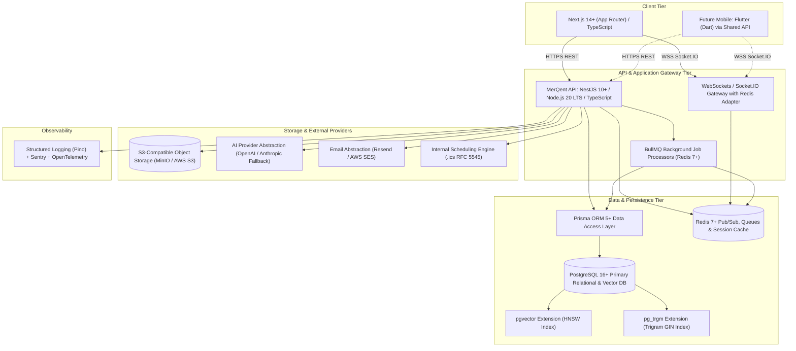

# MerQent — Technology Baseline & Stack Specification

**Document Version:** 2.0.0  
**Status:** Approved Master Architecture  
**Phase:** 1 — Master Architecture Correction  
**Author:** Lead Software Architect & Principal Engineer  

---

## 1. Executive Summary & Core Stack Blueprint

MerQent is an enterprise B2B platform connecting Private Equity firms with Post-Merger Integration (PMI) consultants. The technology stack is established on non-negotiable architectural foundations designed for reliability, modularity, type safety, grounded AI matching, and complete mobile readiness.

---

## 2. Non-Negotiable Technology Direction

The following foundational technologies represent the established, immutable baseline for MerQent:

| Layer | Established Technology | Architectural Rationale |
| :--- | :--- | :--- |
| **Frontend** | **Next.js 14+ + TypeScript** | React Server Components, SSR for public SEO, App Router modular layouts, end-to-end type safety. |
| **Backend** | **NestJS 10+ + Node.js 20 + TypeScript** | Enterprise modular monolith architecture, dependency injection, strict guards/pipes/interceptors, clean domain boundaries. |
| **Database** | **PostgreSQL 16+** | ACID relational integrity, transactional security, native JSONB, `pg_trgm` full-text, and `pgvector` HNSW vector indexes. |
| **ORM** | **Prisma 5+** | Declarative schema as single source of truth, automated migrations, type-safe client generation, raw SQL escape hatch. |
| **AI Engine** | **Hybrid AI Matching Engine** | Two-stage grounded pipeline: relational filtering + `pgvector` semantic retrieval + deterministic multi-factor scoring + LLM explainability. |
| **Realtime** | **WebSockets / Socket.IO** | Bidirectional low-latency messaging, delivery receipts, typing indicators, presence, room-based isolation, Redis cluster adapter. |
| **Authentication** | **JWT + Refresh Token Architecture** | Stateless access tokens (15m), stateful refresh token rotation with family reuse detection in PostgreSQL/Redis, Argon2id hashing. |
| **Future Mobile** | **Flutter (Dart)** | Cross-platform iOS/Android from single codebase; consumes the exact same NestJS REST and WebSocket endpoints. |
| **Version Control** | **Git + GitHub** | Trunk-based development, GitHub Actions CI/CD workflows, pull request status checks. |

---

## 3. Provider-Level Decisions & Extensibility

In accordance with architectural principles, external cloud providers remain abstracted behind interface adapters to guarantee zero vendor lock-in:

| Capability | Current Selection / Adapter | Documented ADR | Status |
| :--- | :--- | :--- | :---: |
| **AI Provider** | OpenAI (`text-embedding-3-small`, `gpt-4o-mini`) via `IAiProvider` | `ADR-006-ai.md` | Abstracted |
| **Search Engine** | Native PostgreSQL (`pg_trgm` + `pgvector`) via `ISearchProvider` | `ADR-007-search.md` | Production |
| **File Storage** | AWS S3 / MinIO via `IStorageService` | `ADR-009-storage.md` | Abstracted |
| **Email** | Resend / AWS SES via `IEmailService` | `ADR-010-email.md` | Abstracted |
| **Calendar** | Native PostgreSQL + RFC 5545 `.ics` via `ICalendarProvider` | `ADR-011-calendar.md` | Abstracted |
| **Deployment** | Multi-stage Docker containers (ECS Fargate / Cloud Run / Managed Postgres) | `ADR-012-deployment.md` | Abstracted |
| **Observability** | Pino JSON logs + Sentry APM + OpenTelemetry | `ADR-013-observability.md` | Abstracted |
| **Payments** | Deferred until commercial monetization phase requires it | N/A | Open Decision |

---

## 4. Architectural Invariants

1. **API-First & Headless**: The NestJS backend has zero knowledge of the Next.js frontend; it exposes standardized REST endpoints and Socket.IO gateways consumed equally by web and future Flutter mobile clients.
2. **Grounded AI**: The AI matching engine is strictly prohibited from hallucinating or fabricating facts, credentials, or deal histories. All explanations must cite verifiable database attributes.
3. **Data Integrity Over Speed**: Multi-entity mutations (connections, project shortlists, verification reviews) must execute within database ACID transactions.
