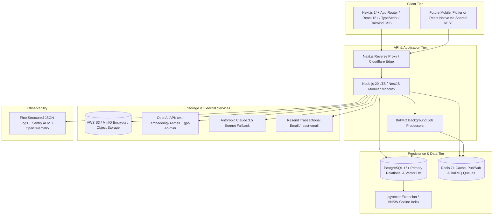

# MerQent — Final Technology Stack Specification

**Document Version:** 1.0.0  
**Status:** Canonical Decision  
**Phase:** 1.5 — Final Technology Stack Selection  
**Author:** Lead Software Architect & Principal Engineer  

---

## 1. Executive Summary & Stack Blueprint

Following the rigorous comparative evaluation in Phase 1.4 and the ratification of Architecture Decision Records (ADR-001 through ADR-010), MerQent's final production technology stack is formalized below.

The stack embodies our core engineering principles: **disciplined modularity, end-to-end type safety, unified relational/vector data integrity, explainable and grounded AI, enterprise security by design, and complete mobile readiness.**

---

## 2. Technology Stack Matrix

| Architecture Layer | Selected Technology | Version / Spec | Primary Architectural Justification | Reference ADR |
|---|---|---|---|---|
| **Frontend Framework** | **Next.js (App Router)** | 14.2+ / React 18+ | Hybrid RSC server rendering for SEO & performance; rich enterprise UI primitives with Radix & Tailwind. | [ADR-001](file:///c:/Users/Vishal%20S%20Naik/MyProjects/MerQent/docs/decisions/ADR-001-frontend-framework.md) |
| **Backend Framework** | **NestJS (Node.js)** | 10.3+ / Node 20 LTS | Enterprise DDD modular architecture, strict TypeScript, dependency injection, and auto-generated OpenAPI contracts. | [ADR-002](file:///c:/Users/Vishal%20S%20Naik/MyProjects/MerQent/docs/decisions/ADR-002-backend-framework.md) |
| **Primary Database** | **PostgreSQL** | 16.3+ | Strict ACID compliance for financial/PE records; native JSONB; unified vector storage with zero ETL lag. | [ADR-003](file:///c:/Users/Vishal%20S%20Naik/MyProjects/MerQent/docs/decisions/ADR-003-primary-database.md) |
| **Search & Discovery** | **Hybrid PostgreSQL** | `tsvector` + `pgvector` HNSW | Real-time transactional search combining exact boolean taxonomy filters with sub-20ms cosine similarity. | [ADR-004](file:///c:/Users/Vishal%20S%20Naik/MyProjects/MerQent/docs/decisions/ADR-004-search-and-vector-retrieval.md) |
| **AI Matching & Rationale** | **OpenAI + Anthropic Adapter** | `text-embedding-3-small` + `gpt-4o-mini` | Guaranteed structured JSON schemas; 1536d standard embeddings; hot-swappable Claude 3.5 Sonnet reasoning fallback. | [ADR-005](file:///c:/Users/Vishal%20S%20Naik/MyProjects/MerQent/docs/decisions/ADR-005-ai-llm-provider.md) |
| **Object Storage** | **Amazon S3 / MinIO** | S3 API v4 / SSE-KMS | Direct browser upload/download via short-lived signed URLs (TTL <= 15 min); local MinIO dev parity. | [ADR-006](file:///c:/Users/Vishal%20S%20Naik/MyProjects/MerQent/docs/decisions/ADR-006-object-storage.md) |
| **Authentication** | **Dual-Token JWT** | RS256 JWT in HttpOnly Cookies + DB Refresh Token | XSS-immune web transport; mobile Bearer token parity; instant server-side revocation capability. | [ADR-007](file:///c:/Users/Vishal%20S%20Naik/MyProjects/MerQent/docs/decisions/ADR-007-authentication-and-sessions.md) |
| **Scheduling** | **Native Scheduler + iCalendar** | RFC 5545 `.ics` via MIME Email & Web Download | Zero third-party OAuth friction; universal Outlook/Google/Apple Calendar compatibility; timezone-safe. | [ADR-008](file:///c:/Users/Vishal%20S%20Naik/MyProjects/MerQent/docs/decisions/ADR-008-calendar-and-scheduling.md) |
| **Real-Time Push** | **Server-Sent Events (SSE)** | HTTP/2 EventSource + Redis Pub/Sub | Transparent traversal of strict corporate enterprise PE firewalls; native browser auto-reconnect. | [ADR-009](file:///c:/Users/Vishal%20S%20Naik/MyProjects/MerQent/docs/decisions/ADR-009-realtime-and-event-messaging.md) |
| **Observability** | **Pino + Sentry + OpenTelemetry** | Pino 9+, Sentry Node SDK, OTel 1.2+ | High-performance JSON logging with automatic PII redaction; distributed tracing; zero vendor lock-in. | [ADR-010](file:///c:/Users/Vishal%20S%20Naik/MyProjects/MerQent/docs/decisions/ADR-010-observability-and-monitoring.md) |
| **Async Queues & Cache** | **Redis + BullMQ** | Redis 7.2+, BullMQ 5+ | Background processing for email dispatch, file virus scanning, vector embedding generation, and match calculation. | Architecture Standard |
| **Monorepo Tooling** | **Turborepo + pnpm** | Turborepo 2+, pnpm 9+ | Blazing fast cached monorepo builds; strict workspace dependency isolation. | Architecture Standard |

---

## 3. End-to-End Type Safety Guarantee

By standardizing on TypeScript across both `apps/web` and `apps/api`, MerQent achieves unified end-to-end type safety:
1. **Domain Models & Enums:** Defined once in `packages/shared-types`.
2. **Validation Schemas:** Defined using `zod` in `packages/shared-validation`, generating both client-side form validation rules and backend NestJS request validation pipes.
3. **API Contracts:** Exported via NestJS Swagger OpenAPI generator and consumed by the frontend via type-safe Fetch clients (`openapi-typescript`).
