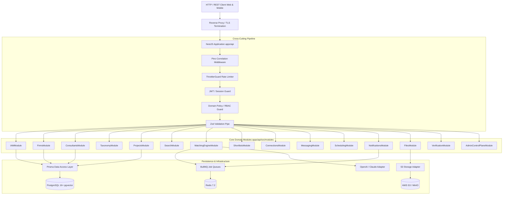

# MerQent — Backend Modular Monolith Architecture

**Document Version:** 1.0.0  
**Status:** Approved Architecture  
**Phase:** 1.7 — Backend Architecture  
**Author:** Lead Software Architect & Principal Engineer  

---

## 1. Architectural Style & Application Boundaries

MerQent's backend is architected as an enterprise **Modular Monolith** built on **NestJS 10+** (Node.js 20 LTS). This architecture balances clean domain isolation with operational simplicity:
- **Single Deployable Unit:** Zero distributed network latency or inter-service RPC serialization overhead during Phase 1-2.
- **Strict Domain Encapsulation:** Modules interact exclusively via public service interfaces or asynchronous events. Direct cross-domain database querying is strictly prohibited.
- **API-First Design:** The application exposes an OpenAPI-documented RESTful API consumed identically by the Next.js web application and future mobile clients.



---

## 2. Domain Module Catalog & Directory Structure

Every domain module in `apps/api/src/modules/<domain>` adheres to a standardized multi-tier internal structure:

```text
modules/<domain>/
├── controllers/          # HTTP request handlers (routing, status codes, OpenAPI decorators)
│   └── <domain>.controller.ts
├── services/             # Core business logic, domain rules, state transitions
│   └── <domain>.service.ts
├── repositories/         # Database persistence abstractions & queries
│   └── <domain>.repository.ts
├── dto/                  # Request & response data transfer objects (backed by Zod)
│   ├── create-<domain>.dto.ts
│   └── <domain>-response.dto.ts
├── events/               # Domain events dispatched by this module
│   └── <domain>-created.event.ts
├── policies/             # Fine-grained authorization & ownership checks
│   └── <domain>-authorization.policy.ts
└── <domain>.module.ts    # NestJS module declaration (declares providers, exports public API)
```

---

### Detailed Module Registry

| Module Name | Public Exported Service | Key Responsibilities | Primary Dependencies |
|---|---|---|---|
| **IAMModule** | `AuthService`, `TokenService` | Credential hashing (Argon2id), JWT issuance, session revocation, MFA verification. | Prisma, Config |
| **FirmsModule** | `FirmService` | PE firm organization lifecycle, membership rosters, firm authorization context. | Prisma, IAM |
| **ConsultantsModule** | `ConsultantProfileService` | Consultant profile maintenance, experience case studies, availability, skill mapping. | Prisma, Taxonomy, Files |
| **TaxonomyModule** | `TaxonomyService` | Governed PMI taxonomies (ERPs, deal types, industries), taxonomy caching. | Prisma, Redis |
| **ProjectsModule** | `ProjectService` | Project creation, requirements definition, status lifecycles, confidentiality masking. | Prisma, Firms, Taxonomy |
| **SearchModule** | `SearchService` | Faceted boolean filtering, keyword trigram search, vector similarity candidate retrieval. | Prisma (`pgvector`) |
| **MatchingModule** | `MatchingEngineService` | Project requirement normalization, composite scoring, grounded explanation synthesis. | Projects, Consultants, AIAdapter |
| **ShortlistsModule** | `ShortlistService` | Project-specific candidate shortlisting, candidate comparison matrices, private PE notes. | Prisma, Projects, Consultants |
| **ConnectionsModule** | `ConnectionService` | Handshake requests, acceptance/rejection workflows, gatekeeper for messaging/scheduling. | Prisma, Notifications, Projects |
| **MessagingModule** | `MessagingService` | Conversation threads, message serialization, read receipts, attachment linking, SSE push. | Prisma, Connections, Files, Redis |
| **SchedulingModule** | `SchedulingService` | Slot negotiation, meeting confirmation, timezone handling, RFC 5545 .ics generation. | Prisma, Connections, Notifications |
| **NotificationsModule** | `NotificationService` | Multi-channel dispatch (in-app alerts, transactional email via Resend), user preferences. | Prisma, Redis, EmailAdapter |
| **FilesModule** | `FileStorageService` | Pre-signed upload/download URLs (TTL <= 15m), MIME validation, virus scan coordination. | S3Adapter, Prisma |
| **VerificationModule** | `VerificationService` | Credential/evidence review queue, badge tier assignment, verification lifecycle. | Prisma, Files, Notifications |
| **AdminModule** | `AdminControlPlaneService` | System oversight, user moderation, taxonomy editing, low-confidence match audit. | All Modules, Prisma |

---

## 3. Cross-Cutting Infrastructure & Request Pipeline

### 3.1 Global Exception Filter & Error Contract
All unhandled exceptions and domain errors are intercepted by a global NestJS `HttpExceptionFilter`. Responses strictly follow RFC 7807 (Problem Details for HTTP APIs):

```json
{
  "statusCode": 403,
  "error": "Forbidden",
  "code": "CONNECTION_NOT_ACCEPTED",
  "message": "Direct messaging requires an active, accepted connection request.",
  "timestamp": "2026-10-07T19:30:00.000Z",
  "path": "/api/v1/conversations/3fa85f64-5717-4562-b3fc-2c963f66afa6/messages",
  "traceId": "req-9b1deb4d-3b7d-4bad-9bdd-2b0d7b3dcb6d"
}
```

### 3.2 Request Validation Pipeline
Incoming request bodies are validated using a custom `ZodValidationPipe`. Incoming JSON payloads are parsed against Zod schemas from `@merqent/shared-validation`. Invalid payloads fail fast with `422 Unprocessable Entity` containing field-level error messages.

### 3.3 Authorization & Policy Evaluation Pipeline
Authorization executes in two sequential gates:
1. **`JwtAuthGuard`:** Validates token signature, expiration, and user active status. Injects `UserContext` (`userId`, `role`, `firmId`, `consultantProfileId`) into `request.user`.
2. **`DomainPolicyGuard`:** Evaluates resource-specific policies. For example, before updating a project, the guard executes `ProjectPolicy.canUpdate(user, projectId)` verifying that the project belongs to the user's `firmId`.

### 3.4 Transaction Boundaries & Unit of Work
Mutations involving multiple aggregates (e.g., Accepting a connection → Creating a conversation → Dispatching notification) execute within a database transaction using Prisma's interactive transaction API:
```typescript
await this.prisma.$transaction(async (tx) => {
  const updatedConnection = await this.connectionRepo.markAccepted(tx, connectionId);
  const conversation = await this.conversationRepo.create(tx, updatedConnection.id);
  await this.notificationRepo.create(tx, { ... });
});
```

---

## 4. Background Job Processing (BullMQ & Redis)

Long-running or computationally intensive tasks are decoupled from synchronous HTTP request threads and processed asynchronously via **BullMQ**:

| Queue Name | Worker Responsibility | Retry Strategy | Dead Letter Queue |
|---|---|---|---|
| `ai-matching-queue` | Ingests new projects, generates embeddings, ranks candidate pool, synthesizes explanations. | 3 retries, exponential backoff (2s, 8s, 32s) | `ai-matching-dlq` |
| `email-dispatch-queue` | Renders React Email templates, dispatches via Resend API, tracks delivery status. | 5 retries, exponential backoff (5s to 5min) | `email-dispatch-dlq` |
| `file-scan-queue` | Downloads newly uploaded S3 file, scans for malware/viruses, updates `FileRecord.scanStatus`. | 2 retries | `file-scan-dlq` |
| `search-index-queue` | Rebuilds `tsvector` and `pgvector` embeddings when consultant profiles are updated. | 3 retries | `search-index-dlq` |

---

## 5. Asynchronous Event Dispatch & SSE Streaming

- **Domain Events:** Dispatched internally via NestJS `EventEmitter2` (e.g., `eventEmitter.emit('connection.accepted', event)`).
- **Cross-Pod Fanout:** Distributed across API server instances via Redis Pub/Sub.
- **Server-Sent Events (SSE):** Clients establish a single persistent stream connection (`GET /api/v1/events/stream`). NestJS maps Redis Pub/Sub events for the authenticated `userId` to the SSE stream using RxJS observables.
