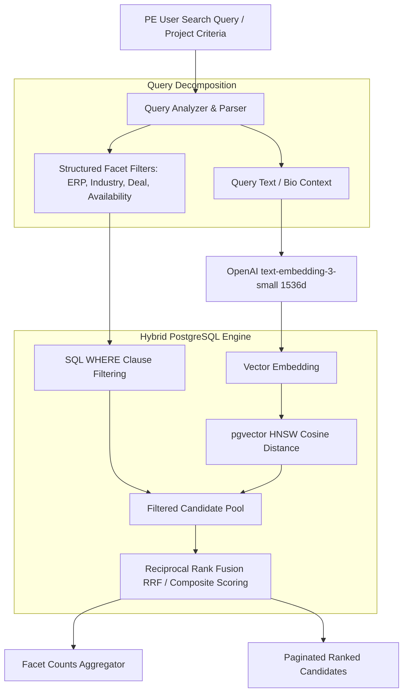
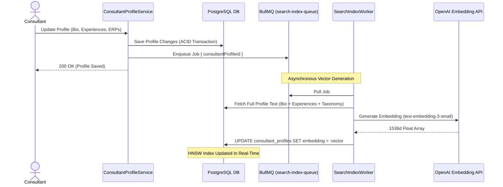

# MerQent — Hybrid Search & Discovery Architecture

**Document Version:** 1.0.0  
**Status:** Approved Architecture  
**Phase:** 1.10 — Search Architecture  
**Author:** Lead Software Architect & AI System Architect  

---

## 1. Architectural Overview & Search Pipeline

Consultant discovery in MerQent is not a generic keyword search; it is a **Hybrid Retrieval System** that bridges two complementary discovery modalities:
1. **Deterministic Structured Filtering:** Strict boolean logic on PMI taxonomy entities (ERP systems, deal archetypes, industries, verification tiers, availability, geography).
2. **Semantic Vector Retrieval:** Dense vector cosine similarity evaluating contextual relevance between natural-language project descriptions and consultant bios/case studies.



---

## 2. Ingestion & Indexing Synchronization Pipeline

To ensure 100% search index freshness without dual-write lag or fragile ETL pipelines, indexing is embedded in the PostgreSQL persistence lifecycle and asynchronous background queues:



### 2.1 Profile Text Document Representation
Before vectorization, the consultant profile is normalized into a dense semantic document:
```text
Role: [PrimaryRoleType]
Headline: [Headline]
PMI Experience: [Years] years
Specialized ERPs: [List of ERP Taxonomy Names]
Target Deal Types: [List of Deal Archetypes]
Industries: [List of Industries]
Bio: [Consultant Bio]
Past Engagements:
- [Role] during [DealContextMasked]: [Description]. Unified [SourceERP] to [TargetERP].
```
This structured document representation ensures that embeddings capture both high-level credentials and granular technical ERP/COA integration nuances.

---

## 3. Hybrid Query Execution & Scoring Mechanics

### 3.1 Composite Score Formulation
When a search query includes both structured filters and a text/embedding query, candidate ranking uses **Reciprocal Rank Fusion (RRF)** combined with weighted feature boosts:

$$\text{FinalScore} = w_{\text{vector}} \cdot S_{\text{vector}} + w_{\text{text}} \cdot S_{\text{bm25}} + w_{\text{tier}} \cdot B_{\text{tier}} + w_{\text{avail}} \cdot B_{\text{avail}}$$

Where:
- $S_{\text{vector}} = 1 - \text{cosine\_distance}(\mathbf{v}_{\text{query}}, \mathbf{v}_{\text{profile}})$ (Normalized 0.0 to 1.0)
- $S_{\text{bm25}}$: Full-text relevance score via `ts_rank_cd`
- $B_{\text{tier}}$: Verification tier boost (Tier 3: +0.15, Tier 2: +0.10, Tier 1: +0.05, Tier 0: 0.0)
- $B_{\text{avail}}$: Immediate availability boost (+0.10)
- Default weights: $w_{\text{vector}} = 0.60$, $w_{\text{text}} = 0.20$, $w_{\text{tier}} = 0.10$, $w_{\text{avail}} = 0.10$

### 3.2 SQL Hybrid Query Construction
```sql
WITH filtered_candidates AS (
  SELECT 
    cp.id,
    cp.user_id,
    cp.headline,
    cp.bio,
    cp.years_pmi_experience,
    cp.availability_status,
    cp.verification_tier,
    1 - (cp.embedding <=> $1::vector) AS vector_similarity,
    ts_rank_cd(to_tsvector('english', cp.headline || ' ' || cp.bio), plainto_tsquery('english', $2)) AS text_rank
  FROM consultant_profiles cp
  WHERE cp.is_published = true
    -- Strict Boolean Facet Filters
    AND ($3::availability_status IS NULL OR cp.availability_status = $3)
    AND ($4::int IS NULL OR cp.years_pmi_experience >= $4)
    AND ($5::uuid[] IS NULL OR EXISTS (
      SELECT 1 FROM consultant_taxonomies ct 
      WHERE ct.consultant_profile_id = cp.id 
        AND ct.taxonomy_term_id = ANY($5::uuid[])
    ))
)
SELECT 
  fc.*,
  (0.60 * COALESCE(fc.vector_similarity, 0) + 
   0.20 * COALESCE(fc.text_rank, 0) + 
   CASE fc.verification_tier 
     WHEN 'TIER_3_REFERENCE_VERIFIED' THEN 0.15 
     WHEN 'TIER_2_CREDENTIAL_VERIFIED' THEN 0.10 
     WHEN 'TIER_1_EMAIL_VERIFIED' THEN 0.05 
     ELSE 0.0 
   END +
   CASE fc.availability_status 
     WHEN 'IMMEDIATELY_AVAILABLE' THEN 0.10 
     ELSE 0.0 
   END) AS composite_score
FROM filtered_candidates fc
ORDER BY composite_score DESC
LIMIT $6 OFFSET $7;
```

---

## 4. Faceting & Aggregation Architecture

To render real-time facet counts on the frontend discovery sidebar (e.g., `SAP S/4HANA (42)`, `Carve-Out (28)`), the search engine performs optimized aggregation CTEs:
- Facet queries reuse the active candidate filter conditions to display dynamic counts reflecting current selections.
- Frequently queried facet aggregations are cached in Redis with a 5-minute TTL.

---

## 5. Failure Handling & Degradation Strategy

1. **AI Embedding API Outage:** If the OpenAI API is unreachable or times out, the search engine gracefully degrades to **Pure Structured + Trigram Full-Text Search**. Results are served with an informational badge: *"Displaying exact keyword and filter matches."*
2. **Missing Embedding:** If a newly registered consultant has not yet had their embedding computed by the background queue, they remain fully discoverable via structured taxonomy filters and keyword queries.
3. **Queue Retries & DLQ:** If embedding generation fails, BullMQ executes exponential backoff retries (3 attempts). Failed jobs route to `search-index-dlq` and alert administrators.
