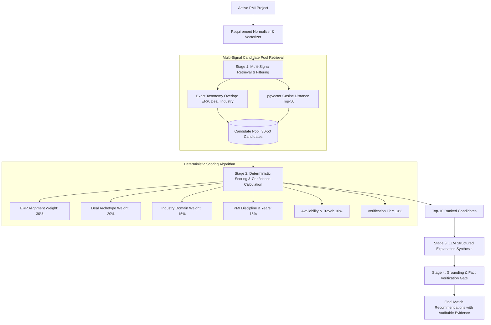

# MerQent — AI Matching Engine Architecture

**Document Version:** 1.0.0  
**Status:** Approved Architecture  
**Phase:** 1.11 — AI Matching Architecture  
**Author:** AI System Architect & Principal Engineer  

---

## 1. Engine Philosophy & Anti-Hallucination Guarantees

The MerQent Matching Engine is engineered around a core principle: **Predictive Assistance with Absolute Grounding**. In private equity and M&A integration, recommending an unqualified consultant or inventing past deal credentials destroys client trust and introduces severe operational liability.

Therefore, the matching engine enforces four architectural constraints:
1. **Deterministic Candidate Filtering (Stage 1):** The initial candidate pool is retrieved using exact database taxonomy matches and vector cosine similarity. The LLM does not search the entire universe or invent candidate IDs.
2. **Deterministic Composite Scoring (Stage 2):** Quantitative match scores (0-100%) and confidence ratings are calculated using deterministic mathematical algorithms based on verified signals, not arbitrary LLM output.
3. **Structured Explanation Generation (Stage 3):** An LLM is utilized exclusively to synthesize human-readable rationales under strict JSON schema enforcement (`json_schema`), where every factual claim is cross-referenced against profile records.
4. **Anti-Hallucination Evidence Linkage (Stage 4):** Any assertion made in an explanation must bind to a verified `sourceEntityId` in the database. Claims failing validation are stripped before delivery.



---

## 2. Multi-Signal Weighting & Scoring Formula

The quantitative **Match Score ($M$)** (scaled 0 to 100) is deterministically computed across six orthogonal PMI dimensions:

$$M = 100 \times \left( w_{\text{erp}} S_{\text{erp}} + w_{\text{deal}} S_{\text{deal}} + w_{\text{ind}} S_{\text{ind}} + w_{\text{pmi}} S_{\text{pmi}} + w_{\text{avail}} S_{\text{avail}} + w_{\text{verif}} S_{\text{verif}} \right)$$

### Dimension Specifications & Weights:
1. **ERP Alignment ($w_{\text{erp}} = 0.30$):**
   - Exact match on Target ERP + Source ERP: $1.0$
   - Exact match on Target ERP only: $0.8$
   - Compatible ERP family (e.g., SAP ECC to S/4HANA): $0.6$
   - No ERP overlap: $0.0$
2. **Deal Archetype Alignment ($w_{\text{deal}} = 0.20$):**
   - Exact match on Deal Type (e.g., Carve-Out with TSA wind-down): $1.0$
   - Related M&A integration experience: $0.6$
   - No direct deal match: $0.2$
3. **Industry Alignment ($w_{\text{ind}} = 0.15$):**
   - Exact industry match (e.g., Industrial Manufacturing): $1.0$
   - Adjacent industry (e.g., Automotive Supply): $0.7$
   - Cross-industry transferable: $0.3$
4. **PMI Discipline & Experience ($w_{\text{pmi}} = 0.15$):**
   - Evaluated by years of dedicated PMI experience ($> 10\text{ yrs} = 1.0$, $5\text{--}10\text{ yrs} = 0.8$, $< 5\text{ yrs} = 0.5$) and functional discipline alignment (Finance/IT/HR).
5. **Availability & Geography ($w_{\text{avail}} = 0.10$):**
   - Immediately available + travel willingness >= project required travel: $1.0$
   - Available within 30 days: $0.7$
   - Booked: $0.1$
6. **Verification Quality Tier ($w_{\text{verif}} = 0.10$):**
   - Tier 3 (Reference Verified): $1.0$
   - Tier 2 (Credential Verified): $0.8$
   - Tier 1 (Email/ID Verified): $0.5$
   - Tier 0 (Unverified): $0.2$

---

## 3. Confidence Rating & Low-Confidence Review Gating

The engine computes a **Confidence Score ($C$)** measuring data completeness:
- **High Confidence ($C \ge 80\%$):** Candidate possesses verified experience covering all mandatory project requirements.
- **Moderate Confidence ($60\% \le C < 80\%$):** Candidate strongly matches core ERP requirements, but certain deal or industry points are inferred from related case studies.
- **Low Confidence ($C < 60\%$):** Significant requirements are unverified or self-attested without supporting evidence.
  - **Platform Invariant:** Matches with $C < 60\%$ are flagged with `isLowConfidence = true`, tagged with an alert badge in the UI, and routed to the administrative AI audit queue for evaluation.

---

## 4. LLM Invocation & Structured Schema Contract

Once the top 10 candidates are selected, the explanation synthesizer invokes OpenAI `gpt-4o-mini` using **Strict Structured Outputs**:

### 4.1 System Prompt Governance
```text
You are the MerQent PMI Matching Engine.
Your task is to synthesize an objective, professional explanation of why the supplied 
candidate was matched to the specified PE integration project.

STRICT INTEGRITY RULES:
1. ONLY reference facts explicitly present in the candidate profile (experiences, ERPs, certifications).
2. DO NOT extrapolate deal values, revenue impact, or employer names not in the context.
3. If an experience point is not verified, note it as "self-reported".
4. Output strictly according to the provided JSON schema.
```

### 4.2 Structured Output Schema
```json
{
  "type": "object",
  "properties": {
    "summary": { "type": "string" },
    "groundedEvidence": {
      "type": "array",
      "items": {
        "type": "object",
        "properties": {
          "category": { 
            "type": "string", 
            "enum": ["ERP_EXPERIENCE", "DEAL_TYPE", "INDUSTRY", "PMI_DISCIPLINE", "AVAILABILITY"] 
          },
          "claim": { "type": "string" },
          "sourceEntityId": { "type": "string" },
          "sourceEntityType": { 
            "type": "string", 
            "enum": ["CONSULTANT_EXPERIENCE", "CONSULTANT_TAXONOMY", "CONSULTANT_CERTIFICATION"] 
          }
        },
        "required": ["category", "claim", "sourceEntityId", "sourceEntityType"],
        "additionalProperties": false
      }
    }
  },
  "required": ["summary", "groundedEvidence"],
  "additionalProperties": false
}
```

---

## 5. Caching, Rate Limiting & Cost Control

1. **Embedding Cache:** Profile embeddings and project requirement embeddings are cached in Redis keyed by MD5 hash of their normalized text.
2. **Match Invalidation:** Matches for a project are calculated on project creation/publication and cached in `project_matches`. Recalculation is triggered only when:
   - Project requirements are updated.
   - An administrator or firm user clicks "Refresh Recommendations" (rate-limited to 1 request per 15 minutes per project).
3. **Cost Ceiling:** By restricting LLM inference to top-10 candidates with concise prompt context, each match run consumes < 12,000 tokens ($0.002 per project matching run).
