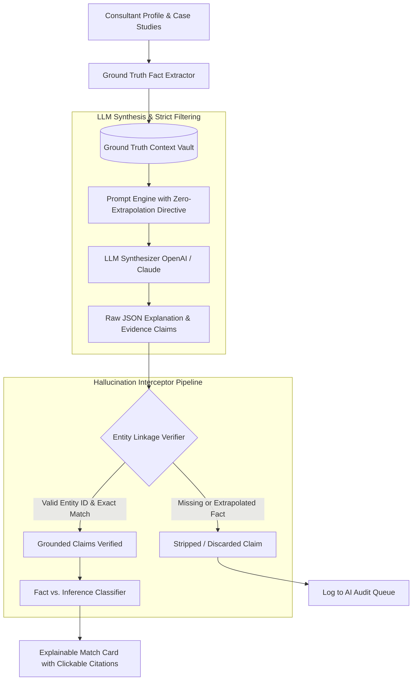
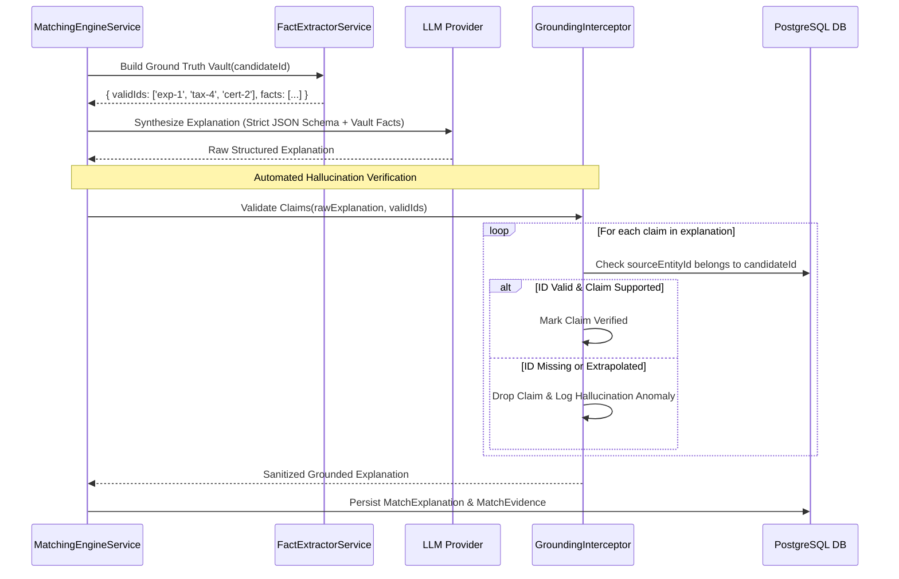

# MerQent — Explainable AI & Anti-Hallucination Architecture

**Document Version:** 1.0.0  
**Status:** Approved Architecture  
**Phase:** 1.12 — Explainable AI Architecture  
**Author:** AI System Architect & Security Architect  

---

## 1. Architectural Mandate: Grounded Traceability

Private equity decision-makers demand **auditability, evidence, and clear justification**. An opaque match score like *"92% Match"* is insufficient for multimillion-dollar M&A integration engagements. PE partners must know:
- *Why* was this operator selected over others?
- *Which* specific ERP systems did they integrate, and in *what* capacity?
- *What* evidence supports their claim of carve-out experience?

MerQent's **Explainable AI (XAI) Architecture** enforces complete provenance: every recommendation point must be grounded in an immutable, verified database record.



---

## 2. Ground Truth Fact Representation

Before generating explanations, the backend extracts a strictly bounded **Fact Vault** from the candidate's relational records:
- **Verified Taxonomy Terms:** Explicit list of UUIDs and standardized names (`ERP_SAP_S4HANA`, `DEAL_CARVEOUT`, `IND_MANUFACTURING`).
- **Experience Entities:** Collection of `ConsultantExperience` IDs, roles, masked deal contexts, systems unified, and durations.
- **Certifications:** Credential names, issuing bodies, and verification statuses.

No external web searches, unverified claims, or ambient training memories are injected into the prompt context.

---

## 3. The 4-Stage Hallucination Protection Pipeline



### Stage 1: Context Isolation
The LLM is prompted with a strictly numbered set of verified facts. It is explicitly prohibited from introducing entities, dates, dollar amounts, or company names not included in the provided prompt context.

### Stage 2: Strict JSON Schema Enforcement
The LLM output is governed by OpenAI's JSON Schema validator. Parsing is guaranteed; hallucinated keys or non-conforming types are rejected at the API boundary.

### Stage 3: Grounding Interceptor & Entity Reference Check
The `GroundingInterceptor` parses every item in `groundedEvidence`:
1. It validates that `sourceEntityId` exists in the database.
2. It validates that `sourceEntityId` belongs to the specific candidate being evaluated.
3. If the LLM generates a claim with an invalid ID, a null ID, or references another user's data, the claim is **immediately stripped**.

### Stage 4: Fact vs. Inference Categorization
Every explanation item is explicitly categorized into one of two visual presentations:
- **`VERIFIED FACT` (Green Badge):** Grounded in a Tier 2 or Tier 3 verified credential, confirmed reference, or audited work history.
- **`SELF-REPORTED CLAIM` (Blue Badge):** Documented by the consultant in their profile, but pending third-party verification.
- Inferred relevance (e.g., "Experience with SAP ECC implies familiarity with legacy ledger migrations") is explicitly badged as **`AI INFERENCE` (Purple Badge)** and never masqueraded as a verified historical fact.

---

## 4. UI Presentation: The Explainable Match Card

On the MerQent web interface, the PE user sees an interactive, auditable breakdown:

```text
┌────────────────────────────────────────────────────────────────────────┐
│ MATCH SCORE: 94%   CONFIDENCE: HIGH (Verified Operator)               │
├────────────────────────────────────────────────────────────────────────┤
│ Why this operator was recommended for Project Apex:                    │
│                                                                        │
│ [VERIFIED FACT] SAP S/4HANA Carve-Out Experience                      │
│ Led financial ledger split for $1.2B industrial supplier under a       │
│ 90-day TSA. (Engagement: Carve-Out Lead, 2021-2023) [View Evidence ↗] │
│                                                                        │
│ [VERIFIED FACT] Chart-of-Accounts (COA) Alignment                      │
│ Certified CPA with documented experience harmonizing multi-entity      │
│ US GAAP ledgers into SAP S/4HANA. [Credential: CPA-94812 ↗]            │
│                                                                        │
│ [SELF-REPORTED] Automotive & Heavy Manufacturing Domain                │
│ 8 years operating inside Tier-1 automotive manufacturing plants.        │
│                                                                        │
│ [AI INFERENCE] Relevant TSA Wind-Down Familiarity                      │
│ Candidate's prior carve-out work included managing transition service  │
│ schedules with corporate parents.                                      │
└────────────────────────────────────────────────────────────────────────┘
```

Clicking `[View Evidence ↗]` opens a modal displaying the exact redacted case study, credential verification timestamp, or administrative verification note, guaranteeing 100% transparency.
