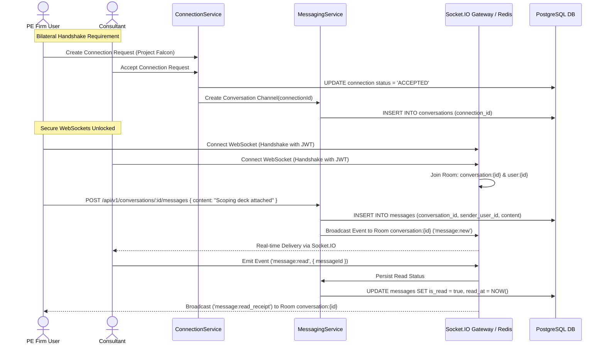

# MerQent — Secure In-Platform Messaging Architecture

**Document Version:** 2.0.0  
**Status:** Approved Master Architecture  
**Phase:** 1 — Master Architecture Correction  
**Author:** Lead Software Architect & Security Architect  

---

## 1. Architectural Philosophy & Connection Gating Invariant

In MerQent, messaging is not an open, unmoderated social network chat. It is a **Confidential B2B Scoping Channel** between Private Equity deal teams and vetted PMI operators. 

To eliminate spam, unsolicited outreach, and unauthorized project disclosures, the platform enforces an absolute architectural invariant:

$$\text{CanCommunicate}(\text{user}_A, \text{user}_B) \iff \exists\, \text{Connection}(\text{firm}, \text{consultant}, \text{project}) \text{ where } \text{status} = \mathbf{ACCEPTED}$$

Any attempt to read, query, or post messages to a conversation where the underlying connection is not in `ACCEPTED` state fails with `403 Forbidden` (`CONNECTION_NOT_ACCEPTED`).

---

## 2. Conversation & Message Lifecycle Entities

- **`Conversation`:** 1-to-1 aggregate bound to a unique `connectionId`. Contains participants: authorized team members of the sponsoring `Firm` and the connected `Consultant`.
- **`Message`:** Immutable record containing text content, sender ID, timestamp, and read status. Deleting or editing sent messages is prohibited to preserve an unalterable commercial record.
- **`MessageAttachment`:** Links to a secure `FileRecord` stored in S3. Pre-signed download URLs are issued only after confirming caller membership in the conversation.

---

## 3. Real-Time Delivery & Socket.IO Architecture

Messaging utilizes **WebSockets powered by Socket.IO** backed by the **`@socket.io/redis-adapter`** (as ratified in `ADR-008-realtime.md`):

1. **Client Sending & Persistence**:
   - Clients submit new messages via authenticated REST endpoint: `POST /api/v1/conversations/:id/messages`.
   - REST guarantees transactional persistence in PostgreSQL, file attachment verification, and content validation before emitting events.
2. **Real-time Event Broadcasting**:
   - Once persisted, the NestJS `MessagingService` broadcasts the message payload to the Socket.IO room `conversation:{id}`.
   - The recipient's active socket instantly receives the `message:new` event.
   - If the recipient is offline, the message is safely queued in PostgreSQL, and an email notification is dispatched via BullMQ.
3. **Typing Indicators & Ephemeral Presence**:
   - WebSockets support low-latency client-emitted events: `typing:start` and `typing:stop` sent directly through the socket connection to room peers without hitting the database.
4. **Horizontal Scaling**:
   - The `@socket.io/redis-adapter` enables multiple NestJS API instances to fan out room events seamlessly across server clusters.

---

## 4. End-to-End Security & Access Control

- **Handshake Authentication**: The Socket.IO gateway authenticates every connection attempt using the client's JWT access token passed in `handshake.auth.token`.
- **Room Authorization**: Clients can only join `conversation:{id}` rooms where their `userId` is an authorized participant.
- **Anti-Tampering**: Timestamps and sender identities are generated server-side.
- **Auditability**: All message creation events and attachment accesses are logged with user ID, IP address, and timestamp.
