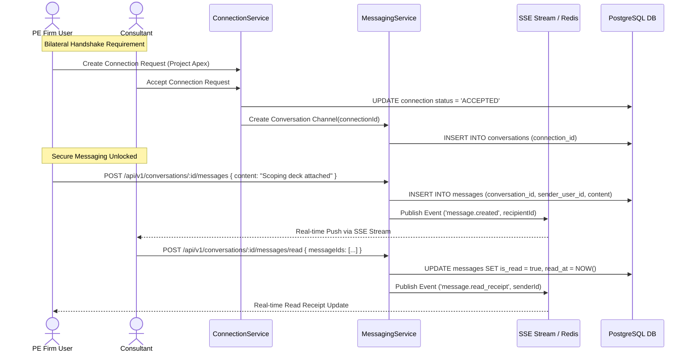

# MerQent — Secure In-Platform Messaging Architecture

**Document Version:** 1.0.0  
**Status:** Approved Architecture  
**Phase:** 1.13 — Messaging Architecture  
**Author:** Lead Software Architect & Security Architect  

---

## 1. Architectural Philosophy & Connection Gating Invariant

In MerQent, messaging is not an open, unmoderated social network chat. It is a **Confidential B2B Scoping Channel** between Private Equity deal teams and vetted PMI operators. 

To eliminate spam, unsolicited outreach, and unauthorized project disclosures, the platform enforces an absolute architectural invariant:

$$\text{CanCommunicate}(\text{user}_A, \text{user}_B) \iff \exists\, \text{Connection}(\text{firm}, \text{consultant}, \text{project}) \text{ where } \text{status} = \mathbf{ACCEPTED}$$

Any attempt to read, query, or post messages to a conversation where the underlying connection is not in `ACCEPTED` state fails with `403 Forbidden` (`CONNECTION_NOT_ACCEPTED`).



---

## 2. Conversation & Message Lifecycle Entities

- **`Conversation`:** 1-to-1 aggregate bound to a unique `connectionId`. Contains participants: authorized team members of the sponsoring `Firm` and the connected `Consultant`.
- **`Message`:** Immutable record containing text content, sender ID, timestamp, and read status. Deleting or editing sent messages is prohibited to preserve an unalterable commercial record.
- **`MessageAttachment`:** Links to a secure `FileRecord` stored in S3. Pre-signed download URLs are issued only after confirming caller membership in the conversation.

---

## 3. Real-Time Delivery & Event Architecture

Messaging uses **Server-Sent Events (SSE)** over HTTP/2 combined with **Redis Pub/Sub** (as ratified in ADR-009):
1. **Client Sending:** Clients dispatch messages via standard authenticated REST calls (`POST /api/v1/conversations/:id/messages`).
2. **Server-Side Fanout:** The NestJS `MessagingService` persists the message to PostgreSQL, updates `lastMessageAt`, and publishes a lightweight event payload to Redis:
   ```json
   {
     "event": "message.created",
     "conversationId": "3fa85f64-5717-4562-b3fc-2c963f66afa6",
     "messageId": "9b1deb4d-3b7d-4bad-9bdd-2b0d7b3dcb6d",
     "senderUserId": "a1b2c3d4-e5f6-7890-abcd-ef1234567890",
     "senderName": "Sarah Jenkins (Operating Partner)",
     "snippet": "We have finalized the carve-out milestones...",
     "createdAt": "2026-10-07T19:35:00.000Z"
   }
   ```
3. **Client Stream Ingestion:** Connected recipients subscribed to `GET /api/v1/events/stream` receive the event instantly, triggering localized TanStack Query cache updates.
4. **Offline Fallback:** If the recipient does not have an active SSE connection, an asynchronous BullMQ worker queues a notification email dispatched after a 5-minute inactivity window.

---

## 4. Cursor-Based Pagination & Ordering

To ensure sub-50ms query latency regardless of conversation length, message history uses **Cursor-Based Pagination** indexed on `(conversation_id, created_at DESC)`:

```sql
SELECT 
  m.id, m.sender_user_id, m.content, m.is_read, m.read_at, m.created_at,
  COALESCE(json_agg(ma.*) FILTER (WHERE ma.id IS NOT NULL), '[]') AS attachments
FROM messages m
LEFT JOIN message_attachments ma ON ma.message_id = m.id
WHERE m.conversation_id = $1
  AND ($2::timestamptz IS NULL OR m.created_at < $2) -- Cursor
ORDER BY m.created_at DESC
LIMIT 50;
```

---

## 5. Security, Moderation & Audit Controls

1. **Anti-Harassment & Moderation:** Users can click "Report Conversation" on any active thread. Flagged threads are routed to the `VERIFICATION_REVIEWER` and `PLATFORM_ADMIN` queue with contextual snapshots.
2. **Break-Glass Audit Inspection:** Direct inspection of message contents by platform administrators is blocked by default and requires a formal break-glass audit ticket logging the exact reason, timestamp, and administrator user ID.
3. **Data Retention:** Messages are retained for the duration of the firm's active subscription + 7 years to meet standard M&A transaction recordkeeping requirements.
