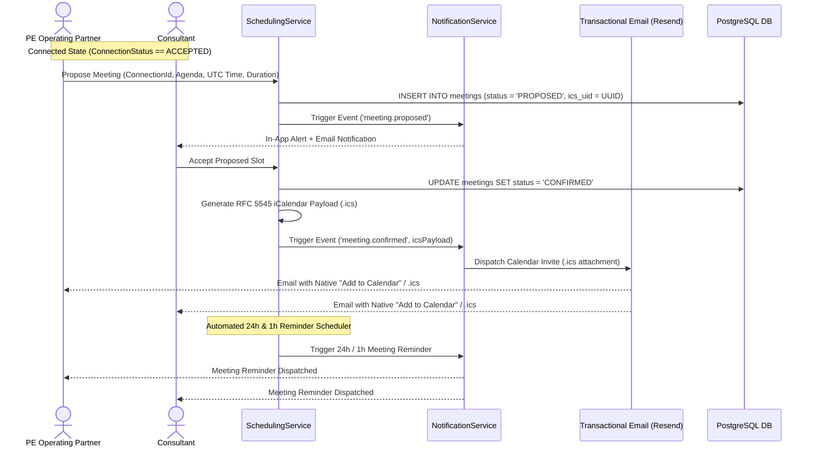

# MerQent — Scheduling & Calendar Architecture

**Document Version:** 1.0.0  
**Status:** Approved Architecture  
**Phase:** 1.14 — Scheduling Architecture  
**Author:** Lead Software Architect & Principal Engineer  

---

## 1. Architectural Strategy & Calendar Boundary

Scheduling in MerQent coordinates introductory discussions, technical diligence interviews, and scoping reviews between Private Equity operating teams and PMI consultants across divergent global time zones.

In accordance with **ADR-008**, MerQent implements a **Platform-Native Scheduler with RFC 5545 iCalendar (`.ics`) Integration**:
- Eliminates third-party OAuth compliance hurdles (Google Workspace Security Assessments, Microsoft Entra Publisher verification).
- Protects executive privacy by avoiding read/write access to external executive calendars.
- Produces universal, cryptographically signed `.ics` payloads natively recognized by Google Calendar, Outlook, and Apple Mail.
- Implements the same connection gating invariant as messaging: meetings can only be scheduled within an `ACCEPTED` connection.



---

## 2. Timezone Normalization & Storage Architecture

Timezone discrepancies represent a major source of missed B2B meetings. MerQent enforces strict temporal rules:
1. **Universal UTC Storage:** In the database, all timestamps (`start_time`, `end_time`) are stored in `TIMESTAMPTZ` (UTC).
2. **Explicit IANA Timezone Tracking:** The initiator's and participant's local IANA timezones (e.g., `America/New_York`, `Europe/London`, `Asia/Tokyo`) are captured and stored in the meeting metadata.
3. **Client-Side Rendering:** The frontend converts UTC database timestamps into the browser's active local timezone using `Intl.DateTimeFormat`, displaying both local time and counterparty local time to prevent scheduling confusion:
   > *"Scheduled for: Thursday, Oct 15, 2:00 PM EDT (11:00 AM PDT for Consultant)"*

---

## 3. RFC 5545 iCalendar Specification

Upon meeting confirmation or rescheduling, MerQent generates an RFC 5545 compliant `.ics` payload:

```text
BEGIN:VCALENDAR
VERSION:2.0
PRODID:-//MerQent Inc//MerQent Scheduler 1.0//EN
CALSCALE:GREGORIAN
METHOD:REQUEST
BEGIN:VEVENT
UID:ics-3fa85f64-5717-4562-b3fc-2c963f66afa6@merqent.com
DTSTAMP:20261007T193500Z
ORGANIZER;CN="Sarah Jenkins (Operating Partner)":mailto:notifications@merqent.com
ATTENDEE;CUTYPE=INDIVIDUAL;ROLE=REQ-PARTICIPANT;PARTSTAT=ACCEPTED;CN="David Vance (PMI Operator)":mailto:david.vance@example.com
DTSTART:20261015T180000Z
DTEND:20261015T184500Z
SUMMARY:MerQent: Project Apex - SAP S/4HANA Carve-Out Alignment
DESCRIPTION:Introductory scoping discussion between Summit Capital and David Vance regarding SAP S/4HANA manufacturing carve-out execution.\n\nMeeting link: https://merqent.com/scheduling/3fa85f64
LOCATION:https://merqent.com/scheduling/3fa85f64
STATUS:CONFIRMED
SEQUENCE:0
BEGIN:VALARM
TRIGGER:-PT15M
ACTION:DISPLAY
DESCRIPTION:Reminder: MerQent PMI Scoping Call
END:VALARM
END:VEVENT
END:VCALENDAR
```

---

## 4. Lifecycle States & Conflict Handling

A meeting progresses through strict lifecycle states:
- `PROPOSED`: One party submits time slot options; awaiting counterparty response.
- `CONFIRMED`: Counterparty accepts a slot; `.ics` dispatched, calendar locks slot.
- `RESCHEDULED`: Either party proposes new slots; increments `SEQUENCE` counter in `.ics`.
- `CANCELED`: Meeting called off; dispatches `.ics` with `METHOD:CANCEL` to purge the calendar event.
- `COMPLETED`: Automated status transition occurring 2 hours after `end_time`.

### Conflict Prevention Invariant:
A user cannot confirm overlapping meetings. When proposing slots, the backend queries `meetings` checking:
```sql
SELECT 1 FROM meetings 
WHERE status IN ('PROPOSED', 'CONFIRMED')
  AND (connection_id IN (SELECT id FROM connections WHERE firm_id = $1 OR consultant_profile_id = $2))
  AND ($3 < end_time AND $4 > start_time);
```

---

## 5. Automated Reminders Architecture

The reminder pipeline is executed via BullMQ scheduled delayed jobs:
1. Upon meeting confirmation, two delayed jobs are added to the queue:
   - **24-Hour Reminder:** `start_time - 24 hours`
   - **1-Hour Reminder:** `start_time - 1 hour`
2. When the job fires, it verifies the meeting has not been `CANCELED` or `RESCHEDULED` before dispatching in-app alerts and email reminders.
3. If a meeting is rescheduled, previous reminder jobs are canceled and rescheduled to the new temporal window.
