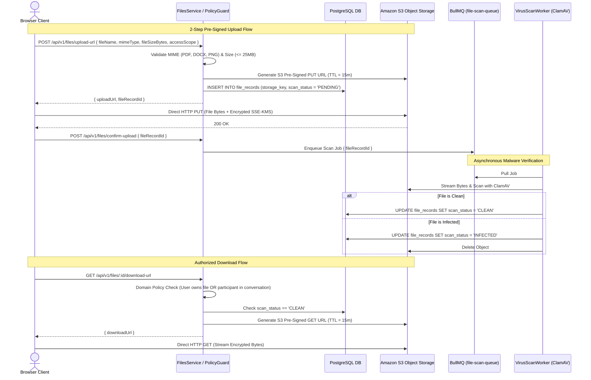

# MerQent — File & Document Storage Architecture

**Document Version:** 1.0.0  
**Status:** Approved Architecture  
**Phase:** 1.16 — File & Document Architecture  
**Author:** Security Architect & Lead Software Architect  

---

## 1. Architectural Philosophy: Zero-Proxy Signed Storage

MerQent processes sensitive, high-value documents: consultant resumes, verified professional certifications, redacted M&A employment agreements, PE project scoping decks, and confidential message attachments.

To prevent server CPU saturation, memory exhaustion, and potential denial-of-service vulnerabilities, the platform enforces a **Zero-Proxy Signed URL Architecture**:
1. **Direct Browser Uploads:** Clients upload files directly to S3 via time-limited, pre-signed `PUT` URLs generated by the backend API.
2. **Authorized Direct Downloads:** Clients download files directly from S3 via time-limited, pre-signed `GET` URLs (TTL <= 15 minutes) issued only after domain policy verification.
3. **Zero Public Bucket Access:** Public read and listing permissions on S3 buckets are completely disabled (`BlockPublicAcls = true`, `BlockPublicPolicy = true`).
4. **Mandatory Virus & Malware Verification:** Uploaded files remain in `scan_status = 'PENDING'` until verified clean by an automated scanning pipeline.

---

## 2. File Metadata Specification (`FileRecord`)

All physical files stored in S3 are tracked in the PostgreSQL `file_records` table:

| Column | Type | Description | Security Constraint |
|---|---|---|---|
| `id` | `UUID` | Primary Key | Random UUIDv4 |
| `storage_key` | `VARCHAR(255)` | S3 Object Key | `vault/{scope}/{uuid}.enc` (never original filename) |
| `original_file_name` | `VARCHAR(255)` | Client filename | Sanitized against directory traversal (`../`) |
| `mime_type` | `VARCHAR(100)` | Content type | Strictly validated against allowed MIME whitelist |
| `file_size_bytes` | `INTEGER` | Byte length | Max 26,214,400 bytes (25 MB) |
| `checksum_sha256` | `VARCHAR(64)` | Integrity hash | Cryptographic SHA-256 checksum |
| `scan_status` | `ENUM` | `PENDING`, `CLEAN`, `INFECTED` | Downloads rejected if not `CLEAN` |
| `owner_user_id` | `UUID` | Creator ID | Foreign key to `users(id)` |
| `access_scope` | `ENUM` | Scope category | Governs domain policy authorization |

---

## 3. Allowed MIME Whitelist & Validation Rules

To prevent executable file uploads and script injection, the backend rejects any upload request outside the strict MIME whitelist:

| Document Category | Permitted MIME Types | Max Size | Allowed Extensions |
|---|---|:---:|---|
| **Resumes & Case Studies** | `application/pdf`, `application/vnd.openxmlformats-officedocument.wordprocessingml.document` | 15 MB | `.pdf`, `.docx` |
| **Verification Evidence** | `application/pdf`, `image/png`, `image/jpeg` | 25 MB | `.pdf`, `.png`, `.jpg`, `.jpeg` |
| **Project Briefs** | `application/pdf`, `application/vnd.openxmlformats-officedocument.wordprocessingml.document`, `application/vnd.ms-excel` | 25 MB | `.pdf`, `.docx`, `.xlsx` |
| **Chat Attachments** | `application/pdf`, `image/png`, `image/jpeg`, `text/plain` | 15 MB | `.pdf`, `.png`, `.jpg`, `.txt` |

---

## 4. Encryption & Retention Architecture

1. **Encryption at Rest:** All objects stored in S3 are encrypted using **Server-Side Encryption with AWS Key Management Service (SSE-KMS)** (`aws:kms`). Dedicated customer-managed encryption keys (CMK) rotate automatically every 365 days.
2. **Encryption in Transit:** All connections to S3 require TLS 1.3 with modern cipher suites. Insecure HTTP connections are denied via S3 bucket policy (`aws:SecureTransport = true`).
3. **Secure Deletion Lifecycle:**
   - Deleted files are soft-deleted in the database (`deleted_at = NOW()`).
   - A BullMQ cleanup worker permanently purges the physical S3 object after a 30-day grace window.
   - Files marked as `INFECTED` are permanently deleted from S3 within 60 seconds of detection.

---

## 5. Domain Access Authorization Rules

A signed download URL is never generated based solely on a valid login token. Access is evaluated by domain policy:
- **Verification Evidence:** Accessible **only** by the consultant who uploaded the file, assigned `VERIFICATION_REVIEWER` staff, and `PLATFORM_ADMIN`. PE firm users have zero access to raw verification evidence (e.g., government IDs or contracts).
- **Message Attachments:** Accessible **only** by verified members of the `Firm` or the `Consultant` participating in the parent `Conversation`.
- **Project Attachments:** Accessible **only** by the sponsoring PE firm members, or consultants with an active `ACCEPTED` connection to that project.
