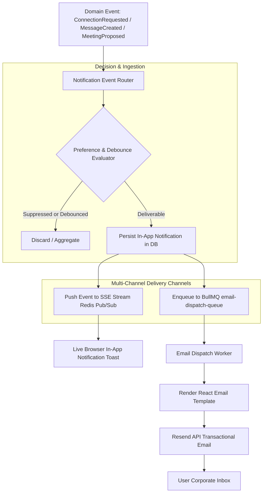

# MerQent — Event-Driven Notification Architecture

**Document Version:** 1.0.0  
**Status:** Approved Architecture  
**Phase:** 1.15 — Notification Architecture  
**Author:** Lead Software Architect & Principal Engineer  

---

## 1. Architectural Model & Notification Pipeline

MerQent employs an **Event-Driven, Decoupled Notification Engine**. Business domain modules (Connections, Projects, Messaging, Scheduling) emit domain events without knowing or caring how those events are delivered to human users.

The `NotificationService` acts as an autonomous consumer that:
1. Ingests domain events from the internal event bus.
2. Checks user notification preferences (`notification_preferences`).
3. Executes rate-limiting and deduplication (debouncing rapid chat notifications).
4. Persists an immutable in-app notification record to PostgreSQL.
5. Emits real-time SSE stream events for active browser sessions.
6. Enqueues transactional email jobs to BullMQ for asynchronous dispatch via Resend.

---

## 2. Definitive Notification Event Catalog

| Event Name | Triggering Aggregate | Default In-App | Default Email | Email Template Name | Debounce Window |
|---|---|:---:|:---:|---|---|
| `matching.new_matches_ready` | `ProjectMatch` | Yes | Yes | `NewMatchesSummaryEmail` | 15 minutes |
| `connection.request_received` | `Connection` | Yes | Yes | `ConnectionRequestEmail` | Immediate |
| `connection.accepted` | `Connection` | Yes | Yes | `ConnectionAcceptedEmail` | Immediate |
| `connection.declined` | `Connection` | Yes | No | None | Immediate |
| `message.received` | `Message` | Yes | Yes (if offline) | `NewMessageAlertEmail` | 5 minutes |
| `meeting.proposed` | `Meeting` | Yes | Yes | `MeetingProposedEmail` | Immediate |
| `meeting.confirmed` | `Meeting` | Yes | Yes (with .ics) | `MeetingConfirmedEmail` | Immediate |
| `meeting.reminder_24h` | `Meeting` | Yes | Yes | `MeetingReminderEmail` | None |
| `meeting.reminder_1h` | `Meeting` | Yes | Yes | `MeetingReminderEmail` | None |
| `verification.badge_approved`| `VerificationRequest` | Yes | Yes | `VerificationApprovedEmail`| Immediate |
| `verification.info_requested`| `VerificationRequest` | Yes | Yes | `VerificationActionNeededEmail`| Immediate |

---

## 3. Idempotency & Debouncing Strategy

### 3.1 Idempotency Key Formulation
To eliminate duplicate emails during network retries or event re-deliveries, every notification generates a deterministic idempotency key stored in Redis:
$$\text{IdempotencyKey} = \text{MD5}(\text{userId} + \text{eventType} + \text{resourceId} + \text{dateBucket})$$
If the key exists in Redis within its TTL window, duplicate processing is halted.

### 3.2 Message Alert Debouncing
If a user receives 10 messages within 3 minutes in an active conversation, sending 10 individual email notifications would alienate the recipient.
- The `NotificationService` uses a **5-Minute Debounce Window**:
- The first unread message schedules a delayed job for $T + 5\text{ minutes}$.
- Subsequent messages within that 5-minute window update the message count in Redis without scheduling new email jobs.
- When the timer fires, the worker checks if the recipient has read the messages via SSE/web. If unread, it dispatches a single consolidated digest email: *"You have 6 new messages from Summit Capital regarding Project Apex."*

---

## 4. Transactional Email Templating (React Email & Resend)

In accordance with **ADR-005 and ADR-008**, transactional emails are developed using **`react-email`** within `apps/api/src/modules/notifications/templates/`:
- **Type-Safe Component Templates:** Reusable React components (`<EmailLayout>`, `<Button>`, `<Header>`, `<Footer>`) guarantee consistent branding and aesthetic polish across email clients.
- **Strict Multipart MIME:** Emails include both high-fidelity HTML and a plain-text fallback, alongside calendar attachments when dispatching meeting invitations (`text/calendar`).
- **DKIM / SPF / DMARC Authentication:** Automated cryptographic signing through Resend guarantees institutional delivery into PE corporate email servers (Outlook 365, Google Workspace) without landing in spam folders.

---

## 5. Failure Handling, Retries & Dead Letter Queues

1. **Email Delivery Retries:** BullMQ handles network or API failures using exponential backoff:
   - Attempt 1: Immediate
   - Attempt 2: 10 seconds
   - Attempt 3: 60 seconds
   - Attempt 4: 5 minutes
   - Attempt 5: 30 minutes
2. **Dead Letter Queue (DLQ):** After 5 failed attempts, the payload is moved to `email-dispatch-dlq`. Administrators receive an alert, and the error reason (e.g., `InvalidRecipient`, `BounceBlocked`) is recorded in `Notification.deliveryError`.
3. **In-App Resiliency:** In-app notifications are saved transactionally to PostgreSQL before external delivery attempts; database failures roll back the event processing, ensuring zero dropped alerts.
