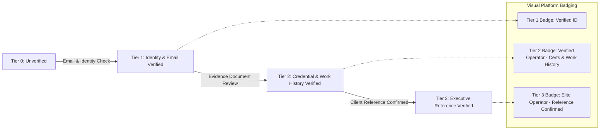
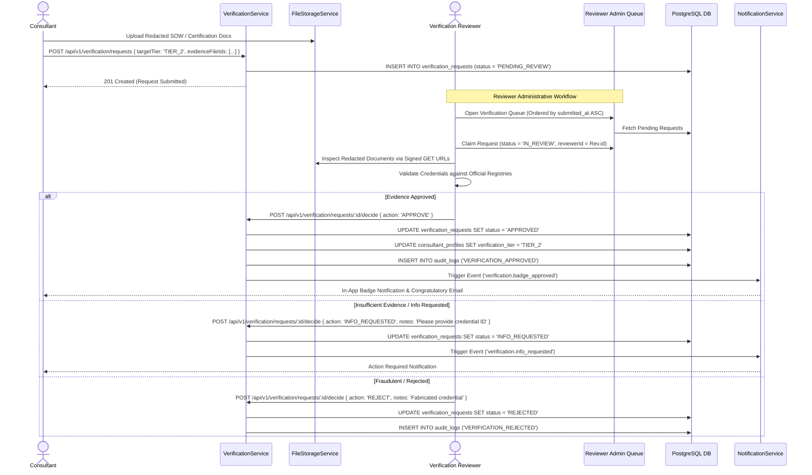

# MerQent — Consultant Verification & Trust Architecture

**Document Version:** 1.0.0  
**Status:** Approved Architecture  
**Phase:** 1.17 — Verification Architecture  
**Author:** Lead Software Architect & Principal Engineer  

---

## 1. Trust Philosophy & The Verification Imperative

Private Equity operating partners deploy PMI consultants to oversee mission-critical post-merger integrations where mistakes cost millions. A major failure mode of traditional marketplaces is **unverified self-attestation** (resumes claiming exaggerated ERP expertise, fictitious Big 4 alumni credentials, or fabricated deal values).

MerQent solves this through a **Progressive Multi-Tier Verification Framework**. Trust is established through auditable evidence, administrative human review, and peer reference validation.

---

## 2. Multi-Tier Progressive Verification Hierarchy

### Tier 0: Unverified (`TIER_0_UNVERIFIED`)
- **Prerequisite:** Self-service registration completed.
- **Verification Depth:** None.
- **Platform Access:** Profile can be edited in draft; unlisted in public discovery; lowest priority in search ranking formula ($w_{\text{verif}} = 0.2$).

### Tier 1: Identity & Corporate Email Verified (`TIER_1_EMAIL_VERIFIED`)
- **Prerequisite:** Validated business email address (corporate domain or active domain SPF/DKIM verification) + Government ID or LinkedIn identity verification.
- **Verification Depth:** Automated cryptographic token confirmation + basic identity proofing.
- **Platform Access:** Profile published in discovery; eligible for connection requests from PE firms.

### Tier 2: Credential & Work History Verified (`TIER_2_CREDENTIAL_VERIFIED`)
- **Prerequisite:** Consultant submits verifiable documentation for at least 2 major PMI claims:
  - Official certification verification (e.g., SAP Certified Integration Associate, PMP, CPA credential ID checked against official registries).
  - Redacted contract / statement of work (SOW) or corporate separation agreement demonstrating role during a corporate carve-out or add-on integration.
- **Verification Depth:** **Human Administrative Review** by `VERIFICATION_REVIEWER` staff.
- **Platform Access:** Elevated search ranking boost (+0.10); "Verified Operator" badge displayed on profile and match cards; eligible for premium PE projects.

### Tier 3: Peer & Reference Verified (`TIER_3_REFERENCE_VERIFIED`)
- **Prerequisite:** Verification reviewer conducts confirmatory outreach (email/phone attestation) with at least two verifiable corporate sponsors (e.g., PE Operating Partner, VP of Finance, or former corporate executive who oversaw the integration).
- **Verification Depth:** Multi-source reference validation confirming consultant integrity, timeline adherence, and synergy achievement.
- **Platform Access:** Highest algorithmic search boost (+0.15); "Elite Verified Operator" gold badge; featured placement in executive discovery.

---

## 3. Administrative Review Queue Workflow

---

## 4. Re-Verification Lifecycle & Expiration

Trust credentials are not static. Systems, roles, and certifications evolve over time:
1. **Annual Re-Verification Cycle:** Tier 2 and Tier 3 badges carry a **365-Day Validity Period** (`expires_at = NOW() + 1 year`).
2. **Automated Expiry Notifications:**
   - 30 days prior to expiration: Email alert reminding consultant to confirm active credentials or submit renewed certifications.
   - 7 days prior to expiration: Final warning.
3. **Grace Period & Graceful Downgrade:** If re-verification is not confirmed within 14 days following expiration, the badge gracefully downgrades to Tier 1 (`TIER_1_EMAIL_VERIFIED`), and search boosts are adjusted automatically without interrupting active client connections.

---

## 5. Auditability & Anti-Collusion Protections

1. **Immutable Decision Trail:** Every review decision records the `reviewer_user_id`, decision timestamp, internal review notes, and exact document version hashes in `audit_logs`.
2. **Reviewer Separation:** Platform administrators or reviewers cannot approve their own consultant accounts. The system enforces an invariant: `reviewer_user_id != consultant.user_id`.
3. **Document Confidentiality Isolation:** Raw verification documents (e.g., government IDs, unredacted contracts) are strictly restricted to the administrative reviewer queue. PE firm users only ever see the resulting verification tier badge and anonymized validation summaries, protecting consultant privacy and confidentiality obligations under past non-disclosure agreements (NDAs).
