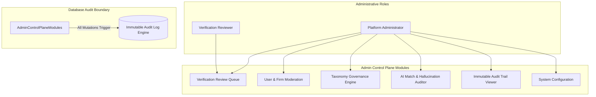

# MerQent — Administration Control Plane Architecture

**Document Version:** 1.0.0  
**Status:** Approved Architecture  
**Phase:** 1.18 — Administration Architecture  
**Author:** Lead Software Architect & Principal Engineer  

---

## 1. Governance Philosophy & Separation of Duties

The MerQent platform requires an administrative control plane to govern users, curate taxonomies, audit AI match quality, review verification credentials, and maintain security compliance.

To protect user confidentiality and prevent unauthorized administrative overreach, the architecture strictly enforces **Separation of Duties (SoD)**:
1. **`VERIFICATION_REVIEWER`:** Focused exclusively on the Trust & Safety review queue. Can view submitted verification evidence and assign badge tiers; strictly barred from reading private messages, modifying system configurations, or accessing administrative audit logs.
2. **`PLATFORM_ADMIN`:** Full governance over users, firms, and taxonomies. Direct access to private user communications is restricted and requires break-glass audit justification.
3. **Mandatory Multi-Factor Authentication (MFA):** Administrative logins require hardware or TOTP MFA challenges on every session.
4. **Tamper-Evident Audit Trail:** Every administrative action is automatically written to `audit_logs` with actor metadata and delta payloads.

---

## 2. Administrative Control Plane Functional Domains

---

### 2.1 Verification Review Queue
- **Capabilities:**
  - View FIFO queue of pending consultant verification requests.
  - Filter queue by requested tier (`TIER_2`, `TIER_3`), submission date, or assigned reviewer.
  - Claim requests to prevent duplicate reviews by multiple staff members.
  - View submitted evidence documents via short-lived, signed, read-only S3 URLs.
  - Record decisions: `APPROVE`, `REJECT`, or `INFO_REQUESTED` with internal review notes.
  - Revoke or downgrade verification tiers if fraudulent activity or lapsed credentials are identified.

---

### 2.2 Taxonomy Governance Engine
- **Capabilities:**
  - Standardize and curate governed PMI terms across six categories: `ERP_SYSTEM`, `ACCOUNTING_SYSTEM`, `DEAL_TYPE`, `INTEGRATION_DISCIPLINE`, `INDUSTRY`, `PMI_TASK`.
  - Add new enterprise software platforms (e.g., adding `ERP_INFOR_LN` or `ERP_WORKDAY_FINANCIALS`).
  - Deprecate obsolete terms gracefully (`isActive = false`) while preserving historical profile and project links.
  - Define parent-child taxonomy hierarchies (e.g., `ERP_SAP` as parent of `ERP_SAP_S4HANA` and `ERP_SAP_ECC`).
  - Trigger asynchronous background re-indexing of consultant embeddings when major taxonomy definitions change.

---

### 2.3 AI Match & Low-Confidence Calibration Center
- **Capabilities:**
  - Inspect all matches flagged with `is_low_confidence = true` ($C < 60\%$).
  - Review candidate scores, signal breakdowns (ERP 30%, Deal 20%, Industry 15%), and generated explanation texts.
  - Identify hallucination anomalies (claims stripped by the `GroundingInterceptor`).
  - Score explanation quality (1-5 rating) to curate golden evaluation datasets for LLM prompt calibration.
  - Adjust global category scoring weights and prompt versioning.

---

### 2.4 User & Firm Moderation
- **Capabilities:**
  - Search and filter all registered users, PE firms, and consultant profiles.
  - Inspect account statuses (`ACTIVE`, `PENDING_VERIFICATION`, `SUSPENDED`, `DEACTIVATED`).
  - Suspend abusive accounts or spam bots with immediate revocation of all active JWT refresh tokens.
  - Moderate reported message threads or inappropriate project postings.
  - Resend email verification links or trigger administrative password reset workflows.

---

### 2.5 Tamper-Evident System Audit Trail
- **Capabilities:**
  - Inspect append-only `audit_logs` table.
  - Filter by `actorUserId`, `action` (e.g., `AUTH_LOGIN`, `VERIFICATION_APPROVE`, `ACCOUNT_SUSPEND`), `targetResourceType`, and timestamp ranges.
  - View JSON diff payloads showing exact pre-mutation and post-mutation states.
  - Export audit logs to encrypted JSON/CSV for SOC 2 Type II and institutional PE compliance audits.

---

## 3. Administrative Security & Session Controls

1. **Dedicated Route Prefix:** All administrative APIs reside under `/api/v1/admin/*`, protected by a dedicated `AdminGuard` verifying:
   - Valid session token.
   - User status is `ACTIVE`.
   - Role matches `PLATFORM_ADMIN` or `VERIFICATION_REVIEWER`.
   - MFA challenge was verified for the active session.
2. **Session Timeout:** Administrative sessions enforce an aggressive 30-minute idle timeout, after which re-authentication is mandatory.
3. **IP Allowlisting Readiness:** The `AdminGuard` supports optional CIDR subnet IP allowlisting (`ADMIN_ALLOWED_IPS`) for corporate VPN restrictions in production environments.
