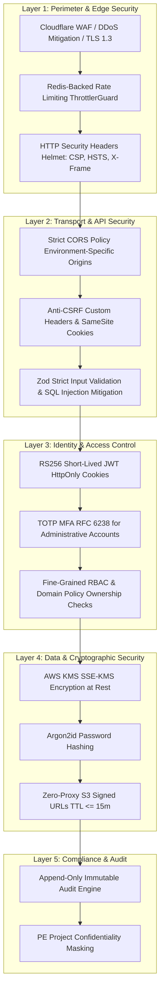

# MerQent — Security & Privacy Architecture

**Document Version:** 1.0.0  
**Status:** Approved Architecture  
**Phase:** 1.19 — Security & Privacy Architecture  
**Author:** Security Architect & Principal Engineer  

---

## 1. Security Philosophy & Threat Modeling

MerQent handles sensitive institutional M&A and private equity data: confidential carve-out plans, unannounced acquisitions, proprietary technology migration strategies, executive compensation estimates, and consultant personal identifiable information (PII).

Security is not an afterthought; it is built into the foundation through a **Defense-in-Depth Model** adhering to the OWASP Top 10, SOC 2 Type II principles, and the NIST Cybersecurity Framework.



---

## 2. Authentication Architecture

### 2.1 Password Security & Hashing
- **Algorithm:** **Argon2id** (winner of the Password Hashing Competition), configured with parameters exceeding OWASP recommendations:
  - Memory cost ($m$): 65,536 KiB (64 MiB)
  - Time cost ($t$): 3 iterations
  - Parallelism ($p$): 4 threads
- **Complexity Enforcement:** Passwords require a minimum of 12 characters, including uppercase, lowercase, numbers, and special symbols. Common breached passwords (from HaveIBeenPwned dictionary) are rejected at registration.

### 2.2 Dual-Token Session Management (ADR-007)
- **Access Token:** Short-lived JWT (15-minute expiration) signed via RS256/EdDSA private key. Transmitted exclusively in an `HttpOnly`, `Secure`, `SameSite=Strict` cookie for web browsers, and via `Authorization: Bearer` for native mobile clients.
- **Refresh Token:** Cryptographically random 64-byte string stored as an Argon2id hash in `refresh_tokens`. Enforces 7-day sliding expiration and device fingerprinting.
- **Immediate Revocation:** Any password change, account suspension, or user logout immediately sets `is_revoked = true` on the refresh token, terminating the session.

### 2.3 Multi-Factor Authentication (MFA / 2FA)
- Implements Time-based One-Time Passwords (**TOTP**) adhering to **RFC 6238** (compatible with Google Authenticator, 1Password, Microsoft Authenticator).
- **Mandatory Enforcement:** Required for all `PLATFORM_ADMIN` and `VERIFICATION_REVIEWER` accounts. Optional but strongly recommended for PE firm users.
- **MFA Secret Protection:** Encrypted at rest in PostgreSQL using AES-256-GCM.

---

## 3. Authorization & Multi-Tenant Isolation

### 3.1 Multi-Tier Enforcement
Every request must pass three sequential security checks:
1. **Authentication Check:** Is the JWT signature valid and unexpired?
2. **Role Check (RBAC):** Does the user have the required role (`PE_FIRM_ADMIN`, `CONSULTANT_OPERATOR`, etc.)?
3. **Domain Ownership Policy (ABAC):** Does the user have rights to this specific resource instance?
   ```typescript
   // Invariant: Sponsoring firm ownership check
   if (project.firmId !== userContext.firmId) {
     throw new ForbiddenException('Resource belongs to another organization tenant.');
   }
   ```

### 3.2 Row-Level Multi-Tenant Scoping
All database queries touching PE-owned resources automatically append `WHERE firm_id = :tenantFirmId` to guarantee that Firm A cannot read, query, or enumerate projects or shortlists belonging to Firm B.

---

## 4. API & Network Security

### 4.1 Input Validation & Anti-Injection
- All request payloads are validated using **Zod** schemas in a global `ZodValidationPipe`. Payloads containing unexpected properties are rejected (`strip` / `strict`).
- SQL injection is eliminated by using **Prisma ORM** parameterized queries and sanitized raw SQL bindings for `pgvector` operations.

### 4.2 Rate Limiting & Abuse Prevention
Configured via NestJS `ThrottlerModule` with a Redis storage engine:
- **Public Auth Endpoints (`/api/v1/auth/login`, `/register`):** 5 requests per minute per IP address.
- **Search Endpoints (`/api/v1/search/*`):** 30 requests per minute per authenticated user.
- **Standard Authenticated API:** 120 requests per minute per user.
- Violations trigger an immediate `429 Too Many Requests` response.

### 4.3 Secure HTTP Headers
Enforced globally via `helmet`:
- **Strict-Transport-Security (HSTS):** `max-age=31536000; includeSubDomains; preload`
- **Content-Security-Policy (CSP):** Strict default-src `'self'`; scripts restricted to signed nonces.
- **X-Frame-Options:** `DENY` (clickjacking mitigation).
- **X-Content-Type-Options:** `nosniff`.

---

## 5. Data Privacy & Confidentiality Controls

### 5.1 Project Confidentiality Masking
PE firms frequently conduct integration scoping before an acquisition is publicly announced. To prevent leaks of Material Non-Public Information (MNPI):
- Projects maintain two title attributes:
  - `confidentialNameMasked` (e.g., *"Project Apex — Multi-Site Industrial Carve-Out"*): Visible in marketplace discovery and match cards.
  - `title` (True Target Name): Restricted strictly to internal PE firm members until an introductory connection is accepted and an NDA is executed.

### 5.2 Data Minimization & Consultant Privacy
- Unverified contact details (personal phone, home address, personal email) are never collected.
- Raw verification evidence (redacted employment contracts, government IDs) is segregated within the admin reviewer queue and cannot be accessed by PE clients.

### 5.3 GDPR & CCPA Compliance (Right to Erasure)
- Users can request account deletion via self-service settings.
- Account deletion executes a cascading purge of personal profile data, experiences, and uploaded resumes, while preserving anonymized transactional records required for legal auditability (`ON DELETE SET NULL` on audit logs).

---

## 6. Cryptographic Key Management & Secrets Lifecycle

1. **Zero Committed Secrets:** Environment variables and API keys are strictly excluded from source control via `.gitignore`.
2. **KMS Centralization:** In production, application secrets (JWT private keys, OpenAI API keys, database credentials) are injected at container runtime from AWS Secrets Manager / KMS.
3. **Zero Data Retention Mandate:** Enterprise agreements with AI providers (OpenAI / Anthropic) enforce Zero Data Retention (ZDR) — deal project specifications are never used to train foundational AI models.
