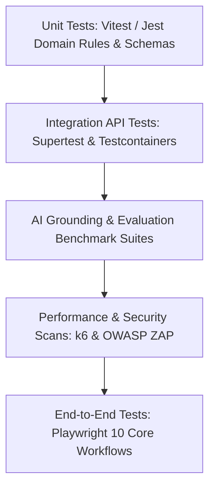

# MerQent — Comprehensive Testing Strategy Architecture

**Document Version:** 1.0.0  
**Status:** Approved Architecture  
**Phase:** 1.21 — Testing Architecture  
**Author:** Principal QA Architect & Lead Software Architect  

---

## 1. Testing Philosophy: The Confidence Pyramid

MerQent is designed to facilitate high-stakes M&A integrations. Software regressions, security boundary breaches, or ungrounded AI hallucinations directly threaten client trust.

The platform employs a **Multi-Tier Quality Assurance Pyramid** ensuring comprehensive test coverage across every layer of the system:

---

## 2. Test Classification & Coverage Mandates

| Test Level | Primary Tooling | Execution Frequency | Target Scope | Minimum Code Coverage |
|---|---|---|---|:---:|
| **Unit Testing** | Jest / Vitest | Pre-commit & PR CI | Domain entities, Zod validation schemas, matching scoring formulas, authorization policies, DTO mappers. | **85%** |
| **Integration Testing**| Supertest + Testcontainers (PostgreSQL + Redis) | PR CI Pipeline | Module controllers, database repository transactions, vector HNSW search queries, signed S3 URLs, event bus handlers. | **80%** |
| **AI Grounding Tests** | Custom Jest Assertions + Golden Datasets | Nightly CI & Prompt PRs | Anti-hallucination interceptors, fact vault entity linkage, confidence threshold gating. | **100% Pass** |
| **Security Tests** | Jest + Automated RBAC Scanners | PR CI Pipeline | Tenant isolation leaks, privilege escalation attempts, unauthorized file downloads, unaccepted connection messaging. | **100% Pass** |
| **E2E Testing** | Playwright (Headless Chromium) | Pre-Release & Staging | 10 critical end-to-end user journeys from registration through meeting coordination. | Core Flows |
| **Performance Tests** | k6 Load Testing | Staging Release Gate | Search query latency, API p95 response time, concurrent SSE streams, vector retrieval under load. | NFR Thresholds |

---

## 3. The 10 Critical End-to-End (E2E) Workflows (Playwright)

The Playwright test suite (`tests/e2e/`) validates ten end-to-end business workflows:

1. **E2E-01: Consultant Onboarding:** Registration → Email Verification → Profile Completion (Bio, ERP Taxonomies, Experience Case Studies) → Draft Preview.
2. **E2E-02: Trust & Verification Submission:** Consultant submits Tier 2 verification evidence (redacted contract, PMP certificate) → Reviewer inspects in Admin Queue → Admin approves → Profile awarded "Verified Operator" badge.
3. **E2E-03: PE Firm Onboarding:** Firm Admin registers → Enters AUM tier and firm details → Invites colleague (`PE_FIRM_MEMBER`) → Colleague accepts invitation.
4. **E2E-04: PMI Project Creation:** PE User creates project → Defines required ERPs (SAP S/4HANA), deal type (Carve-Out), timeline, and confidentiality mask → Transitions status to `ACTIVE`.
5. **E2E-05: Hybrid Search & Discovery:** PE User executes faceted search (Manufacturing + SAP + Carve-Out) → Validates facet counts → Executes free-text search → Inspects candidate cards.
6. **E2E-06: AI Matching & Grounded Explanations:** PE User triggers project match → Inspects ranked candidate pool → Clicks "Why Recommended?" → Validates verified evidence citations in modal.
7. **E2E-07: Candidate Shortlisting & Comparison:** PE User shortlists 3 candidates → Enters private evaluation notes → Generates side-by-side comparison matrix.
8. **E2E-08: Bilateral Connection Handshake:** PE User dispatches connection request with introductory note → Consultant receives in-app alert & email → Consultant accepts request → Channel status transitions to `ACCEPTED`.
9. **E2E-09: Secure Direct Messaging:** Connected parties open conversation → Exchange text messages → Upload PDF scoping brief → Recipient downloads file → Read receipts update in real-time.
10. **E2E-10: Meeting Coordination & Calendar Dispatch:** Connected party proposes meeting slot → Counterparty confirms slot → Platform generates `.ics` payload → Validates email delivery and calendar confirmation state.

---

## 4. AI Grounding & Anti-Hallucination Evaluation Suite

Testing AI components requires deterministic verification of non-deterministic model outputs:
1. **The Golden Evaluation Dataset:** A version-controlled corpus of 50 synthetic project-consultant pairs with hand-annotated ground truth facts.
2. **Grounding Interceptor Test Suite:**
   - Injects deliberately hallucinated responses (e.g., claiming a candidate led a "Workday Financials migration" when profile only lists SAP).
   - Asserts that `GroundingInterceptor` strips the hallucinated claim 100% of the time.
   - Asserts that all remaining claims have a valid `sourceEntityId` resolving in the candidate database.
3. **Confidence Degradation Test:**
   - Evaluates edge-case candidate profiles with missing certifications and sparse bios.
   - Asserts that the calculated Confidence Score ($C$) drops below 60% and correctly tags `isLowConfidence = true`.

---

## 5. Security & Penetration Test Suite

Automated security integration tests (`tests/security/`) assert:
- **Tenant Isolation Check:** PE Firm A attempts to access `GET /api/v1/projects/:id` belonging to Firm B $\to$ Must return `403 Forbidden`.
- **Connection Gating Check:** User attempts to post a message or propose a meeting on a connection in `PENDING` state $\to$ Must return `403 Forbidden` (`CONNECTION_NOT_ACCEPTED`).
- **File Quarantine Check:** User attempts to download a file with `scan_status = 'PENDING'` or `'INFECTED'` $\to$ Must return `403 Forbidden`.
- **Privilege Escalation Check:** `PE_FIRM_MEMBER` attempts to invoke `POST /api/v1/admin/taxonomies` $\to$ Must return `403 Forbidden`.

---

## 6. Performance Benchmarking Targets (k6)

| Target Metric | Benchmark Condition | NFR Target |
|---|---|:---:|
| **OLTP API Read Latency (p95)** | 500 concurrent virtual users | **< 200 ms** |
| **OLTP API Mutation Latency (p95)**| 200 concurrent virtual users | **< 350 ms** |
| **Hybrid Search Latency (p95)** | Complex boolean + vector cosine search | **< 500 ms** |
| **AI Matching Engine Pipeline** | Candidate pool retrieval + composite scoring | **< 3.0 s** |
| **SSE Stream Connection Scalability** | 2,000 persistent SSE listeners per node | Zero dropped events |
