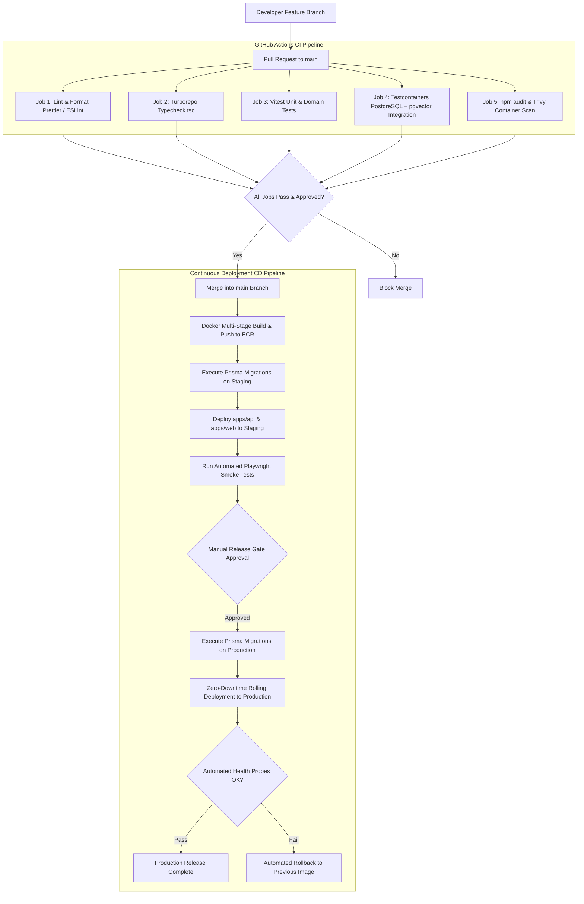

# MerQent — CI/CD Pipeline & Release Architecture

**Document Version:** 1.0.0  
**Status:** Approved Architecture  
**Phase:** 1.22 — CI/CD Architecture  
**Author:** DevOps Architect & Lead Software Architect  

---

## 1. CI/CD Philosophy: Zero-Downtime Trunk-Based Delivery

MerQent enforces automated, reproducible, and secure continuous integration and delivery orchestrated via **GitHub Actions**. The pipeline guarantees that no code reaches production without passing static analysis, end-to-end typechecks, automated unit and integration tests, security vulnerability scans, and database migration verifications.

---

## 2. Branching & Release Strategy

MerQent utilizes **Trunk-Based Development** paired with short-lived feature branches:
- **`main` Branch:** Protected trunk representing deployable state. Direct pushes are disabled; changes require a Pull Request (PR) with at least one senior engineering approval and green CI checks.
- **Feature Branches:** Named `feat/<domain>-
`, `fix/<domain>-
`, or `chore/
`. Branches live < 48 hours to minimize merge drift.
- **Release Tags:** Releases are tagged using Semantic Versioning (`v1.0.0`, `v1.1.0`) automatically generated via standard release tools.

---

## 3. GitHub Actions Pipeline Specification

### 3.1 Pull Request CI Pipeline (`.github/workflows/ci.yml`)
Executed on every PR commit:
1. **Setup & Cache:** Provisions Node.js 20 LTS, pnpm, and restores Turborepo remote build cache.
2. **Lint & Code Style:** Runs `pnpm turbo run lint` and Prettier format verification.
3. **Type Safety Verification:** Runs `pnpm turbo run typecheck` across all apps and packages in parallel.
4. **Unit Tests:** Executes Vitest/Jest unit tests with coverage reporting (`pnpm turbo run test:unit`).
5. **Database Integration Tests:** Boots ephemeral PostgreSQL 16 (with `pgvector`) and Redis containers via Docker services; runs Prisma migrations and executes API integration suites.
6. **Security Vulnerability Scan:** Runs `pnpm audit` and scans Dockerfiles with **Trivy** to intercept base-image CVEs before merging.

### 3.2 Continuous Deployment Pipeline (`.github/workflows/cd.yml`)
Triggered on merge into `main`:
1. **Container Build & Push:** Multi-stage Docker builds produce minimal, hardened distroless container images for `apps/api` and `apps/web`, tagged with Git SHA and semver, pushed to Amazon Elastic Container Registry (ECR).
2. **Staging Database Migration:** Executes `pnpm prisma migrate deploy` against staging PostgreSQL.
3. **Staging Rolling Deployment:** Updates AWS ECS / Kubernetes service definitions with the new container image.
4. **Automated Smoke Testing:** Executes Playwright headless smoke tests against the live staging environment.
5. **Production Release Gate:** Requires explicit authorization from the Lead Architect or Engineering Lead in GitHub Environments.
6. **Production Zero-Downtime Deployment:** Executes rolling container replacement with healthcheck probing (`/api/v1/health/liveness` and `/readiness`).

---

## 4. Database Migration Safety & Rollback Protocol

Database schema changes represent the highest risk factor in continuous delivery. MerQent enforces strict migration safety rules:

1. **Expand-and-Contract Pattern:** Breaking schema changes are split into backward-compatible phases:
   - *Phase 1 (Expand):* Add new nullable columns or tables; deploy application code that writes to both old and new columns.
   - *Phase 2 (Migrate):* Asynchronously backfill historical data.
   - *Phase 3 (Contract):* Remove legacy columns in a subsequent release after all old application versions have ceased running.
2. **Pre-Deployment Execution:** Prisma migrations execute as an isolated ECS task **before** new application pods receive user traffic. If migration scripts fail, the deployment is aborted immediately, leaving active production pods untouched.
3. **Automated Rollback:** If newly deployed application containers fail liveness or readiness probes within 3 minutes of traffic cutover:
   - Traffic routing switches back to the prior stable container image.
   - An emergency PagerDuty alert is triggered.
