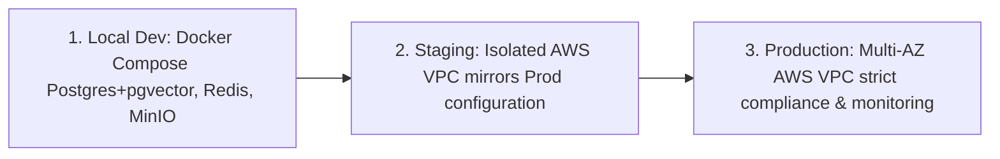

# MerQent — Production Cloud Deployment Architecture

**Document Version:** 1.0.0  
**Status:** Approved Architecture  
**Phase:** 1.23 — Deployment Architecture  
**Author:** DevOps Architect & Lead Software Architect  

---

## 1. Infrastructure Philosophy & Cloud Blueprint

MerQent's production infrastructure is designed around **Operational Simplicity, High Availability, and Strict Multi-Tenant Security**. 

Rather than adopting complex, high-maintenance Kubernetes clusters prematurely for Phase 1-2, the platform standardizes on **AWS Serverless Container Infrastructure (Amazon ECS on AWS Fargate)**. This provides automated container orchestration, horizontal autoscaling, zero node-management overhead, and SOC 2 Type II compliance out of the box.

```mermaid
graph TD
    Internet[Public Internet / PE Clients & Operators] --> Cloudflare[Cloudflare Edge / DNS / DDoS / WAF / SSL]
    Cloudflare --> ALB[AWS Application Load Balancer]

    subgraph AWS VPC (10.0.0.0/16) - Multi-AZ
        subgraph Public Subnets
            ALB
        end

        subgraph Private Application Subnets
            WebTasks[Next.js Web Service: ECS Fargate 2+ Tasks]
            ApiTasks[NestJS API Service: ECS Fargate 2+ Tasks]
            WorkerTasks[BullMQ Worker Service: ECS Fargate 2+ Tasks]
        end

        subgraph Private Isolated Data Subnets
            RDS[(Amazon Aurora PostgreSQL 16 + pgvector Multi-AZ)]
            ElastiCache[(Amazon ElastiCache Redis 7.2 Cluster)]
        end
    end

    subgraph External Managed SaaS
        S3[(Amazon S3 Encrypted Bucket SSE-KMS)]
        OpenAI[OpenAI / Anthropic Enterprise APIs]
        Resend[Resend Transactional Email]
        Secrets[AWS Secrets Manager]
    end

    ALB --> WebTasks
    ALB --> ApiTasks
    WebTasks --> ApiTasks
    ApiTasks --> RDS
    ApiTasks --> ElastiCache
    ApiTasks --> WorkerTasks
    WorkerTasks --> ElastiCache
    WorkerTasks --> RDS
    ApiTasks --> S3
    ApiTasks --> OpenAI
    WorkerTasks --> Resend
    ApiTasks --> Secrets
```

---

## 2. Infrastructure Component Registry

| Component | AWS / Cloud Service | Sizing / Tier (Production) | High Availability & Redundancy |
|---|---|---|---|
| **DNS & Edge Routing** | Cloudflare Enterprise / Route 53 | Anycast Edge Network | Global DDoS protection, automated TLS 1.3 |
| **Ingress Load Balancing** | AWS Application Load Balancer (ALB) | Dual-AZ Multi-Subnet | Health probe path routing (`/api/*` to API; `/*` to Web) |
| **Frontend Web Service** | AWS ECS Fargate (`apps/web`) | 2 Tasks (1 vCPU, 2 GB RAM each) | Auto-scales 2 to 6 tasks on CPU > 70% |
| **Backend API Service** | AWS ECS Fargate (`apps/api`) | 2 Tasks (2 vCPU, 4 GB RAM each) | Auto-scales 2 to 8 tasks on CPU > 70% |
| **Background Workers** | AWS ECS Fargate (BullMQ Workers) | 2 Tasks (1 vCPU, 2 GB RAM each) | Auto-scales on BullMQ queue depth |
| **Primary Relational & Vector DB**| Amazon Aurora PostgreSQL Serverless v2 | 2 to 8 ACUs (Aurora Capacity Units) | Multi-AZ Automated Failover, read replicas |
| **Cache, Pub/Sub & Queues**| Amazon ElastiCache for Redis | `cache.t4g.medium` (Multi-AZ) | Primary + Read Replica with automated failover |
| **Object Storage** | Amazon S3 | Standard Tier + SSE-KMS | 99.999999999% (11 9s) durability, Multi-AZ |
| **Secret Management** | AWS Secrets Manager | Managed KMS encryption | Automatic rotation; zero secrets in Git or images |

---

## 3. Environment Strategy & Configuration Parity

MerQent operates across three distinct, isolated environments:



1. **Local Development:** Developers run `docker compose up` launching local PostgreSQL 16 (with `pgvector`), Redis 7.2, and MinIO. Zero external cloud costs; 100% offline development parity.
2. **Staging Environment:** Dedicated AWS VPC (`10.1.0.0/16`) deployed via Terraform. Matches production architectures with scaled-down resources. Automatically updated on merge to `main`.
3. **Production Environment:** Hardened AWS VPC (`10.0.0.0/16`) with multi-AZ redundancy across `us-east-1a` and `us-east-1b`. Requires manual deployment authorization in GitHub.

---

## 4. Disaster Recovery & Backup Strategy

MerQent defines strict Business Continuity and Disaster Recovery (BCDR) objectives:
- **Recovery Point Objective (RPO):** **< 15 minutes** (Maximum allowable data loss in catastrophic outage).
- **Recovery Time Objective (RTO):** **< 2 hours** (Maximum allowable downtime to restore full platform availability).

### Backup Protocols:
1. **Automated Point-in-Time Recovery (PITR):** Amazon Aurora PostgreSQL maintains continuous transaction log (WAL) backups, enabling recovery to any second within the past 35 days.
2. **Nightly Encrypted Snapshots:** Automated cross-region snapshot replication (e.g., from `us-east-1` to `us-west-2`) stored under AWS KMS encryption.
3. **S3 Object Versioning & Cross-Region Replication:** Bucket versioning protects against accidental deletions; cross-region replication archives critical verification evidence documents.

---

## 5. Cost-Optimized Scaling Dynamics

The initial production architecture is engineered to minimize idle run-rate expenses while scaling elastically as platform adoption accelerates:

- **Baseline Monthly Cost (Early-Stage Production):**
  - Amazon ECS Fargate (Web + API + Worker tasks): ~$120/month
  - Amazon Aurora Serverless v2 (2 ACUs baseline): ~$110/month
  - Amazon ElastiCache Redis (`cache.t4g.medium` Multi-AZ): ~$45/month
  - Cloudflare & ALB & S3: ~$45/month
  - **Total Baseline:** **~$320 / month**
- **Elastic Scaling:** As concurrent PE searches and AI matches increase, Aurora Serverless scales compute seamlessly up to 8 ACUs, and ECS tasks scale horizontally without architectural refactoring.
