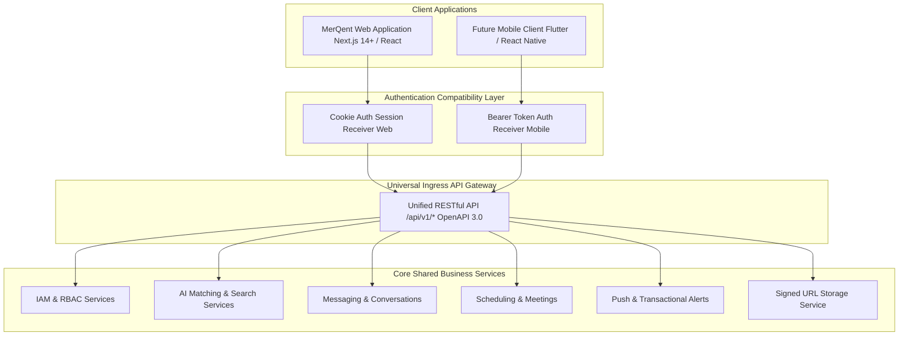

# MerQent — Future Mobile Application Readiness Architecture

**Document Version:** 1.0.0  
**Status:** Approved Architecture  
**Phase:** 1.24 — Mobile Readiness Architecture  
**Author:** Lead Software Architect & Principal Engineer  

---

## 1. Architectural Strategy: Client-Agnostic Core

The initial release of MerQent is delivered as a modern responsive web application. However, Private Equity operating executives and traveling PMI consultants frequently conduct deal conversations, review urgent match alerts, and confirm meeting times from mobile devices.

To guarantee that a future **Native Mobile Application (Flutter or React Native)** can be introduced in Phase 3 with **zero backend refactoring**, the MerQent backend is engineered as an entirely client-agnostic API platform.



---

## 2. Mobile Architectural Foundations

---

### 2.1 Universal Authentication Handshake
- **Web Clients:** Store short-lived JWTs inside `HttpOnly` cookies.
- **Mobile Clients:** Receive standard JSON tokens upon authentication:
  ```json
  {
    "accessToken": "eyJhbGciOiJSUzI1NiIs...",
    "refreshToken": "d8f1e2c3b4a5...",
    "expiresIn": 900,
    "user": {
      "id": "a1b2c3d4-...",
      "role": "CONSULTANT_OPERATOR"
    }
  }
  ```
- Mobile clients store the `refreshToken` in native secure hardware storage (**iOS Keychain / Android Keystore**) and transmit the access token via the standard header: `Authorization: Bearer <token>`.
- The NestJS `JwtAuthGuard` automatically detects and prioritizes Bearer headers when cookies are absent.

---

### 2.2 Mobile-Optimized Payload Design & Cursor Pagination
Mobile networks experience packet loss, high latency, and bandwidth constraints:
- **Timestamp Cursors:** Endpoints serving feeds (messages, notifications, project matches) enforce ISO timestamp cursor pagination (`?cursor=2026-10-07T19:45:00Z&limit=20`), preventing off-by-one errors and duplicate cards during infinite scrolling.
- **Concise Card DTOs:** High-traffic list endpoints return lean summary DTOs (omitting full rich-text case study descriptions), fetching heavy unredacted profiles only when the user taps into a detail screen.

---

### 2.3 Push Notification Readiness (FCM & APNs)
While web users receive in-app alerts via Server-Sent Events (SSE), mobile users require background push notifications when the application is terminated:
- The `NotificationService` includes an abstract `IPushNotificationAdapter` interface.
- Phase 1 persists native device tokens (`device_tokens`: `userId`, `platform` [iOS/Android], `pushToken`, `updatedAt`).
- Phase 3 activates the **Firebase Cloud Messaging (FCM)** and **Apple Push Notification service (APNs)** adapter to deliver native background push alerts without modifying event definitions.

---

### 2.4 Mobile File Upload & Download Pipeline
Native mobile clients consume the exact same two-step S3 signed URL flow designed in Phase 1.16:
1. Mobile app requests upload URL: `POST /api/v1/files/upload-url`.
2. Mobile app streams document/photo directly to Amazon S3 via native HTTP background uploaders (`NSURLSession` on iOS / `WorkManager` on Android) without freezing the UI.
3. Mobile app confirms upload completion: `POST /api/v1/files/confirm-upload`.

---

### 2.5 Universal Deep Linking Specification
The platform reserves standardized URL schemes for seamless mobile deep linking:

| Route Purpose | Web URL | Mobile Deep Link URI | Mobile Target Screen |
|---|---|---|---|
| **Direct Conversation** | `https://merqent.com/messaging/:id` | `merqent://conversations/:id` | `ChatScreen(conversationId)` |
| **Meeting Details** | `https://merqent.com/scheduling/:id` | `merqent://meetings/:id` | `MeetingDetailScreen(meetingId)` |
| **Match Rationale** | `https://merqent.com/firm/projects/:pId/matches` | `merqent://projects/:pId/matches` | `MatchRecommendationScreen(projectId)` |
| **Connection Request** | `https://merqent.com/connections/:id` | `merqent://connections/:id` | `ConnectionHandshakeScreen(connectionId)` |

---

## 3. Implementation Policy
In strict compliance with **Phase 1 Master Rules (Section 32)**:
- Mobile client code (Flutter / React Native) will **NOT** be built during Phase 1 or Phase 2.
- All backend endpoints and domain services are verified to adhere to the mobile contracts specified above.
