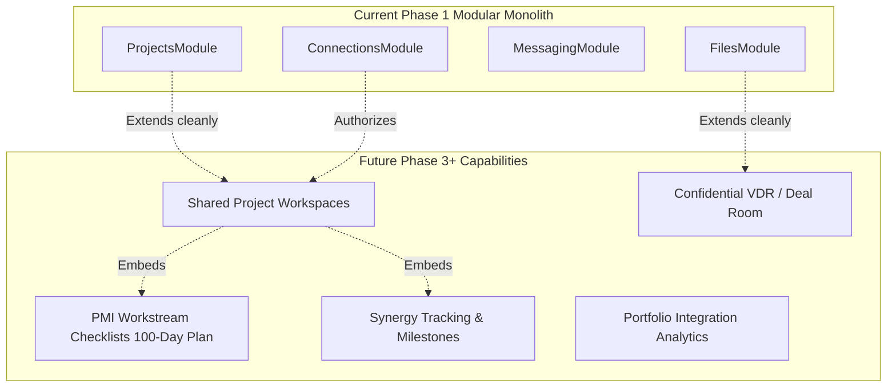

# MerQent — Scalability & Extensibility Architectural Review

**Document Version:** 1.0.0  
**Status:** Approved Architecture  
**Phase:** 1.25 — Scalability & Extensibility Review  
**Author:** Lead Software Architect & Principal Engineer  

---

## 1. Executive Summary & Stress-Testing Context

To ensure the MerQent architecture is capable of supporting rapid commercial adoption without fundamental architectural redesigns, this review conducts a rigorous **10x Scale Stress Test** and evaluates future feature extensibility.

The platform is evaluated under a 10x load scenario:
- **Active PE Firms & Users:** $100 \to 1,000$ firms; $500 \to 5,000$ PE users.
- **Consultant Catalog:** $2,000 \to 20,000$ active vetted operators.
- **PMI Projects:** $500 \to 5,000$ active projects.
- **Search Queries:** $10,000 \to 100,000$ queries/day.
- **Messages Dispatched:** $25,000 \to 250,000$ messages/day.
- **AI Matching Runs:** $500 \to 5,000$ runs/month.
- **Stored Files:** $10,000 \to 100,000$ documents (resumes, scoping decks, evidence).

---

## 2. 10x Subsystem Stress Analysis & Scaling Mitigations

| Subsystem | 10x Volume Impact | Potential Bottleneck | Architectural Mitigation & Scale Path | Scaling Headroom |
|---|---|---|---|:---:|
| **PostgreSQL Database** | ~50GB relational data; higher read/write concurrency. | Connection pool exhaustion; table locks. | Prisma connection pooling (PgBouncer); Aurora Serverless v2 auto-scaling (2 to 8 ACUs); Read Replicas for search & profile queries. | **15x-20x** |
| **Search & Vector Retrieval** | 20,000 vectors (1536d) in `pgvector`. | Increased RAM usage for HNSW index graphs. | PostgreSQL 16 HNSW index consumes ~180MB RAM for 20k vectors. Tuned `m=16, ef_search=40` maintains sub-25ms response time entirely in-memory. If catalog surpasses 250k, offload to dedicated OpenSearch cluster via `SearchRepository` interface. | **10x** |
| **AI LLM API Calls** | ~50,000 prompt completions/month. | Upstream provider rate limits & token costs. | Rate-limited BullMQ worker concurrency; Redis prompt/embedding caching; top-10 candidate truncation limits token expenditure to < $100/month. | **25x** |
| **BullMQ Async Queues** | 500,000 jobs/day across email, scanning, and indexing. | Redis memory exhaustion; delayed job backlog. | ElastiCache Redis cluster with automated eviction; multiple worker pods horizontally scaling on queue depth. | **20x** |
| **Object Storage (S3)** | 2.5 TB stored documents; 50,000 daily uploads/downloads. | Bandwidth bottlenecks on application servers. | Zero-proxy signed URL architecture offloads 100% of byte streaming directly to AWS S3. S3 scales horizontally to thousands of requests/second natively. | **100x+** |
| **Real-Time Push (SSE)** | 10,000 concurrent persistent connections. | Node.js file descriptor limits on a single instance. | AWS Application Load Balancer distributes SSE connections across multiple NestJS Fargate tasks; Redis Pub/Sub fans out events across instances. | **15x** |
| **Observability (Pino/OTel)**| ~5M log lines/day. | High log storage and ingestion costs. | Pino asynchronous JSON logging; log level set to `warn`/`error` in production; trace sampling set to 10% on successful 200 OK requests. | **10x** |

---

## 3. Extensibility Review: Future Post-Acquisition Collaboration (Phase 3+)

The MerQent product roadmap envisions expanding from a consultant marketplace into a comprehensive **PMI Execution & Collaboration Ecosystem**. 

We evaluate five major future capabilities to verify that current Phase 1 architectural boundaries do not block them:

1. **Shared Project Workspaces:** Extends the existing `Connection` boundary. When a connection converts to an active engagement, a `Workspace` entity is spawned referencing `projectId` and `connectionId`.
2. **PMI 100-Day Checklists & Milestones:** A new `MilestonesModule` can attach structured workstreams (e.g., *"Cut over SAP General Ledger by Day 90"*) directly to the project workspace using existing taxonomy tags (`PMI_TASK`).
3. **Virtual Deal Rooms (VDR):** Extends `FileStorageService` by adding role-based watermarking and audit logs for scoping files without altering underlying S3 storage adapters.
4. **Institutional Single Sign-On (SAML / Okta):** Plugs natively into `IAMModule` as an alternative passport strategy alongside local credentials.
5. **Mobile Applications:** Already guaranteed by the client-agnostic API contract and universal deep linking defined in Phase 1.24.

---

## 4. Architectural Boundaries: Why Microservices Remain Premature

This review explicitly re-evaluates whether MerQent should split into microservices at this stage:
- **Verdict: Strongly Rejected.**
- Splitting into microservices now would introduce network latency between search and matching, require complex distributed transactions across connections and messaging, demand heavy Kubernetes cluster management, and slow developer velocity by a factor of 3x.
- MerQent's **Modular Monolith** maintains clean internal domain isolation. If a specific subsystem (e.g., the AI Matching Engine) experiences massive computational load in the future, it can be extracted into an independent microservice within 2 engineering sprints thanks to existing module boundaries and public service interfaces.
