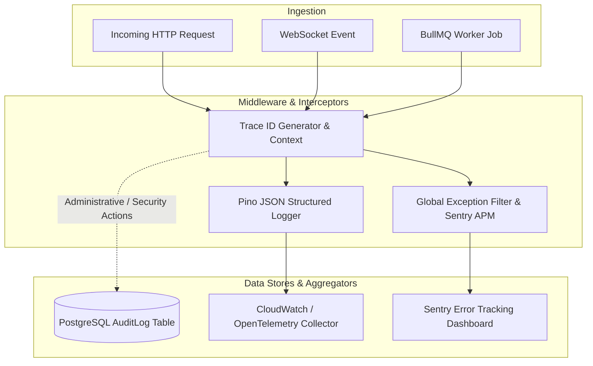

# MerQent — Observability, Monitoring & Audit Architecture

**Document Version:** 1.0.0  
**Status:** Approved Master Architecture  
**Phase:** 1 — Master Architecture Correction  
**Author:** Lead Software Architect & Principal Engineer  

---

## 1. Executive Summary & Observability Blueprint

MerQent handles high-value, confidential M&A integration transactions and sensitive consultant credentials. Observability is architected across four unified pillars:
1. **Structured Logging (Pino)**: High-speed JSON log output carrying unique trace IDs across all HTTP requests, WebSocket connections, and background jobs.
2. **APM & Error Tracking (Sentry)**: Automated capture of unhandled exceptions, performance bottlenecks, and external API failures.
3. **Metrics & Health Monitoring (OpenTelemetry & Prometheus)**: System telemetry tracking request latency (p50/p95/p99), database connection pool health, AI token consumption, and WebSocket connection counts.
4. **Immutable Audit Logging (Database-Backed `AuditLog`)**: Tamper-evident recording of all administrative interventions, verification tier changes, and security-sensitive operations.

---

## 2. Structured Logging Standards

- **Format**: JSON-formatted log streams written to `stdout`.
- **Correlation ID**: Every HTTP request receives an `x-request-id` header (generated via UUIDv4 or propagated from upstream ingress).
- **Log Levels**:
  - `DEBUG`: Verbose query execution and pipeline steps (disabled in production).
  - `INFO`: Normal operational milestones (user login, project created, match batch completed).
  - `WARN`: Recoverable degradation (AI provider fallback invoked, email retry scheduled).
  - `ERROR`: Unhandled exceptions, failed DB transactions, and security threshold breaches.
  - `FATAL`: Unrecoverable node crash or infrastructure unavailability.
- **Data Redaction**: Passwords, refresh tokens, credit card data, and raw secret keys are strictly redacted at the logger serializer level.

---

## 3. Immutable Security Audit Logging

All privileged and administrative events are stored in the PostgreSQL `AuditLog` table with:
- `id`: Unique identifier (UUID).
- `userId`: Identity of the actor performing the action.
- `action`: Standardized event string (e.g. `AUTH.LOGIN_FAILED`, `VERIFICATION.APPROVED`, `PROJECT.MODERATED`).
- `entityType` & `entityId`: Target resource affected.
- `oldValue` & `newValue`: JSONB snapshots of state changes.
- `ipAddress` & `userAgent`: Network context.
- `createdAt`: Database timestamp (immutable).

---

## 4. Health Checks & Probes

NestJS exposes health endpoints via `@nestjs/terminus` at `/api/v1/health`:
- **Liveness Probe** (`/api/v1/health/liveness`): Confirms process event loop is responsive.
- **Readiness Probe** (`/api/v1/health/readiness`): Validates database connectivity, Redis connection, and storage bucket access before accepting traffic.
