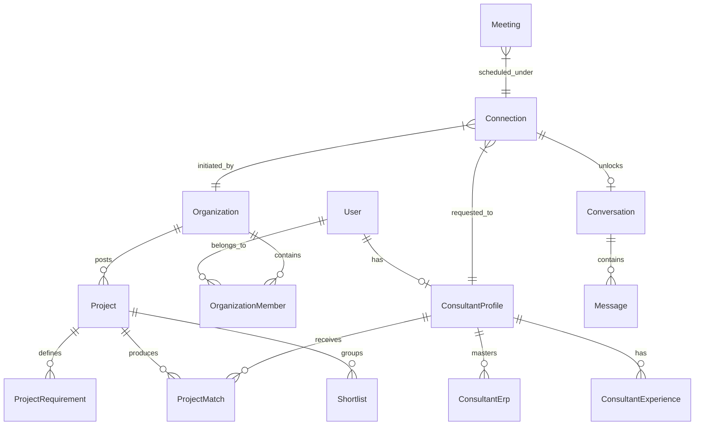

# MerQent — Relational & Vector Database Design

## 1. Schema Authority & Technology Selection
The authoritative database schema is defined in [`prisma/schema.prisma`](file:///c:/Users/Vishal%20S%20Naik/MyProjects/MerQent/prisma/schema.prisma) targeting **PostgreSQL 16+** with the **`pgvector`** and **`pg_trgm`** extensions.



---

## 2. Core Entities & Table Counts
The schema defines 21 domain entities structured across normalized relational boundaries:

1. **Identity & Access**: `users`, `refresh_tokens`, `audit_logs`
2. **Organizations & Teams**: `organizations`, `organization_members`
3. **Consultants & Expertise**: `consultant_profiles`, `consultant_erps`, `consultant_experiences`, `verification_requests`
4. **PMI Taxonomies**: `industry_taxonomies`, `erp_taxonomies`, `accounting_taxonomies`, `deal_type_taxonomies`, `integration_type_taxonomies`, `pmi_task_taxonomies`
5. **Projects & Scoping**: `projects`, `project_requirements`
6. **Matching & Discovery**: `project_matches`, `shortlists`, `shortlist_items`
7. **Connections & Realtime**: `connections`, `conversations`, `messages`, `meetings`, `notifications`, `file_records`

---

## 3. Indexing & Query Optimization
- **Foreign Keys**: Every relation enforces explicit referential integrity with foreign key indexes.
- **Trigram Search (`pg_trgm`)**: GIN indexes on `consultant_profiles.bio`, `consultant_experiences.headline`, and `projects.description` enable fast typo-tolerant keyword search.
- **Dense Vector Search (`pgvector`)**: HNSW index with cosine distance operator (`vector_cosine_ops`) on 1536-dimensional profile and project embeddings:
  ```sql
  CREATE INDEX idx_consultant_profiles_embedding 
  ON consultant_profiles USING hnsw (embedding vector_cosine_ops);
  ```
- **Lifecycle & Status**: Composite indexes on `(status, created_at)` optimize dashboard queries and pagination.
