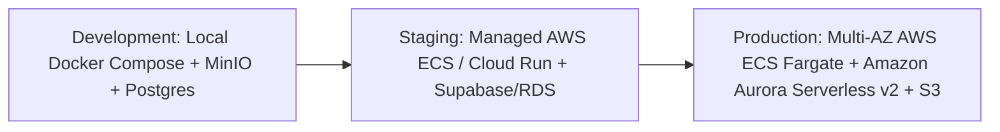

# MerQent — Deployment & Environments Strategy

## 1. Multi-Stage Environment Architecture
MerQent isolates operations across three distinct environments:

---

## 2. Environment Matrix

| Environment | Hosting Target | Database | Storage | AI Provider | Realtime |
| :--- | :--- | :--- | :--- | :--- | :--- |
| **Development** | Localhost (Node.js 20) | Docker PostgreSQL 16 + pgvector | MinIO (S3 compatible) | Mock / OpenAI Sandbox | Socket.IO local |
| **Staging** | Managed Container Cloud (Render / Cloud Run) | Managed Postgres 16 | AWS S3 Staging Bucket | OpenAI Sandbox | Socket.IO + Redis |
| **Production** | AWS ECS Fargate (Multi-AZ) | Amazon Aurora Serverless v2 Postgres | AWS S3 Private Encrypted | OpenAI Enterprise (ZDR agreement) | Socket.IO + Redis Cluster |

---

## 3. Zero-Downtime Deployment & Migrations
1. **Database Migrations First**: Schema migrations execute prior to application container cutover (`prisma migrate deploy`). Backward-incompatible column drops must use a two-phase rollout (deprecate in code, drop in subsequent release).
2. **Rolling Container Update**: New ECS / Cloud Run task versions spin up and pass `/api/v1/health/readiness` health probes before traffic is shifted by the load balancer.
3. **Rollback Strategy**: If health checks fail within 120 seconds, the deployment automatically aborts and preserves the existing healthy container generation.
