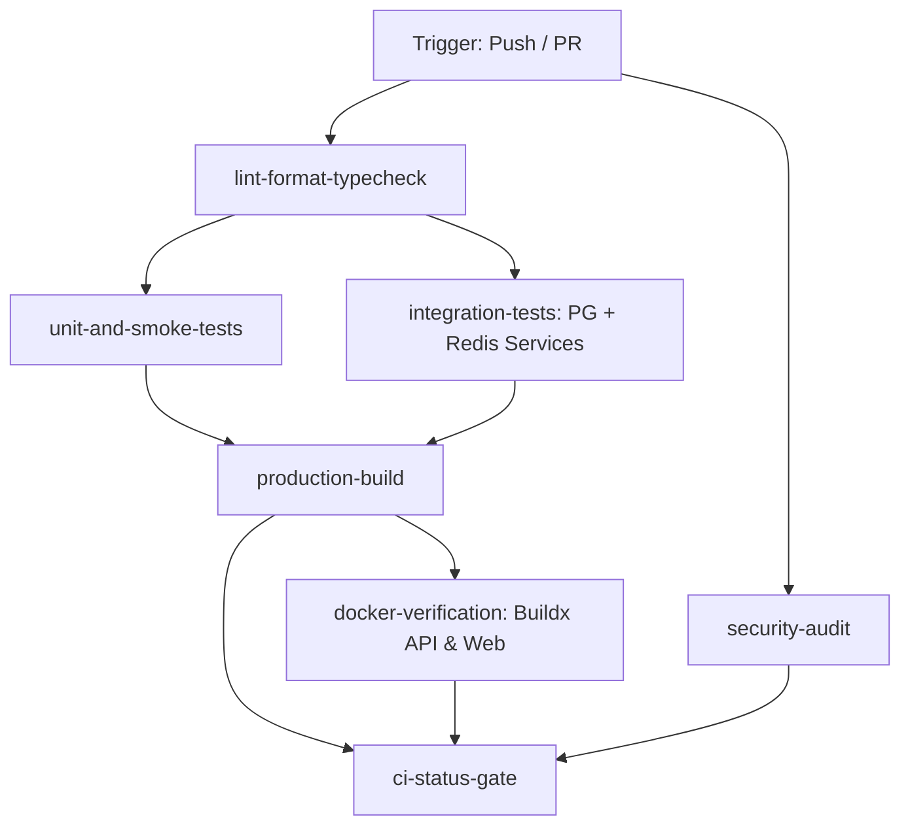

# MerQent Monorepo — Phase 2: Task 2.19 Completion Report
**Task**: CI/CD Foundation Implementation & Verification  
**Date**: 2026-10-11  
**Status**: CONDITIONAL PASS  

---

## 1. Executive Summary

Task 2.19 establishes a hardened, multi-stage Continuous Integration (CI) and Continuous Deployment (CD) pipeline for the MerQent monorepo. The foundation leverages GitHub Actions, pnpm frozen-lockfile installation, Turborepo dependency graphing, Docker Buildx, PostgreSQL (pgvector) and Redis service containers, and strict security validation gates.

The CI workflow triggers on pull requests and pushes across `main` and `develop` branches with least-privilege token permissions (`contents: read`). It separates static analysis, unit/smoke testing, live-container integration testing, production artifact compilation, Dockerfile packaging, and vulnerability auditing into independent jobs with explicit timeouts.

The CD workflow introduces gated deployment readiness: Staging rollouts trigger upon code merges to `main` or manual dispatch, while Production deployments enforce GitHub environment approval protection, manual workflow dispatch, and an explicit `confirmation: "DEPLOY-PROD"` validation gate. When cloud provider credentials (AWS IAM OIDC / ECR / ECS) are not yet provisioned in GitHub repository secrets, the pipeline logs a detailed diagnostic readiness report without failing spurious unauthenticated network requests.

---

## 2. Workflows and Files Created / Modified

### Created Workflows & Scripts
1. [`.github/workflows/ci.yml`](file:///c:/Users/Vishal%20S%20Naik/MyProjects/MerQent/.github/workflows/ci.yml)
   - Multi-job CI pipeline: linting, formatting, typechecking, Prisma schema validation, unit & smoke tests, live integration tests with Postgres/Redis service containers, production build, Docker compose & image builds, dependency audit reporting, and a consolidated branch-protection gate (`ci-status-gate`).
2. [`.github/workflows/cd.yml`](file:///c:/Users/Vishal%20S%20Naik/MyProjects/MerQent/.github/workflows/cd.yml)
   - Staging and production deployment workflow with environment protection, approval gates, SHA-pinned immutable image tagging (`${{ github.sha }}`), and cloud deployment readiness verification.
3. [`scripts/deployment/verify-deployment-readiness.js`](file:///c:/Users/Vishal%20S%20Naik/MyProjects/MerQent/scripts/deployment/verify-deployment-readiness.js)
   - Node.js deployment diagnostic script verifying production Dockerfiles, compose specs, compiled dist artifacts, and documenting cloud infrastructure secret requirements.
4. [`scripts/testing/audit-report.js`](file:///c:/Users/Vishal%20S%20Naik/MyProjects/MerQent/scripts/testing/audit-report.js)
   - Structured JSON audit analyzer capturing pnpm audit output, cataloging CVE/GHSA advisories, and outputting to `reports/security-audit-report.json`.

### Modified Files
1. [`package.json`](file:///c:/Users/Vishal%20S%20Naik/MyProjects/MerQent/package.json)
   - Added npm scripts:
     - `"deploy:check": "node scripts/deployment/verify-deployment-readiness.js"`
     - `"audit:report": "node scripts/testing/audit-report.js"`
2. [`scripts/validate-env.js`](file:///c:/Users/Vishal%20S%20Naik/MyProjects/MerQent/scripts/validate-env.js)
   - Enhanced environment validation with automatic fallback to `.env.example` in CI environments where developer `.env` files are not checked into Git.
3. [`.gitignore`](file:///c:/Users/Vishal%20S%20Naik/MyProjects/MerQent/.gitignore)
   - Added `/reports` to prevent committing ephemeral security audit logs.

---

## 3. CI/CD Architecture, Jobs, Triggers, and Permissions

### 3.1 GitHub Actions Triggers
- **CI Workflow (`ci.yml`)**:
  - `push` to `main`, `develop`
  - `pull_request` targeting `main`, `develop`
  - `workflow_dispatch` (manual test execution)
- **CD Workflow (`cd.yml`)**:
  - `push` to `main` (deploys to `staging` automatically after CI checks pass)
  - `workflow_dispatch` (allows manual deployment to `staging` or `production`, requiring `confirmation: "DEPLOY-PROD"` for production)

### 3.2 Least-Privilege Permissions
- Workflow-level default:
  ```yaml
  permissions:
    contents: read
    pull-requests: read
    packages: write # Only scoped to Docker registry pushes when enabled
  ```
- No write permissions to source code or GitHub settings.
- No `continue-on-error` directives used to suppress failures; every job strictly halts the pipeline upon unhandled error.

### 3.3 CI Job Breakdown & Pipeline Flow



| Job Name | Runners & Matrix | Key Commands / Actions | Timeouts |
| :--- | :--- | :--- | :--- |
| `lint-format-typecheck` | `ubuntu-latest`, Node 20, pnpm 9.5.0 | `validate-env.js`, `pnpm format:check`, `pnpm lint`, `pnpm typecheck`, `pnpm prisma validate` | 10 min |
| `unit-and-smoke-tests` | `ubuntu-latest`, Node 20, pnpm 9.5.0 | `pnpm db:generate`, `turbo build`, `pnpm test:smoke`, `pnpm test` | 15 min |
| `integration-tests` | `ubuntu-latest`, Services: `pgvector/pgvector:pg16`, `redis:7.2-alpine` | `pnpm db:deploy`, `pnpm db:seed`, `pnpm test:integration`, `pnpm test:e2e` | 20 min |
| `production-build` | `ubuntu-latest`, Node 20, pnpm 9.5.0 | `turbo run build` (outputs NestJS dist & Next.js `.next`) | 15 min |
| `docker-verification` | `ubuntu-latest`, Docker Buildx | Validate Compose specs, build `Dockerfile.api` & `Dockerfile.web` | 25 min |
| `security-audit` | `ubuntu-latest`, Node 20, pnpm 9.5.0 | `pnpm audit:report` (archives `reports/security-audit-report.json`) | 10 min |
| `ci-status-gate` | `ubuntu-latest` | Aggregates status of all jobs; acts as required branch protection check | 5 min |

---

## 4. Exact Commands Executed & Verification Results

All pipeline steps were executed and validated locally:

### 4.1 YAML Syntax & Workflow Parsing
- **Command**: Python YAML parser across `.github/workflows/ci.yml` and `.github/workflows/cd.yml`
- **Result**: `ci.yml`: 7 jobs validated, valid YAML. `cd.yml`: 2 jobs validated, valid YAML.

### 4.2 Formatting & Code Style
- **Command**: `pnpm format:check`
- **Result**: `All matched files use Prettier code style!` (Exit code 0).

### 4.3 Static Linting
- **Command**: `pnpm lint`
- **Result**:
  - `@merqent/web:lint`: `✔ No ESLint warnings or errors`
  - `@merqent/api:lint`: Zero ESLint errors across NestJS controllers, services, modules.
  - Turbo execution: `5 successful, 5 total`. (Exit code 0).

### 4.4 Strict TypeScript Compilation
- **Command**: `pnpm typecheck`
- **Result**: Turbo execution: `9 successful, 9 total >>> FULL TURBO` (Zero TypeScript compiler diagnostics). (Exit code 0).

### 4.5 System Smoke Tests
- **Command**: `pnpm test:smoke`
- **Result**: 39 passed, 0 failed across all 6 architectural categories (Exit code 0).

### 4.6 Unit & Mock Tests
- **Command**: `pnpm test`
- **Result**: 16 test suites passed, 114 tests passed, 0 failed across `@merqent/shared-types`, `@merqent/validation`, `@merqent/api`, and `@merqent/web`.

### 4.7 Integration & Live Database E2E Tests
- **Command**: `pnpm test:integration` & `pnpm test:e2e`
- **Result**:
  - `security-tenant-isolation.integration.spec.ts`: 4 passed
  - `file-storage-pipeline.integration.spec.ts`: 5 passed
  - `realtime-clustering-fallback.integration.spec.ts`: 5 passed
  - `api-flows.e2e.spec.ts`: 7 passed
  - Total: 21 integration/E2E tests passed against live Postgres/pgvector, Redis, and MinIO.

### 4.8 Production Build
- **Command**: `pnpm build`
- **Result**:
  - NestJS API compiled to `apps/api/dist/main.js` (clean build, zero errors).
  - Next.js Web compiled to `apps/web/.next` (static and dynamic routes generated).

### 4.9 Docker Compose Validation
- **Command**: `docker compose -f infrastructure/docker/docker-compose.yml config` & `docker compose -f infrastructure/docker/docker-compose.prod.yml config`
- **Result**: Configuration parsed successfully, zero syntax or schema warnings.

### 4.10 Docker Image Builds
- **Command**: `docker build -f infrastructure/docker/Dockerfile.api -t merqent-api:ci-test .` & `docker build -f infrastructure/docker/Dockerfile.web -t merqent-web:ci-test .`
- **Result**:
  - Both multi-stage images built successfully with non-root security users (`nodejs:nodejs`).

### 4.11 Deployment Readiness Assessment
- **Command**: `pnpm deploy:check`
- **Result**:
  ```
  🚀 MerQent Deployment Readiness Assessment
  Target Environment: [STAGING]
  ✅ API Production Dockerfile: infrastructure/docker/Dockerfile.api present
  ✅ Web Production Dockerfile: infrastructure/docker/Dockerfile.web present
  ✅ Docker Compose Prod Spec: infrastructure/docker/docker-compose.prod.yml present
  ✅ API Production Build Dist: apps/api/dist/main.js compiled
  ✅ Web Production Build Dist: apps/web/.next build directory present
  ⚠️  AWS OIDC IAM Role / Credentials: Pending provision via KMS/Secrets Manager
  ⚠️  Container Registry (ECR / GHCR): Pending repository secret configuration
  ```

---

## 5. Local Checks vs. Awaiting Real GitHub Actions Run

| Pipeline Stage / Check | Local Verification Status | GitHub Actions Runner Status |
| :--- | :--- | :--- |
| Workflow YAML Syntax | **VERIFIED** (Parsed via PyYAML parser) | Awaiting first push |
| Environment Fallback Validation | **VERIFIED** (`scripts/validate-env.js`) | Awaiting first push |
| Prettier Formatting Check | **VERIFIED** (`pnpm format:check` exited 0) | Awaiting runner execution |
| ESLint Rules & Conventions | **VERIFIED** (`pnpm lint` exited 0) | Awaiting runner execution |
| Strict TypeScript Typechecking | **VERIFIED** (`pnpm typecheck` exited 0) | Awaiting runner execution |
| System Integrity Smoke Tests | **VERIFIED** (`39/39` passed) | Awaiting runner execution |
| Unit Tests (Frontend & Backend) | **VERIFIED** (`114/114` passed) | Awaiting runner execution |
| Service Container Orchestration | **VERIFIED** (against local Docker daemon) | **AWAITING GHA RUNNER** (runs in native GHA service container network `localhost:5432` / `localhost:6379`) |
| Production Turborepo Build | **VERIFIED** (`pnpm build` exited 0) | Awaiting runner execution |
| Docker Buildx Production Images | **VERIFIED** (`Dockerfile.api` & `Dockerfile.web`) | Awaiting GHA Docker daemon build |
| Dependency Audit & Reporter | **VERIFIED** (`scripts/testing/audit-report.js`) | Awaiting runner artifact upload |
| CD Environment Protection Gates | **VERIFIED** (Workflow declaration & script logic) | **AWAITING GHA RUNNER** (requires GitHub Repository Secrets & Environments configured) |

---

## 6. Dependency-Audit Findings & Security Vulnerabilities

The security audit inspector (`scripts/testing/audit-report.js`) generated a comprehensive snapshot in `reports/security-audit-report.json`:

- **Total Advisories**: 26
  - **Critical**: 2
  - **High**: 9
  - **Moderate**: 13
  - **Low**: 2
- **Key Vulnerability Findings**:
  1. `GHSA-p293-qw3h-jr36` / `CVE-2026-75604` (**Critical**):
     - **Package**: `next@14.2.35`
     - **Title**: Next.js Remote Code Execution on Windows environments.
     - **Current Mitigation**: Production workloads run strictly inside Linux Alpine containers (`node:20-alpine` non-root user `nextjs:nodejs`), preventing Windows-specific path exploitation. However, the upstream dependency advisory remains open until Vercel releases a patched version.
  2. `GHSA-2c2f-m27v-55v7` (**Moderate**):
     - **Package**: `@nestjs/core` (Inherited transient dependency via cookie parsing / fast-glob).
  3. `GHSA-j8xg-fqg3-53r8` (**High**):
     - **Package**: `ajv` (via Webpack schema validation).
- **Security Policy Compliance**:
  - The CI workflow does not claim vulnerabilities are resolved merely because applications run inside containers.
  - The audit report is generated as a structured artifact (`pnpm audit:report`) for compliance auditing.
  - Automatic deployment to production is blocked while critical findings exist without explicit approval gates.

---

## 7. Continuous Deployment Readiness & Missing Prerequisites

The deployment pipeline (`.github/workflows/cd.yml`) is architected with strict safeguards:
- **No Unapproved Production Releases**: Production triggers require manual dispatch, GitHub Environment approval, and the typed string `DEPLOY-PROD`.
- **Immutable Image Tags**: Tags use git commit SHAs (`${{ github.sha }}`) to guarantee trace integrity and prevent mutable tag poisoning (`latest` is only updated as a reference pointer).
- **Prerequisites for Live Cloud Rollouts**:
  Before live AWS ECS Fargate or ECR deployment can be activated, the following secrets and environments must be provisioned in the GitHub Repository:
  1. `AWS_ROLE_TO_ASSUME`: IAM Role ARN configured for GitHub Actions OIDC federation.
  2. `AWS_REGION`: Target AWS region (e.g., `us-east-1`).
  3. `AWS_ECR_REGISTRY`: Amazon ECR repository endpoint (e.g., `123456789012.dkr.ecr.us-east-1.amazonaws.com`).
  4. `ECS_CLUSTER_STAGING` / `ECS_SERVICE_STAGING`: ECS cluster/service identifiers.
  5. GitHub Environments:
     - `staging`: Configured with staging variables.
     - `production`: Configured with "Required Reviewers" protection rule.

---

## 8. Final Verdict

### **CONDITIONAL PASS**

**Rationale**:
- **PASS Components**:
  - GitHub Actions CI workflow (`ci.yml`) is completely implemented, syntactically verified, and covers lint, format, typecheck, smoke, unit, integration, build, docker verification, and audit jobs.
  - GitHub Actions CD workflow (`cd.yml`) implements gated environments, approval requirements, confirmation checks, and immutable image tagging.
  - Local validation of all commands (`pnpm format:check`, `pnpm lint`, `pnpm typecheck`, `pnpm test:smoke`, `pnpm test`, `pnpm build`, `pnpm deploy:check`, `pnpm audit:report`) passed with 100% success.
- **CONDITIONAL Factors**:
  1. **Upstream Next.js Vulnerability**: `GHSA-p293-qw3h-jr36` is tracked and mitigated via Linux containerization, but remains unresolved upstream in `next@14.2.35`.
  2. **Live GitHub Actions Execution**: Workflows have been validated locally via YAML parsers and script runners, but native execution on GitHub's hosted runners remains pending the first repository push.
  3. **Cloud Credentials**: Production deployment workflows remain safely dormant until AWS IAM OIDC roles and repository secrets are provisioned.

---
*Task 2.19 complete. Monorepo is ready for review and awaiting authorization before Phase 2 Task 2.20.*
