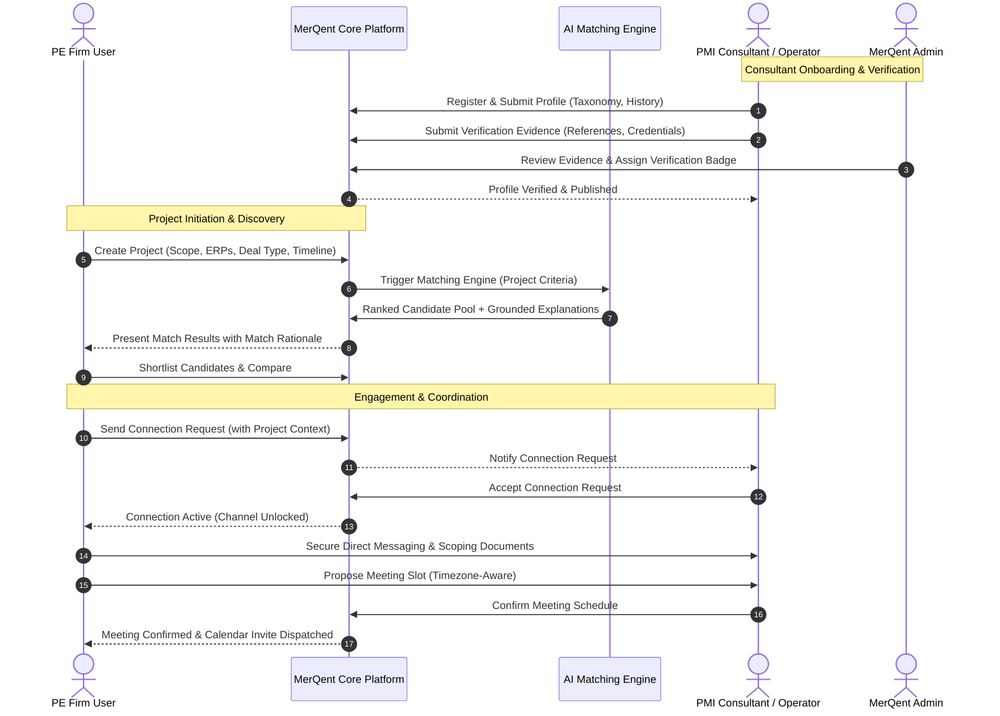

# MerQent — Product Definition Document

**Document Version:** 1.0.0  
**Status:** Canonical Baseline  
**Classification:** Core Product Definition  
**Target Domain:** Post-Merger Integration (PMI) / Private Equity (PE) Professional Services  

---

## 1. Executive Summary & Problem Statement

Private equity (PE) firms and strategic acquirers invest billions in acquiring corporate assets. However, value creation hinges on **Post-Merger Integration (PMI)** — the rigorous, high-stakes operational period immediately following deal closure. Over 70% of M&A value destruction occurs during PMI due to failure in consolidating complex IT and Enterprise Resource Planning (ERP) landscapes, harmonizing divergent charts of accounts and financial reporting frameworks, standardizing operational supply chains, and resolving cultural/organizational frictions under severe timeline pressures.

Generic consultant marketplaces (e.g., Upwork, Catalant, GLG) treat professional services as broad taxonomies ("finance", "strategy", "software engineering"). They lack the structural comprehension required for PMI. Finding an operator who has specifically executed a **carve-out of an SAP ECC 6.0 manufacturing plant into an Oracle Cloud ERP environment under a 120-day Transition Services Agreement (TSA)** is virtually impossible on generic platforms.

**MerQent** is the purpose-built, domain-specialized B2B marketplace engineered specifically to bridge this gap. MerQent connects **Private Equity Firms** and their Portfolio Operations Groups with **vetted PMI Consultants and seasoned Operators** who possess battle-tested experience unifying ERPs, accounting systems, IT infrastructures, and corporate cultures post-acquisition.

---

## 2. Core Value Proposition

### 2.1 For Private Equity Firms & Portfolio Operations
- **Precision Matching:** Discover operators by hyper-specific PMI taxonomies (e.g., Carve-out, TSA wind-down, NetSuite consolidation, COA harmonization, multi-jurisdiction payroll integration).
- **Explainable AI Matching:** Match scores are accompanied by clear, auditable, grounded rationale referencing verified past engagements, eliminating black-box uncertainty.
- **Trust & Verification:** Access pre-vetted professionals whose work histories, certifications, deal types, and references have undergone multi-tiered verification.
- **Secure Collaboration:** Project specifications, candidate shortlists, confidential NDAs/conversations, and scheduled introductory meetings remain strictly guarded under role-based access control.

### 2.2 For PMI Consultants & Experienced Operators
- **High-Signal Discovery:** Showcase niche integration experience without having it diluted by generic consulting categories.
- **Verified Credibility:** Establish verified badges for complex technical and operational integrations (e.g., Big 4 PMI alumni, certified SAP/Workday integration leads, ex-portfolio company CIOs/CFOs).
- **Direct Deal Flow:** Connect directly with PE investment directors, operating partners, and portco leadership seeking specific expertise.
- **Streamlined Workflow:** Manage project inquiries, schedule exploratory interviews across time zones, and exchange sensitive scoping documentation within a unified environment.

---

## 3. Target User Personas

### 3.1 Private Equity Firm (PE User / Sponsor)
- **Titles:** Operating Partner, Vice President of Portfolio Operations, Chief Transformation Officer, M&A Integration Director.
- **Needs:** Rapid deployment of trusted specialists to portfolio companies within days or weeks of deal closing; zero tolerance for exaggerated resumes or ungrounded claims.
- **Workflow:** Defines project constraints (deal type, ERPs involved, target close date, budget, geography), reviews ranked match candidates, evaluates explainable match evidence, shortlists, initiates connection requests, conducts encrypted messaging, and schedules alignment sessions.

### 3.2 PMI Consultant / Operator
- **Titles:** PMI Practice Leader, Fractional CIO/CFO, Technical Integration Architect, Change Management Lead, Carve-Out Program Director.
- **Distinction (Consultant vs. Operator):**
  - *Consultant:* Focuses on integration governance, advisory frameworks, synergy modeling, and program management office (PMO) leadership.
  - *Operator:* Former in-house executive (VP of Finance, IT Director, COO) with hands-on execution experience configuring systems, migrating ledgers, migrating data pipelines, and managing floor operations.
- **Workflow:** Builds a comprehensive profile mapping career history to PMI taxonomies; uploads verification evidence; receives notifications for relevant projects; accepts/declines connection requests; negotiates project scope via secure messaging.

### 3.3 Platform Administrator & Verification Reviewer
- **Titles:** Trust & Safety Lead, Verification Analyst, Platform Admin.
- **Needs:** Audit capabilities, identity and reference verification review tools, taxonomy governance, AI match quality monitoring, and system configuration.

---

## 4. End-to-End Core Product Workflow

---

## 5. Domain-Specific PMI Knowledge Dimensions

MerQent is differentiated by its granular taxonomy:
1. **Deal Archetypes:** Platform Acquisition, Add-On / Tuck-In, Carve-Out (Divestiture), Joint Venture, Reverse Merger, Distressed Turnaround.
2. **Integration Focus Areas:**
   - *Financial & Accounting:* Chart of Accounts (COA) Harmonization, ERP Consolidation, Intercompany Eliminations, Revenue Recognition (ASC 606), Treasury/Cash Management.
   - *Information Technology:* Data Center Migration, Cloud Tenant Consolidation, Identity Access Management (Active Directory/Okta), Cybersecurity Posture Alignment.
   - *Operations & Supply Chain:* Plant Network Rationalization, Vendor Master Unification, Logistics Routing, Warehouse Management System (WMS) Integration.
   - *Human Capital & Culture:* Severance/Retention Structuring, Benefits Harmonization, Leadership Assessment, Cultural Diagnostics, Works Council / Labor Union Negotiations.
3. **Core Enterprise Platforms:** SAP (S/4HANA, ECC), Oracle (Cloud, EBS, NetSuite), Microsoft Dynamics 365, Workday, Salesforce, Infor, Epicor, Coupa, Adaptive Insights.

---

## 6. Grounding and AI Integrity Commitments

In accordance with MerQent core engineering principles:
- **Zero Fabrication:** The AI engine is strictly constrained from inventing or extrapolating professional accomplishments, transaction sizes, or past employer references.
- **Traceable Attribution:** Every match point in an explanation must cite a specific, verifiable profile claim or verified credential ID.
- **Human In The Loop:** Any match result scoring below calibrated confidence thresholds is flagged for administrative evaluation or displayed with explicit uncertainty indicators.
