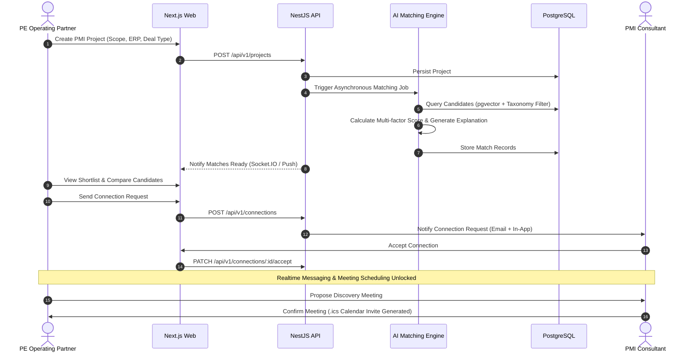
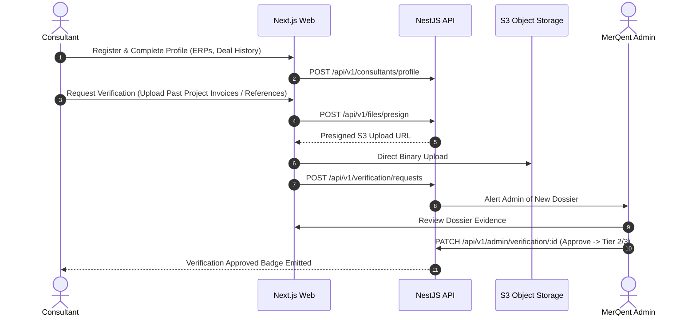

# MerQent — User Flows Specification

## 1. PE Firm Core Workflow

---

## 2. Consultant Onboarding & Verification Flow

---

## 3. Realtime Messaging & Interaction Flow
1. **Pre-requisite**: Connection request between PE Firm and Consultant must be in `ACCEPTED` state.
2. **Conversation Handshake**:
   - Web client connects to Socket.IO gateway (`/realtime/messages`) providing JWT in `auth.token`.
   - Gateway verifies token and joins client into room `conversation:{conversationId}`.
3. **Message Transmission**:
   - Sender posts message via REST `POST /api/v1/conversations/:id/messages` (for atomic persistence, file validation, and DB transaction).
   - Backend persists message and emits Socket.IO event `message:new` to room `conversation:{id}` and `notification:new` to recipient's `user:{recipientId}` room.
   - Recipient acknowledges message; Socket.IO emits `message:read` back to sender.
