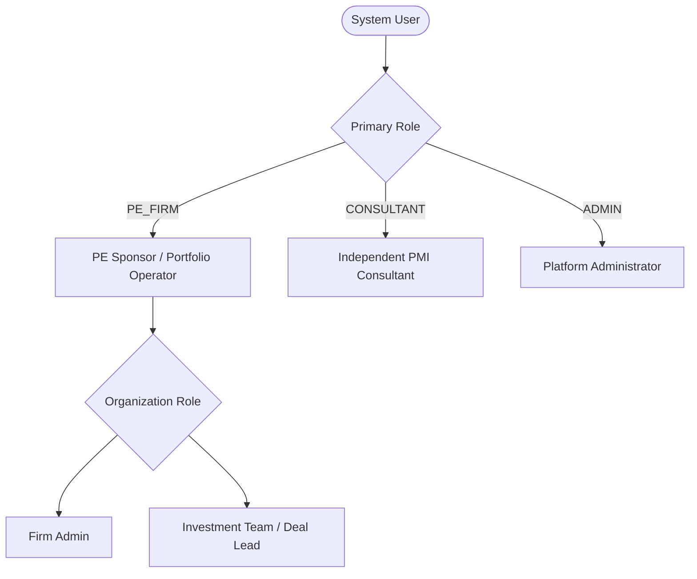

# MerQent — User Roles & Permissions Specification

## 1. System Roles Overview
MerQent enforces strict Role-Based Access Control (RBAC) across three primary system actors and distinct organization permission levels.

---

## 2. Role Definitions

### 2.1 Private Equity Firm (`PE_FIRM`)
- **Profile**: Private Equity Investment Directors, Operating Partners, Portfolio Company CXOs, and VP Operations executing post-merger integration.
- **Key Objectives**: Post integration projects, discover specialized PMI operators, run AI matching, review explainable score breakdowns, shortlist candidates, initiate connection requests, interview candidates, and manage engagements.
- **Sub-Roles (Organization Level)**:
  - `OWNER / ADMIN`: Manage organization profile, invite investment team members, billing management, manage all firm projects.
  - `MEMBER`: Create and manage assigned projects, view shortlisted candidates, send connection requests, initiate messages and calendar meetings.

### 2.2 PMI Consultant / Operator (`CONSULTANT`)
- **Profile**: Independent seasoned operators, former Big 4 PMI leaders, interim CIOs/CFOs, ERP cutover veterans, carve-out specialists.
- **Key Objectives**: Build verified professional profiles (ERPs, industries, deal types, M&A history), set availability and day rates, submit verification evidence, browse matched PMI projects, accept connection requests, communicate via realtime messaging, and schedule discovery interviews.
- **Verification Tiers**:
  - `TIER_0_UNVERIFIED`: Self-reported profile claims. Searchable with unverified badge.
  - `TIER_1_IDENTITY`: Government ID & work email verified.
  - `TIER_2_EXPERIENCE`: Deal history and past employer/client references validated by MerQent admin review.
  - `TIER_3_CERTIFIED_LEAD`: Validated track record of lead ERP cutovers / carve-outs with verified references and background check.

### 2.3 Platform Administrator (`ADMIN`)
- **Profile**: MerQent operations, trust & safety team, and platform curators.
- **Key Objectives**: Review consultant verification dossiers, moderate project postings, manage controlled taxonomies, monitor AI match quality and low-confidence scores, access audit logs, and enforce compliance.

---

## 3. Role Permissions Matrix

| Capability / Resource | `PE_FIRM` (Member) | `PE_FIRM` (Admin) | `CONSULTANT` | `ADMIN` |
| :--- | :---: | :---: | :---: | :---: |
| **Manage Firm Profile & Team** | ❌ | ✅ | ❌ | ✅ |
| **Create / Edit PMI Projects** | ✅ | ✅ | ❌ | ✅ (Moderation) |
| **View Project Matches & Explanations** | ✅ (Assigned) | ✅ | ✅ (Own matches) | ✅ |
| **Search Consultant Database** | ✅ | ✅ | ❌ | ✅ |
| **Create & Manage Shortlists** | ✅ | ✅ | ❌ | ❌ |
| **Initiate Connection Request** | ✅ | ✅ | ❌ | ❌ |
| **Accept / Decline Connection** | ❌ | ❌ | ✅ | ❌ |
| **Realtime Messaging** | ✅ (Connected) | ✅ (Connected) | ✅ (Connected) | ❌ (Private) |
| **Propose / Confirm Meetings** | ✅ (Connected) | ✅ (Connected) | ✅ (Connected) | ❌ |
| **Submit Verification Evidence** | ❌ | ❌ | ✅ | ❌ |
| **Approve / Reject Verification** | ❌ | ❌ | ❌ | ✅ |
| **Manage Taxonomies (ERP, Industry)** | ❌ | ❌ | ❌ | ✅ |
| **View Platform Audit Logs** | ❌ | ❌ | ❌ | ✅ |
