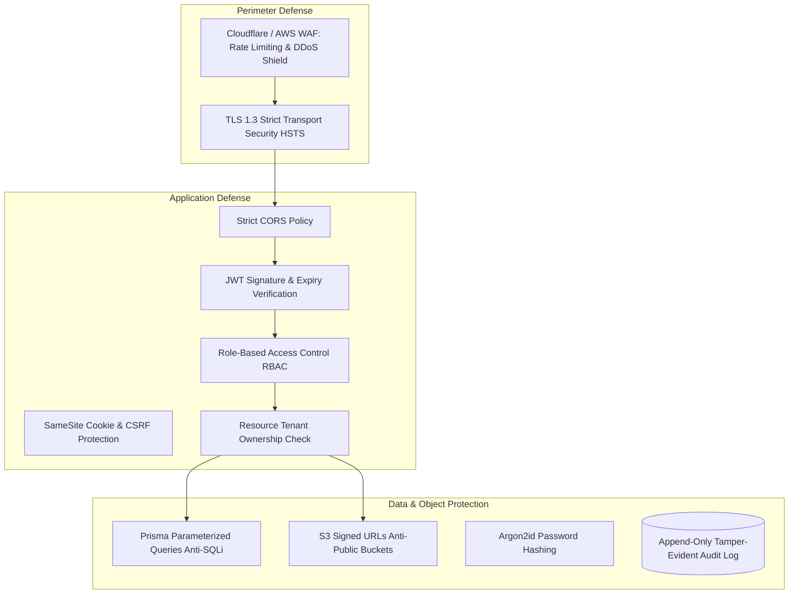

# MerQent — Enterprise Security & Privacy Architecture

## 1. Security Architecture Principles
MerQent handles sensitive corporate transactions, confidential M&A targets, and executive identities. Security is integrated across every architectural boundary:

---

## 2. Threat Mitigation Standards

| Threat Vector | Mitigation Strategy | Implementation Location |
| :--- | :--- | :--- |
| **SQL Injection (SQLi)** | Parameterized queries enforced via Prisma ORM; raw SQL strictly forbidden unless using typed `$queryRaw`. | Data layer (`src/infrastructure/database`) |
| **Cross-Site Scripting (XSS)** | React automatic JSX escaping, DOMPurify for rich text, strict Content Security Policy (CSP). | Frontend (`apps/web`) |
| **IDOR (Insecure Direct Object Reference)** | Ownership guards (`OwnershipGuard`) check resource `organizationId` or `consultantId` against caller JWT claims. | Controller / Guard layer (`src/common/guards`) |
| **Credential Stuffing & Brute Force** | Redis-backed rate limiting on `/api/v1/auth/login` (max 5 failed attempts per 15 min); Argon2id hashing. | Auth module (`src/modules/auth`) |
| **Token Hijacking & Replay** | Refresh token family rotation: reuse of a revoked token invalidates the entire family. | Auth module (`src/modules/auth`) |
| **MNPI Data Leaks (M&A Leakage)** | Project alias masking: public search results hide target company name; disclosed only upon mutual connection. | Project module (`src/modules/projects`) |
| **Malicious File Uploads** | Direct binary uploads to private S3 via presigned URLs; MIME magic byte verification; ClamAV virus scan. | File module (`src/modules/files`) |
