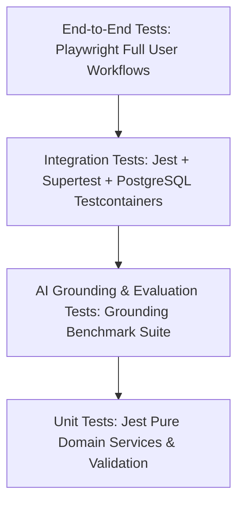

# MerQent — Comprehensive Quality & Testing Strategy

## 1. Testing Pyramid & Automation Frameworks
MerQent enforces an automated testing strategy covering unit, integration, end-to-end, security, and AI grounding tests.

---

## 2. Test Classification & Coverage Targets

| Test Category | Tooling & Runtime | Target Scope | Coverage Target |
| :--- | :--- | :--- | :---: |
| **Unit Tests** | Jest + ts-jest | Domain services, multi-factor score calculation, Zod validation schemas, utility functions. | > 85% domain coverage |
| **Integration Tests** | Supertest + PostgreSQL testcontainers | REST API endpoints, Prisma ORM queries, database constraints, transaction rollbacks. | All primary API routes |
| **AI Grounding Tests** | Custom benchmark runner + LLM judge | Ingestion of 50 test project requirements; asserts 0% fabricated credentials in outputs. | 100% factual grounding |
| **E2E Tests** | Playwright | Full browser user journeys: PE onboarding, project posting, shortlist comparison, connection handshake. | Core golden paths |
| **Security Tests** | OWASP ZAP / Custom Jest security suites | IDOR penetration tests, role escalation attempts, unauthenticated route probing, SQLi payloads. | Zero critical/high |

---

## 3. Automated CI Pipeline Execution
Tests are enforced on every GitHub Pull Request via `.github/workflows/ci.yml`:
1. **Linter & Typecheck**: `pnpm lint` && `pnpm typecheck`
2. **Unit & Security Tests**: `pnpm test:unit`
3. **Integration Tests**: Dockerized Postgres & Redis test runner
4. **AI Grounding Benchmark**: Fast mock embedding and grounding assertion checks.
